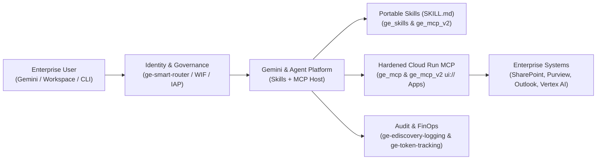

# Google Public Sector AI Hub (`gps-ai-hub`)

> **Disclaimer**: This repository and its contents are provided for illustration and educational purposes only as example code. This is **not** an official Google product or officially supported Google Cloud software. Provided as-is under the [Apache License 2.0](./LICENSE) without warranty of any kind.

High-level reference architectures, security-hardened **Model Context Protocol (MCP)** connectors, portable **Agent Skills (`SKILL.md`)**, **MCP Apps (`ui://`)**, and governance pipelines for **Gemini** (`Gemini Enterprise`) and **Vertex AI Agent Platform** on Google Cloud.

---

## Project Catalog (`./projects`)

| Project | Category | High-Level Overview |
| :--- | :--- | :--- |
| **[`ge_mcp_v2`](./projects/ge_mcp_v2)** | **MCP `v2.0` (Skills + Apps)** | Next-generation Cloud Run Streamable HTTP MCP suite implementing **MCP Skills (`SEP-2640`)** with SHA-256 verified `SKILL.md` manifests and **MCP Apps (`SEP-1865`)** interactive `ui://` workbenches across Vertex AI Claude, Outlook, SharePoint (`Sites.Selected`), Microsoft Purview Sensitivity Labels, and Google Cloud SDP. |
| **[`ge_mcp`](./projects/ge_mcp)** | **MCP `v1` Connectors** | Hardened Streamable HTTP MCP servers for Cloud Run (`claude_mcp_sonnet`, `customize_outlook_mcp`, 5 SharePoint/Purview/SDP variants, and `workiq-mcp-purview` Azure RMS encryption verification). |
| **[`ge_skills`](./projects/ge_skills)** | **Portable `SKILL.md` Skills** | Domain-specific `SKILL.md` capability bundles including Microsoft 365 SharePoint/Outlook citation & temporal search enhancers (`ge_m365_connector_skill`) and deterministic Medicaid fraud compliance workflows (`ge_medicaid_skill`). |
| **[`ge-ediscovery-logging`](./projects/ge-ediscovery-logging)** | **Compliance & eDiscovery** | 100% server-side eDiscovery capture, Cloud KMS-signed WORM Cloud Storage archival, BigQuery forensic views, IAP Compliance Review Portal, and Microsoft Purview eDiscovery / DSPM for AI integration. |
| **[`ge-token-tracking`](./projects/ge-token-tracking)** | **FinOps & Observability** | Lightweight OpenTelemetry + BigQuery token consumption, per-model cost breakdown, and Workforce Identity Federation (WIF) chargeback dashboard on Cloud Run. |
| **[`ge-smart-router`](./projects/ge-smart-router)** | **Identity & Routing** | Identity-aware External HTTPS Load Balancer + IAP dispatcher that routes users to their assigned Gemini application based on Cloud Identity or Workspace group membership. |
| **[`Output AI Verification Loop`](./projects/Output%20AI%20Verification%20Loop)** | **Output Engineering** | Portable `output-engineer` skill and 5-tab interactive HTML Review Canvas that audits AI-generated security/RFP responses using ASD-STE100 controlled English, Mermaid diagrams, and dual-model review. |
| **[`Gemini_Weekly_Updates`](./projects/Gemini_Weekly_Updates)** | **Executive Enablement** | Account-aware release briefing pipeline pairing public release-note filtering with a mandatory Human-in-the-Loop (HITL) Workspace Gmail Draft review gate. |

👉 See **[`projects/README.md`](./projects/README.md)** for detailed per-module architecture notes.

---

## Architecture At a Glance



---

## Security & Engineering Standards

- **Zero Secrets in Source or Env Flags**: All deployment scripts bind credentials from **Google Cloud Secret Manager** (`--set-secrets`) and exclude `.env*` and token caches via `.gitignore`, `.dockerignore`, and `.gcloudignore`.
- **Least-Privilege Runtime Defaults**: Cloud Run services run as non-root container users (`USER node` / `USER appuser`) under dedicated service accounts, with fail-closed `HTTP 401` Bearer/IAM validation, RFC 7636 PKCE (`S256`), and cross-tool `Sites.Selected` allowlist enforcement.
- **Fail-Closed DLP & XSS Hardening**: Purview + Cloud SDP connectors scan full document windows with ReDoS-safe patterns, and all `v2.0` `ui://` MCP Apps render exclusively via DOM APIs (`0` `innerHTML` sinks) under strict Content Security Policies.
- **Continuous Verification ([`ge-mcp-ci.yml`](./.github/workflows/ge-mcp-ci.yml))**: Automated GitHub Actions matrix running `npm ci`, `npm audit`, syntax checks, and loopback (`127.0.0.1`) smoke & security suites across both `projects/ge_mcp` and `projects/ge_mcp_v2`.

---

## Quick Start

```bash
# Clone the repository
git clone git@github.com:cloud-gtm/gps-ai-hub.git
cd gps-ai-hub

# Run local loopback security & smoke tests on any v2.0 MCP connector
cd projects/ge_mcp_v2/least-privilege-sharepoint-mcp-server
npm ci
./test_local.sh
```
