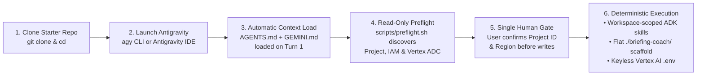

# Google Antigravity Hands-On Workshop Starter (`AGY Website Workshop`)

> **Disclaimer**: This repository and its contents are provided for illustration and educational purposes only as example code. This is not an official Google product or officially supported Google Cloud software. Provided as-is under the [Apache License 2.0](https://www.apache.org/licenses/LICENSE-2.0) without warranty of any kind.

---

## Overview

**`AGY Website Workshop`** is a turnkey, enterprise- and public-sector-ready hands-on workshop starter for **Google Antigravity** (`agy` CLI and Antigravity IDE) and the **[Agent Development Kit (ADK)](https://adk.dev/)**.

In **90 minutes**, a customer or agency cohort progresses through three structured labs using the **Plan → Review → Approve → Verify** human-in-the-loop pattern:
1. **Lab 1 — Mission Web Portal (`./lab1-mission-portal/`)**: Direct Google Antigravity via `/plan` to build, review, and customize a zero-dependency HTML/CSS/JS portal served over a hardened `127.0.0.1` loopback server (`scripts/preview_lab1.py`).
2. **Lab 2 — Keyless Vertex AI ADK Agent (`./briefing-coach/`)**: Use [`agents-cli`](https://github.com/google/agents-cli) to scaffold, configure, and test a real Python ADK agent (`gemini-3.8-flash`) authenticated via keyless **Google Cloud Application Default Credentials (ADC)** (zero API keys on disk or in chat) and inspect tool execution inside `adk web`.
3. **Lab 3 — Multi-Agent Specialist Team (`briefing_coach` → `topic_explainer` + `readiness_quizzer`)**: Refactor the single agent into a coordinator with two specialist sub-agents, verify `transfer_to_agent` handoffs, and visualize the live agent execution graph.

---

## Why Use an `AGENTS.md` File to Drive Customer Installations & Workshops?

Traditional workshop and customer deployment guides rely on **human-executed runbooks**: 15–20 manual steps asking participants to pipe shell installers (`curl | sh`), edit `PATH` profiles, click through nested folder pickers, copy-paste raw API keys into `.env` files, and troubleshoot permission errors on venue Wi-Fi.

Pairing a repository-root **[`AGENTS.md`](./AGENTS.md)** (mirrored to **[`GEMINI.md`](./GEMINI.md)**) with **Antigravity CLI (`agy`)** or **Antigravity IDE** inverts that model, turning the repository itself into a **self-verifying, human-approved installer**:



### 6 Architectural Advantages of the `AGENTS.md` Installation Pattern

| Installation Challenge | Traditional Manual Setup Guide | `AGENTS.md` + `AGY CLI` Playbook Pattern |
| :--- | :--- | :--- |
| **1. First-Turn Context & Skill Discovery** | Global skill installers depend on `npx`, Git, and pre-existing home directories (`~/.gemini`); running steps out of order silently skips skill linking. | **Context-Native on Turn 1**: `AGENTS.md` and `GEMINI.md` load directly from the repository root the instant `agy` or the IDE opens the folder, and `scripts/bootstrap_tools.sh` installs ADK skills at `--workspace` scope (`./.agents/skills/`). |
| **2. Environment & IAM Discovery** | Humans manually look up Project IDs, guess regions, and hit opaque runtime `403` errors mid-lab when APIs or IAM roles are missing. | **Zero-Guessing Read-Only Preflight First**: `AGENTS.md` instructs the agent to run `scripts/preflight.sh` *before* asking questions, auto-discovering active `gcloud` identity, `GOOGLE_CLOUD_PROJECT`, `aiplatform.googleapis.com` status, and `testIamPermissions`, then asking for one confirmation. |
| **3. Credential & Secret Hygiene** | Participants generate static API keys and paste them into TextEdit/Notepad (or accidentally into chat prompts), creating secret sprawl or `.env.txt` typos. | **Keyless Enterprise Auth by Default**: Configures `GOOGLE_GENAI_USE_VERTEXAI=TRUE` with [Application Default Credentials](https://docs.cloud.google.com/sdk/gcloud/reference/auth/application-default/login) so zero API keys ever touch `.env`, Git, or chat transcripts. |
| **4. Directory Layout & Path Drift** | Creating a folder in a GUI picker and running `agents-cli create <name>` inside it produces broken double-nested `name/name/app` paths and `PATH` (`exit 127`) loops. | **Enforced Workspace Topology**: `AGENTS.md` pins exact relative directories (`./lab1-mission-portal/` and `./briefing-coach/`) and injects `$HOME/.local/bin` into `PATH` so GUI-launched IDEs never miss `uv` or `agents-cli`. |
| **5. Predictable `/plan` Execution** | Open-ended `/plan` prompts stall for several minutes when ADK workflow skills pause for multi-turn Phase 0 requirements interviews. | **Pre-Seeded Specification**: Copies a validated `templates/briefing-coach.agents-cli-spec.md` to `.agents-cli-spec.md` during bootstrap so `/plan` produces reviewable plans in seconds. |
| **6. Locked-Down Customer Laptops** | Fails on managed enterprise/agency laptops where MDM/EDR blocks shell pipe installers, local Python compilers, or consumer Gmail sign-in. | **Identical on Laptop, Cloud Shell & Cloud Workstations**: Runs unchanged inside [Google Cloud Workstations](https://cloud.google.com/workstations/docs/overview) or Cloud Shell using corporate SSO / Workforce Identity and browser Web Preview (`127.0.0.1:8080` / `8081`). |

---

## Repository Structure

| File / Path | Purpose |
| :--- | :--- |
| [`AGENTS.md`](./AGENTS.md) | Master turnkey bootstrap, security guardrails, and Lab 1–3 execution playbook loaded automatically by Antigravity |
| [`GEMINI.md`](./GEMINI.md) | Companion entrypoint mirroring `AGENTS.md` across all Antigravity CLI and IDE surfaces |
| [`guide/`](./guide/) | **Interactive Participant & Facilitator Lab Portal (`127.0.0.1:8082`)** — sticky Core + Bonus `<progress>` tracker, 2-state Light/Dark theme toggle, hidden `?review` Facilitator Mode, CSS `.hl` screenshot callouts + zoom lightbox, `"What good looks like"` verification drawers, Live Synthetic PII Trap (`Test A` → `Test B`), ARIA Role Chooser tabs, 4 packaged `.zip` / `SKILL.md` skills, and Monday-Morning Tool Decision Matrix |
| [`scripts/preflight.sh`](./scripts/preflight.sh) | Read-only environment, binary, Vertex AI API, IAM (`testIamPermissions`), and ADC discovery check |
| [`scripts/bootstrap_tools.sh`](./scripts/bootstrap_tools.sh) | Idempotent `agents-cli` check and `--workspace` ADK skills installer (`./.agents/skills/`) |
| [`scripts/preview_lab1.py`](./scripts/preview_lab1.py) | Hardened `127.0.0.1` loopback static server for both `./guide` (`--guide` on port `8082`) and Lab 1 (`--port 8081`) with realpath sandbox boundary, dotfile block, and zero-`'unsafe-inline'` CSP headers |
| [`templates/briefing-coach.agents-cli-spec.md`](./templates/briefing-coach.agents-cli-spec.md) | Pre-validated Phase 0 ADK specification preventing live-workshop planning stalls |
| [`starters/lab1-mission-portal/`](./starters/lab1-mission-portal/) | Catch-up reference build for Lab 1 (`index.html`, `styles.css`, `script.js` with zero `innerHTML` DOM sinks) |
| [`.env.example`](./.env.example) | Keyless Vertex AI configuration template (`GOOGLE_GENAI_USE_VERTEXAI=TRUE`, `gemini-3.8-flash`) |
| [`tests/test_workshop_starter.py`](./tests/test_workshop_starter.py) | Automated loopback security, CSP, and path-traversal test suite |

---

## Quick Start (Replaces 30-Minute Pre-Workshop Setup)

### Option A: Google Cloud Workstations or Cloud Shell (Recommended for Enterprise & Public Sector Cohorts)
No local laptop installs required: `gcloud` and Python are pre-installed, and browser **Web Preview** proxies ports `8081` (Lab 1) and `8080` (`adk web`).

1. Open your assigned [Cloud Workstation](https://cloud.google.com/workstations/docs/overview) or Google Cloud Shell terminal.
2. Clone the repository and open the workshop directory:
   ```bash
   git clone git@github.com:cloud-gtm/gps-ai-hub.git
   cd "gps-ai-hub/projects/AGY Website Workshop"
   ```
3. Launch the **Interactive Lab Portal** on `http://127.0.0.1:8082/` (append `?review` for Facilitator Mode) and start **Antigravity CLI (`agy`)** (or open this folder in **Antigravity IDE**):
   ```bash
   python3 scripts/preview_lab1.py --guide &
   agy
   ```

### Option B: Local Workstation (macOS, Windows WSL2, or Linux)
1. Ensure [Google Antigravity](https://antigravity.google/download), `gcloud`, and [`uv`](https://docs.astral.sh/uv/getting-started/installation/) are installed via your organization's approved software channel.
2. Authenticate keyless Application Default Credentials once in your terminal:
   ```bash
   gcloud auth login
   gcloud config set project YOUR_PROJECT_ID
   gcloud auth application-default login
   ```
3. Clone this repository, open `projects/AGY Website Workshop` in Antigravity IDE (or run `agy` in the folder), and set the permission shield to **Default** (*Ask before sensitive operations*) with model **Gemini 3.8 Flash**.

---

## 90-Minute Hands-On Workshop Flow

### Step 0: 1-Prompt Environment Bootstrap (5 Minutes)
Paste this single prompt into Antigravity:

```text
Run the read-only preflight check in AGENTS.md, show me my discovered Google Cloud project and Vertex AI ADC status for confirmation, and then run the bootstrap step.
```

**Checkpoint**: `scripts/preflight.sh` reports `[OK]` for `gcloud`, `GOOGLE_CLOUD_PROJECT`, `Vertex AI ADC`, and `aiplatform.googleapis.com`, and `scripts/bootstrap_tools.sh` installs the workspace ADK skills into `./.agents/skills/`.

---

### Lab 1: Plan, Review & Build a Mission Web Portal (20 Minutes)
Learn the core human-director loop (**Plan → Review → Approve → Verify**) on a zero-dependency web application before writing agent Python code.

1. **Ask for a Plan (`/plan`)**:
   Type `/plan` in Antigravity and send:
   ```text
   Follow Lab 1 in AGENTS.md to plan a responsive 3-file Mission AI Services Portal in ./lab1-mission-portal/ (index.html, styles.css, script.js) with a time-of-day greeting, Mission Summary, three Priority Initiative cards with an Active Pilot filter button, and a contact footer. Wait for me to click Proceed.
   ```
2. **Review & Approve**: Verify the plan creates only the 3 files inside `./lab1-mission-portal/` with zero external dependencies, then click **Proceed**.
3. **Preview Safely on Loopback (`127.0.0.1:8081`)**:
   ```text
   Start the hardened Lab 1 preview server from AGENTS.md in the background and share the link.
   ```
   Open `http://127.0.0.1:8081/` (or **Web Preview → Port 8081**).
4. **Personalize & Audit**: Customize the portal with your team's real or sample initiatives, refresh the browser, and verify in Antigravity's **Review** diff view that the agent added only facts you provided.

---

### Lab 2: Build & Test a Keyless Vertex AI ADK Agent (25 Minutes)
Move from directing an agent to building your own with **ADK** and **`agents-cli`**.

1. **Build `briefing_coach`**:
   ```text
   Follow Lab 2 in AGENTS.md to scaffold briefing-coach with agents-cli, configure keyless Vertex AI ADC in ./briefing-coach/.env for my confirmed project, implement the briefing_coach agent on gemini-3.8-flash with the build_prep_schedule(minutes) tool, and run a smoke test.
   ```
2. **Inspect Tool Execution in `adk web` (`127.0.0.1:8080`)**:
   ```text
   Start agents-cli playground on port 8080 in the background and share the link.
   ```
   Open `http://127.0.0.1:8080/dev-ui/?app=app` (or **Web Preview → Port 8080**) and ask:
   ```text
   Explain Zero Trust micro-segmentation in plain language. I have 90 minutes before my executive briefing, so build me a prep schedule too.
   ```
   Click the **`build_prep_schedule(90)`** event in `adk web` to inspect the deterministic function arguments, return payload, and single-agent graph.

---

### Lab 3: Upgrade to a Multi-Agent Specialist Team (25 Minutes)
Split responsibilities across a coordinator and specialist sub-agents so complex workflows stay modular and auditable.

1. **Create the Specialist Team**:
   ```text
   Follow Lab 3 in AGENTS.md to turn briefing_coach into a multi-agent coordinator with two sub-agents (topic_explainer and readiness_quizzer), keeping build_prep_schedule on briefing_coach and gemini-3.8-flash on all agents. Restart the playground on port 8080.
   ```
2. **Test Multi-Agent Handoffs (`transfer_to_agent`)**:
   Click **New Session** in `adk web` and send these prompts one by one:
   - `"Can you quiz me on Zero Trust architecture?"` → Watch `briefing_coach` delegate to `readiness_quizzer`.
   - Answer the question, then ask: `"I'm still unsure how policy enforcement points work. Can you explain that simply?"` → Watch `readiness_quizzer` hand off to `topic_explainer`.
   - `"Thanks! I have 60 minutes left. Build my prep schedule."` → Watch `topic_explainer` hand back to `briefing_coach`, which invokes `build_prep_schedule(60)`.
3. **Inspect the Multi-Agent Graph & Routing Descriptions**:
   Click the latest tool/handoff event in `adk web` to view the 3-agent hierarchy, and test how editing `readiness_quizzer`'s `description` changes routing behavior.

---

## Running Local Security & Verification Tests

To run the automated verification suite (testing `127.0.0.1` loopback binding, Content-Security-Policy headers, `../` and `.env` path-traversal blocking, and zero unsafe DOM sinks):

```bash
python3 -m unittest discover -s tests -v
```

---

## Further Reading

- [Google Antigravity FAQ](https://antigravity.google/docs/faq)
- [Agent Development Kit (ADK) Documentation](https://adk.dev/)
- [`google/agents-cli` on GitHub](https://github.com/google/agents-cli)
- [Google Cloud Workstations Overview](https://cloud.google.com/workstations/docs/overview)
