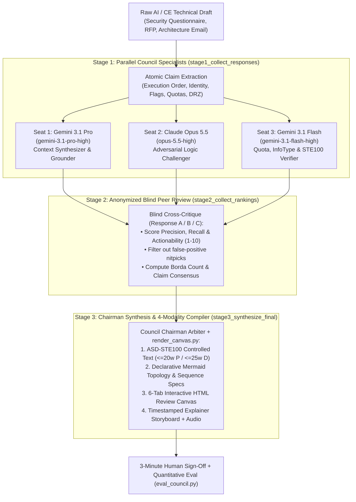

# Output AI Verification Loop (`output-engineer`) — Karpathy 3-Stage LLM Review Council

> **Disclaimer**: This repository and its contents are provided for illustration and educational purposes only as example code. This is not an official Google product or officially supported Google Cloud project. This code is provided as-is for demonstration purposes and is NOT intended or supported for production workloads.

---

## Overview: What is Output Engineering?

While *prompt engineering* focuses on crafting input queries, **Output Engineering** is the deliberate transformation of AI-generated drafts into multi-modal, verifiable, and cognitively optimized representations.

When Customer Engineers (CEs), Solutions Architects, and Field Specialists use AI to draft complex security questionnaire responses, RFP answers, or architecture proposals, subtle hallucinations and ordering inversions often hide inside dense walls of fluent prose. The **Output AI Verification Loop (`output-engineer` skill)** compresses a 30-minute line-by-line review into a **3-minute structural audit** by combining **Andrej Karpathy's 3-Stage LLM Council (`llm-council`)** with **four deterministic output modalities** and a **quantitative evaluation harness**:

### The Karpathy 3-Stage LLM Review Council
- **Stage 1 — Independent Parallel Council Specialists (`stage1_collect_responses`):**
  Dispatches heterogeneous frontier models in parallel so no model anchors another (`gemini-3.1-pro-high` as Context Synthesizer & Grounder, `opus-5.5-high` as Adversarial Logic Challenger & STE100 Enforcer, and `gemini-3.1-flash-high` as Quota, SDP `infoType` & Regional Entitlement Verifier).
- **Stage 2 — Anonymized Blind Peer Review & Borda Consensus Matrix (`stage2_collect_rankings`):**
  Strips model identities into blind labels (`Response A`, `Response B`, `Response C`), has each council model score its peers on **Precision (1–10)**, **Recall (1–10)**, and **Actionability (1–10)**, filters out hallucinated false-positive nitpicks, and computes **Borda Count** rankings plus per-claim consensus badges.
- **Stage 3 — Council Chairman Synthesis & Deterministic Gate (`stage3_synthesize_final`):**
  The Council Chairman resolves disputed claims/scores (such as calibrating Seat 1's `90/100` score down to `4.5/10` after blind peer verification), verifies 100% ASD-STE100 compliance via `scripts/check_ste100.py`, and compiles the standalone **6-Tab Interactive HTML Review Canvas** via `scripts/render_canvas.py`.

### The 4 Verifiable Output Modalities
1. **Modality 1 — Writing (ASD-STE100 Controlled Technical English at ~80% Strictness):**
   - Rewrites explanations into **Simplified Technical English (ASD-STE100)**: Descriptive sentences $\le 25$ words, Procedural steps $\le 20$ words starting with an imperative verb, active voice only, one term per concept, and zero AI filler.
2. **Modality 2 — Diagrams (Declarative Mermaid.js Architecture & Sequence Models):**
   - Automatically maps narrative claims into `flowchart LR` trust-boundary diagrams (Zone 1 / Zone 2 / Zone 3) and chronological `sequenceDiagram` gate flows, exposing missing hops or ordering contradictions immediately.
3. **Modality 3 — Web Pages (6-Tab Interactive HTML Review Canvas):**
   - Compiles any `council_review.json` into a self-contained, 6-tab **Interactive HTML Review Canvas** (`review_canvas_template.html`) that renders natively in the **Jetski / Antigravity** side pane or any desktop browser.
4. **Modality 4 — Explainer Videos & Narrated Storyboards:**
   - Generates a timestamped 2-minute visual storyboard (`00:00–02:00`) with an interactive scene stepper and built-in browser voice narration (`window.speechSynthesis`) so reviewers can listen to and inspect complex data flows step by step.

---

## Architecture: The 3-Stage Council & Output Engineering Loop



---

## Repository Structure

```text
Output AI Verification Loop/
├── README.md                                       # Onboarding & 3-Stage Council architecture guide
├── install_skill.sh                                # One-command installer for Jetski / Antigravity
├── skill/
│   └── output-engineer/
│       ├── SKILL.md                                # Portable skill definition for Jetski / Antigravity
│       ├── references/
│       │   └── asd_ste100_quick_reference.md       # ASD-STE100 (~80% pragmatic) rules & examples
│       └── resources/
│           └── review_canvas_template.html         # Data-driven 6-tab Interactive HTML Review Canvas template
├── scripts/
│   ├── council_runner.py                           # Karpathy 3-Stage Council Engine (Stage 1 -> 2 -> 3)
│   ├── render_canvas.py                            # Compiler: council_review.json -> standalone 6-tab HTML
│   ├── eval_council.py                             # Quantitative evaluation harness against golden dataset
│   └── check_ste100.py                             # Deterministic validator for ASD-STE100 word caps & voice
├── examples/
│   ├── sample_security_review_council.json         # 3-Stage Council JSON for Agency Security Review
│   ├── sample_security_review_canvas.html          # 6-tab HTML Review Canvas for Agency Security Review
│   ├── golden_security_claims_eval.json            # Labeled ground-truth dataset (14 claims + 1 FP trap)
│   └── dual_model_benchmark_report.md              # Benchmark comparing Gemini 3.1 Pro vs. Claude Opus 5.5
└── tests/
    └── test_output_engineer.py                     # Automated unittest suite (9 tests)
```

---

## Quickstart

### 1. Compile the 3-Stage Council Review & Interactive HTML Canvas

```bash
python3 scripts/council_runner.py \
  --preset security-review \
  --output examples/sample_security_review_council.json \
  --render-html examples/sample_security_review_canvas.html
```

### 2. Run the Quantitative Evaluation Harness (`eval_council.py`)

Evaluate the 3-Stage Council against the labeled golden benchmark dataset (`examples/golden_security_claims_eval.json`) to compare 1-pass single models against the full Karpathy 3-Stage Council on Recall, Precision, F1, False-Positive Filtering, Score Calibration MAE, and ASD-STE100 compliance:

```bash
python3 scripts/eval_council.py \
  --council-json examples/sample_security_review_council.json \
  --golden examples/golden_security_claims_eval.json
```

### 3. Validate ASD-STE100 Sentence Compliance (`check_ste100.py`)

```bash
python3 scripts/check_ste100.py \
  examples/dual_model_benchmark_report.md \
  skill/output-engineer/references/asd_ste100_quick_reference.md \
  --check-word-tags --check-passive
```

### 4. Run the Automated Unit Test Suite

```bash
python3 -m unittest discover -s tests -v
```
