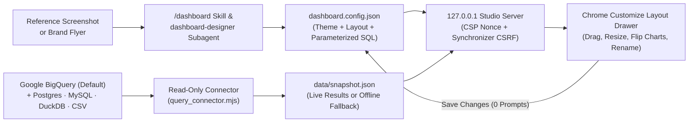

# Google Antigravity Dashboard Studio Plugin & Hands-On Workshop (`agy-dashboard-studio`)

> **Disclaimer**: This repository and its contents are provided for illustration and educational purposes only as example code. This is **not** an official Google product or officially supported Google Cloud software. Provided as-is under the [Apache License 2.0](../../LICENSE) without warranty of any kind.

A turnkey **Google Antigravity (`AGY`) Plugin**, **Spec-Driven Visual Dashboard Runtime**, and **60-Minute Hands-On Business Analytics Workshop** designed so business analysts, program managers, and public-sector leaders can spin up clean, dynamic dashboards, emulate a reference screenshot, connect to **Google BigQuery** (by default) and four additional data sources, and adjust layout, chart types, widths, and brand colors **visually in Chrome without excessive prompting**.

---

## Included Assets

```text
projects/agy-dashboard-studio/
├── README.md                         # Architecture & quickstart guide
├── dashboard-studio/                 # Strict-validated Antigravity plugin (v1.0.2)
│   ├── plugin.json                   # Official v1 schema manifest
│   ├── README.md                     # Pre-install plugin documentation
│   ├── assets/logo.svg               # 1:1 Light/Dark theme icon
│   ├── rules/AGENTS.md               # Spec-preservation & read-only SQL guardrails
│   ├── agents/dashboard-designer.md  # Multimodal screenshot & schema mapper subagent
│   └── skills/dashboard/             # /dashboard skill, BigQuery/multi-DB connector & studio runtime
├── workshop/                         # Interactive 60-minute participant guide (West Virginia edition)
│   ├── index.html                    # Sticky progress tracker, left wayfinding rail & ?review mode
│   ├── styles.css                    # Fira Sans + Navy (#053254), Rust (#C1452C) & Gold (#D5A245)
│   ├── workshop.js                   # Zero-innerHTML progress, copy-to-clipboard & lightbox
│   ├── img/                          # Annotated UI diagrams & downloadable wv-style-reference.svg
│   └── starters/                     # Ready-to-download plugin ZIP + Track A & Track B catch-up ZIPs
└── live-demo/                        # Standalone static build of the WV Mountain State Ready dashboard
```

---

## Architecture Overview



---

## Key Capabilities

1. **Screenshot Style Emulation**: On every new `/dashboard` build, the skill asks whether the user has a screenshot (or brand flyer/PDF) of a dashboard to emulate—extracting background, card surface, primary/accent/secondary hex colors, border contrast, corner radius, and density directly into `dashboard.config.json`.
2. **Zero-Prompt Visual Customization (`Customize Layout`)**: Business users click **Customize Layout** in Chrome to drag-and-drop cards, resize grid columns (`1/3`, `1/2`, `2/3`, `Full`), switch chart types (`Bar`, `H-Bar`, `Line`, `Donut`, `Table`), edit headings inline, switch palettes, and click **Save Changes** (`POST /api/config` -> `dashboard.config.json`). Because `rules/AGENTS.md` requires reading `dashboard.config.json` before any future AI edit, visual customizations are never overwritten when adding new SQL metrics.
3. **Dual-Mode BigQuery Default + 4 Secondary Connectors**:
   - **Google BigQuery (`bigquery` — default)**: Keyless Application Default Credentials (`gcloud auth application-default print-access-token`) over the BigQuery `jobs.query` REST API with typed `queryParameters` (`@param`), a `1 GB` `maximumBytesBilled` guardrail, and automatic fallback to `data/snapshot.json` when offline at a workshop venue.
   - **Additional Connectors**: Native read-only execution for **PostgreSQL / Cloud SQL / AlloyDB** (`psql`), **MySQL** (`mysql`), **DuckDB / Parquet** (`duckdb -readonly`), and **CSV**.
4. **Two Public-Sector Workshop Tracks (State of West Virginia Edition)**:
   - **Track A (`wv-mountain-state-ready`)**: *$40M Mountain State Ready Site Readiness Portfolio* ($25M Shell Building Loans + $15M Tier 1–3 Site Readiness Grants across West Virginia counties).
   - **Track B (`wv-incident-triage`)**: *Mine & Corrections Incident Report Triage* (synthetic operational triage dataset tracking critical alert latency SLAs, routine filing automation, fail-safe holds, and Spam verification).

---

## Quick Start

### 1. Validate & Install the Plugin in Google Antigravity

```bash
cd projects/agy-dashboard-studio
agy plugin validate --strict ./dashboard-studio
agy plugin install ./dashboard-studio
agy plugin list
```

### 2. Spin Up a Local Dashboard Project

```bash
mkdir -p /tmp/wv-demo
node ./dashboard-studio/skills/dashboard/scripts/scaffold_dashboard.mjs \
  --target /tmp/wv-demo \
  --template wv-mountain-state-ready
cd /tmp/wv-demo
node server.mjs
# Open http://127.0.0.1:4173 in Chrome and click "Customize Layout"
```

### 3. Preview the Interactive Workshop Guide Locally

Open `projects/agy-dashboard-studio/workshop/index.html` in Chrome (append `?review` to toggle facilitator dry-run notes).

---

## Security & Engineering Controls

- **Zero External `npm` Dependencies**: Uses 100% Node.js 18+ built-in modules (`node:http`, `node:fs`, `node:crypto`, `node:https`, `node:child_process`)—zero supply-chain exposure and zero `npm install` latency on workshop Wi-Fi.
- **Loopback-Only & Hardened HTTP**: `server.mjs` binds strictly to `127.0.0.1`, sets per-request cryptographic Content Security Policy nonces, `X-Frame-Options: DENY`, `X-Content-Type-Options: nosniff`, `Permissions-Policy`, rate limiting, and synchronizer CSRF + `HttpOnly; SameSite=Strict` cookies on state-changing `POST` endpoints.
- **Zero `innerHTML` & Read-Only Parameterized SQL**: All frontend DOM and SVG charts use `createElement` / `createElementNS` / `textContent` (`0` `innerHTML` sinks), and `query_connector.mjs` rejects any non-`SELECT`/`WITH` or multi-statement SQL while preserving server-side `queries` against browser mutation.
