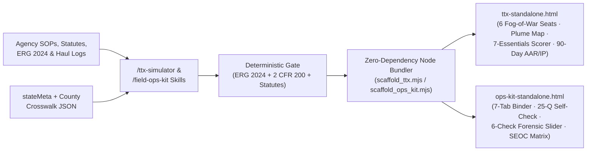

# Google Antigravity Emergency Readiness & HSEEP Crisis Studio (`agy-emergency-readiness`)

> **Disclaimer**: This repository and its contents are provided for illustration and educational purposes only as example code. This is **not** an official Google product or officially supported Google Cloud software. Provided as-is under the [Apache License 2.0](../../LICENSE) without warranty of any kind.

A standalone **Google Antigravity (`AGY`) Plugin**, **Offline-Ready Crisis & Forensic Runtime**, and **120-Minute Hands-On Public Sector Workshop** built for State, County, Municipal, Tribal, and Federal Emergency Management teams.

Engineered specifically for **locked-down government endpoints and air-gapped Emergency Operations Centers (`EOCs`)**:
- **Zero Python, Zero `npm`, Zero Local Ports Required:** Both scaffolders use 100% Node.js 18+ built-in modules (`node:fs`, `node:path`, `node:crypto`) and compile self-contained single-file `.html` applications (`< 0.5s` offline load, `0` external CDNs, `0` `innerHTML` sinks) that open natively in Antigravity's Side Pane, Chrome/Edge (`file://`), or off a USB drive during power/network outages.
- **Pre-Loaded Flagship State Pack + 1-Prompt `"Swap to My State"`:** Ships ready to demo with **State of West Virginia (`55` counties)** datasets (*Operation Winter Gorge* + *Tug Fork / Guyandotte FEMA PA Debris Crosswalk*), while supporting **1-prompt re-branding to any US state** (Florida `FDEM`, Texas `TDEM`, California `Cal OES`, Virginia `VDEM`, Ohio, Pennsylvania, etc.) via top-level `stateMeta` JSON—zero JavaScript edits required.

---

## Included Assets

```text
projects/agy-emergency-readiness/
├── README.md                              # Architecture, 1-command install & demo guide
├── emergency-readiness/                   # Strict-validated Antigravity plugin (v1.0.0)
│   ├── plugin.json                        # Official plugin manifest
│   ├── README.md                          # Pre-install plugin overview
│   ├── assets/logo.svg                    # 1:1 Light/Dark theme icon
│   ├── rules/AGENTS.md                    # ERG 2024, 2 CFR 200 & zero-innerHTML guardrails
│   └── skills/
│       ├── ttx-simulator/                 # /ttx-simulator HSEEP Multi-Role Tabletop & Crisis Simulator
│       └── field-ops-kit/                 # /field-ops-kit Disaster Binder, Self-Check, Forensic Crosswalk & SEOC Matrix
├── live-demos/                            # Pre-built standalone HTML apps — open in any browser in 5 seconds!
│   ├── ttx-standalone.html                # Interactive HSEEP Tabletop & Crisis Simulator (Operation Winter Gorge)
│   └── ops-kit-standalone.html            # Interactive Field Readiness, 6-Check Forensic Crosswalk & 55-County Kit
└── workshop/                              # Facilitator & Multi-State Enablement Pack
    ├── WORKSHOP_RUNBOOK.md                # 120-Minute, 5-Pod "AI Crucible" Facilitator & Participant Guide
    └── SWAP_TO_MY_STATE_PROMPTS.md        # Copy-paste 1-Prompt "Swap to My State" recipes (FL, TX, CA, VA & custom CSVs)
```

---

## Architecture Overview



---

## 3 Ways to Experience or Install (Pick One)

### 1. Try the Pre-Built Interactive Demos in 5 Seconds (Zero Install)
Want to show an Account Executive, Emergency Management Director, or CISO what the output looks like before installing anything? Clone or download the two self-contained files in [`live-demos/`](./live-demos/) and double-click in Chrome or Edge:
- **[`live-demos/ttx-standalone.html`](./live-demos/ttx-standalone.html)** — **HSEEP Multi-Role Tabletop & Crisis Simulator (*Operation Winter Gorge*)**: Switch across all 55 counties, toggle the 6 **Fog-of-War** agency seats, trigger cascading consequences (`Option C` direct water on `UN1005` liquid ammonia), inspect the **ERG 2024 Guide 125** SVG plume plotter, test the **`<= 120`-word 7-Essentials Public Warning Auto-Scorer**, and export a **90-day FEMA EMPG `AAR/IP`**.
- **[`live-demos/ops-kit-standalone.html`](./live-demos/ops-kit-standalone.html)** — **Disaster Field Readiness, Forensic Crosswalk & Regional Kit**: Browse the **7-Tab Disaster Timeline Binder** (`24` county tools), score a county on the **25-Question Readiness Self-Check**, drag the **Max Loaded-Trip Minutes Slider (`35–65 min`)** across `18` debris haul loads to quarantine `$4,556.00` in T&M anomalies (`19-min` impossible transit, `+4.2t` truck tare swap, duplicate scale ticket) and generate a **Federal Reviewer Justification Memo**, or filter the **55-County / 28-Region SEOC Crosswalk**.

### 2. 1-Command Google Antigravity Plugin Install (Recommended for Coworkers)
Paste into your terminal (or directly into a **+ New Conversation** in Google Antigravity):
```bash
agy plugin install https://github.com/peterfishergcp/gps-ai-hub/tree/main/projects/agy-emergency-readiness/emergency-readiness
```

### 3. Local Sparse-Checkout + Strict Validation
```bash
git clone --depth 1 --filter=blob:none --sparse https://github.com/peterfishergcp/gps-ai-hub.git agy-em
cd agy-em && git sparse-checkout set projects/agy-emergency-readiness
cd projects/agy-emergency-readiness
agy plugin validate --strict ./emergency-readiness
agy plugin install ./emergency-readiness
```

---

## Adapting to Your State in 1 Prompt (`Swap to My State`)

Once installed, open [`workshop/SWAP_TO_MY_STATE_PROMPTS.md`](./workshop/SWAP_TO_MY_STATE_PROMPTS.md) and paste a 1-prompt state conversion (pre-written for **Florida `FDEM`**, **Texas `TDEM`**, **California `Cal OES`**, **Virginia `VDEM`**, or **Bring-Your-Own County CSVs**). Both skills populate `stateMeta` and re-bundle a brand-new offline `.html` application tailored to your state's counties, emergency statutes, DOT/Police districts, and hazards.

---

## Running the 120-Minute Hands-On Customer Workshop

See **[`workshop/WORKSHOP_RUNBOOK.md`](./workshop/WORKSHOP_RUNBOOK.md)** for the complete **120-Minute, 5-Pod *"AI Crucible"* Facilitator & Participant Runbook**—structured so Emergency Management, Fire/Hazmat, Cyber/OT, Public Health, and Finance/Procurement teams co-build, adversarially verify (`Gemini` + `Claude` cold-start statutory check), and run a live multi-seat tabletop exercise and FEMA Public Assistance forensic audit together.

---

## Security & Engineering Controls

- **Strict Plugin Validation (`0` Warnings)**: Passes `agy plugin validate --strict` cleanly.
- **Zero External `npm` or Python Dependencies**: Built exclusively on Node.js 18+ standard library modules (`node:fs`, `node:path`, `node:crypto`).
- **Safe DOM Construction (`0` `innerHTML` Sinks)**: Every HTML view and SVG tactical plume map uses `document.createElement`, `document.createElementNS`, `replaceChildren`, and `textContent` exclusively, paired with SHA-256 Content-Security-Policy locking (`default-src 'none'; connect-src 'none'`) on standalone builds.
