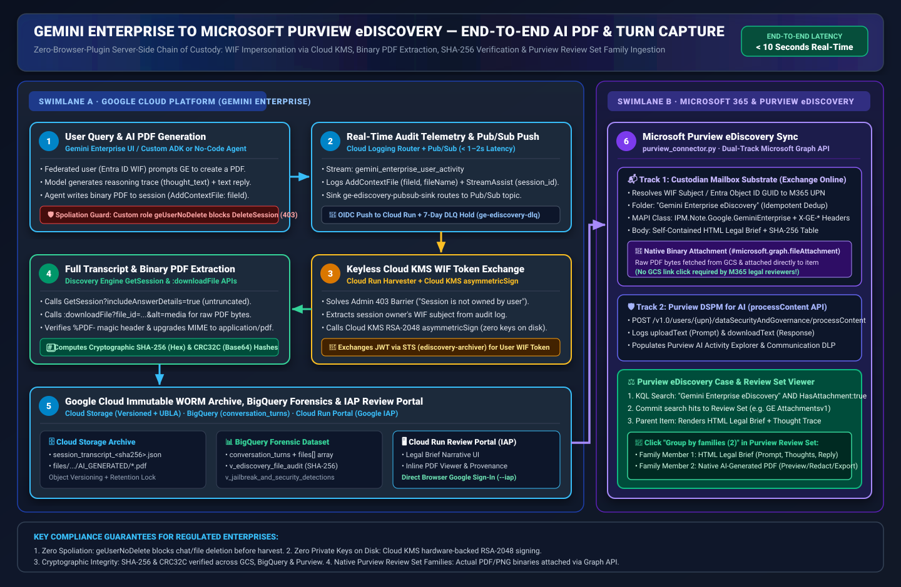

# Gemini Enterprise Server-Side eDiscovery Capture, Cloud Storage Archival, BigQuery Forensic Reporting & Compliance Review Portal

> **Disclaimer**: This repository and its contents are provided for illustration and educational purposes only as example code. This is not an official Google product or officially supported Google Cloud project. This code is provided as-is for demonstration purposes and is NOT intended or supported for production workloads. The views, code, and opinions expressed in this repository are those of the author(s) and do not necessarily reflect the position, opinions, or official policy of Google LLC or Google Cloud Platform.

---

## Overview

Regulated enterprises deploying **Gemini Enterprise** (Google Cloud Discovery Engine) and **NotebookLM Enterprise** with **Workforce Identity Federation (WIF)** (such as Microsoft Entra ID, Okta, or Ping Identity) often require **100% server-side eDiscovery and compliance archival** of:
1. **User Prompts & Full Model Responses** (`prompt_text` and `response_text` across Gemini Enterprise chat sessions, Deep Research reports, custom No-Code/ADK agents, and NotebookLM Enterprise notebooks)
2. **Model Reasoning / Chain-of-Thought** (`thought_text`)
3. **User-Uploaded Attachments (`USER_PROVIDED`)** (PDFs, Word documents, spreadsheets, text files, images — with automatic magic-byte MIME detection)
4. **AI-Generated Artifacts (`AI_GENERATED`)** (PNG/JPEG/WebP images generated by Gemini/Imagen, binary PDF reports generated by No-Code `docgen_agent` or custom ADK agents via `tool_context.save_artifact()`, and compiled multi-slide HTML presentations from interactive Canvas `save_slides_to_artifact` tool calls)
5. **NotebookLM Enterprise Sources (`NOTEBOOK_SOURCE`) & 12-Modality Studio Artifacts (`NOTEBOOK_STUDIO_ARTIFACT`)** (PDFs, Markdown/text, Google Drive files, YouTube videos, web URLs, and Agentspace sources attached to notebooks, plus all 12 Studio modalities — Audio Overviews `.mp3`, Video Overviews `.mp4`, Slide Decks `.pdf`, Infographics `.png`, Reports, Flashcards, Quizzes, Mind Maps, Study Guides, FAQs, Timelines, Briefing Docs, and Studio Notes downloaded via Discovery Engine's Scotty `:download?alt=media` endpoint)
6. **Spoliation Prevention & Drift-Safe Custom IAM Role (`geUserNoDelete`)** (prevents users from deleting chat history or session attachments prior to harvest while automatically staying in sync with Google updates to `roles/discoveryengine.user`)
7. **Cryptographic Chain-of-Custody Metadata** (`SHA-256`, `CRC32C`, byte sizes, word/token counts, MIME types, and immutable Cloud Storage URIs)
8. **BigQuery Security & Forensic Reporting + Self-Contained Compliance Review Portal (`portal/`)** (automated jailbreak/prompt-injection detection, NotebookLM Enterprise forensic views, parameterized user forensic dossiers, and a React 18 Legal Brief Narrative UI deployed on Cloud Run)
9. **Microsoft Purview eDiscovery & DSPM for AI Integration (`purview_connector.py`)** (dual-track Microsoft Graph pipeline pushing self-contained HTML Legal Briefs + native binary `#microsoft.graph.fileAttachment` payloads into the custodian's Exchange Online `Gemini Enterprise eDiscovery` mailbox folder for Purview eDiscovery Content Search, Custodian Legal Holds, and Review Sets, plus `dataSecurityAndGovernance/processContent` for Purview DSPM for AI Activity Explorer & Audit)

This solution provides a complete, zero-browser-plugin, server-side pipeline that captures, archives, and indexes every Gemini Enterprise conversation turn, binary file attachment, and NotebookLM Enterprise interaction into **Google Cloud Storage**, **BigQuery**, and **Microsoft Purview eDiscovery**, paired with a self-contained **Compliance & Legal Brief Review Portal** on Cloud Run.

---

## Why a Special Architecture is Required

When a user authenticates to Gemini Enterprise or NotebookLM Enterprise via **Workforce Identity Federation (WIF)**, Discovery Engine binds every conversation session (`sessions/{sessionId}`), session file (`fileId`), and private notebook (`notebooks/{notebookId}`) exclusively to that user's federated principal (`principal://iam.googleapis.com/locations/global/workforcePools/<YOUR_WORKFORCE_POOL_ID>/subject/<USER_SUBJECT>`):

- **The Admin Ownership Barrier (`HTTP 403`)**: Standard Google Cloud IAM Project Owners or `roles/discoveryengine.admin` principals **cannot** call `GetSession`, `:downloadFile`, or `notebooks:listRecentlyViewed` / `notebooks.get` on a Workforce Identity user's private session or notebook. Attempting to do so with an admin OAuth token returns:
  ```text
  HTTP 403 PERMISSION_DENIED: Session is not owned by the provided user.
  ```
- **The Spoliation Window (`DeleteSession` Before Harvest)**: Standard `roles/discoveryengine.user` grants `discoveryengine.sessions.delete` and `discoveryengine.sessions.removeContextFile`. Because raw uploaded/generated binary files (`:downloadFile`) and untruncated $>64\text{ KiB}$ transcripts (`GetSession`) reside inside the user's Discovery Engine session until harvested, a user with `roles/discoveryengine.user` could delete a chat session immediately after generating or uploading sensitive material.
- **Cloud Logging Payload Truncation & Separate Sub-Product Streams**:
  - While enabling `observabilityEnabled=true` and `sensitiveLoggingEnabled=true` on Gemini Enterprise engines emits real-time `discoveryengine.googleapis.com/gemini_enterprise_user_activity` logs, those log entries only contain **metadata and file IDs** (`fileId`, `fileName`, `mimeType`)—not the raw binary bytes of uploaded documents or AI-generated images/PDFs/slides.
  - **NotebookLM Enterprise** does not run through `AssistantService.StreamAssist` or store artifacts under `engines/*/sessions/*`. Instead, it uses a separate project-level `customerProvidedConfig.notebooklmConfig.observabilityConfig` setting, emits logs to a separate `discoveryengine.googleapis.com/notebooklm_enterprise_user_activity` stream (`NotebookService.GenerateFreeFormStreamed`, `SourceService.BatchCreateSources`, `AudioOverviewService.*`), and stores notebooks under `projects/*/locations/*/notebooks/*`.

### How This Solution Solves These Challenges

```mermaid
flowchart LR
    subgraph IAM["Spoliation Prevention & Drift-Safe IAM"]
        R1["roles/discoveryengine.user\n(Google-Managed Predefined Role)"]
        SYNC["Two-Layer Delete-Guard Sync\n(setup_no_delete_role.py &\nsync_no_delete_role.py)"]
        R2["Custom Role: geUserNoDelete\n(Blocks sessions.delete &\nsessions.removeContextFile)"]
        R1 -->|"Filter & Sync New Perms"| SYNC --> R2
    end

    subgraph User["Gemini Enterprise, Custom ADK Agents & NotebookLM (WIF User)"]
        A["GE Prompt + File Upload (:uploadFile)"]
        B["GE StreamAssist, Canvas & ADK Agent\n(Text + AI Image, Slide Deck & PDF Gen)"]
        DEL["User Attempt: DeleteSession\n(Blocked: HTTP 403 PERMISSION_DENIED)"]
        N["NotebookLM Chat, Sources & 12-Modality Studio\n(Audio/Video Overviews, Slides, Mind Maps, Quizzes)"]
    end

    subgraph Logging["Cloud Logging, Pub/Sub & DLQ"]
        C["gemini_enterprise_user_activity"]
        NL["notebooklm_enterprise_user_activity"]
        PS["Pub/Sub Topic & OIDC Push\n(ge-ediscovery-events -> /pubsub)"]
        DLQ["Dead-Letter Queue (7-Day Hold)\n(ge-ediscovery-dlq-hold &\nscripts/replay-dlq.sh)"]
    end

    subgraph Harvester["Real-Time Cloud Run Harvester (ge-ediscovery-harvester)"]
        D["1. Receive Real-Time Event (<10s) or Sweep"]
        KMS["2. Sign WIF JWT via Cloud KMS asymmetricSign\n(RSA_SIGN_PKCS1_2048_SHA256 — Zero Key on Disk)"]
        E["3. Exchange JWT for Short-Lived WIF Token via STS\n(ediscovery-archiver OIDC Provider)"]
        F["4. Fetch Full Session (GetSession), Binary Files (:downloadFile),\nCanvas Slides, NotebookLM Sources & Scotty Studio Media"]
    end

    subgraph Storage["Compliance Archive & Analytics"]
        G[("Cloud Storage Bucket\n(Versioning + UBLA)\n• session_transcript_<sha256>.json\n• notebook_archive_<sha256>.json\n• USER_PROVIDED binaries\n• AI_GENERATED PDFs, PNGs & HTML Slides\n• NOTEBOOK_STUDIO MP3/MP4/PDF/JSON")]
        H[("BigQuery Dataset (ge_ediscovery)\n• conversation_turns\n• v_ediscovery_file_audit\n• v_realtime_agent_and_file_activity\n• v_notebooklm_forensic_audit\n• v_jailbreak_and_security_detections\n• fn_user_forensic_report()")]
    end

    subgraph Portal["Compliance Review Portal & Microsoft Purview eDiscovery"]
        UI["React 18 Legal Brief Narrative UI (Cloud Run)\n• Turn Reasoning & Grounding Citations\n• File Provenance Box (SHA-256 & CRC32C)\n• Inline PDF, HTML Slide, Image & Audio/Video Player\n• NotebookLM Sources, Chat & Studio Modality Viewer"]
        PV["Microsoft Purview eDiscovery & DSPM for AI (purview_connector.py)\n• Track 1: Custodian Mailbox Folder ('Gemini Enterprise eDiscovery')\n  + MAPI IPM.Note.Google.GeminiEnterprise + Binary fileAttachments\n• Track 2: dataSecurityAndGovernance/processContent (DSPM for AI)"]
    end

    R2 -.->|"Enforced on WIF Pool"| User
    A --> C
    B --> C
    N --> NL
    C -->|"Real-Time Partitioned Sink"| H
    NL -->|"Real-Time Partitioned Sink"| H
    C -->|"ge-ediscovery-pubsub-sink"| PS
    NL -->|"ge-ediscovery-pubsub-sink"| PS
    PS -->|"OIDC Push"| D
    PS -.->|"After 10 Failed Attempts"| DLQ
    DLQ -.->|"replay-dlq.sh --replay"| PS
    D --> KMS
    KMS --> E
    E --> F
    F -->|"Archive Raw JSON + Binaries"| G
    F -->|"Load Structured Turns + SHA-256/CRC32C"| H
    F -.->|"Sync Turns + Binary Attachments"| PV
    G -->|"HTTP Range Media Proxy (/api/media)"| UI
    H -->|"Parameterized SQL (/api/logs & /api/search)"| UI
```





1. **Engine-Level, Agent-Level & Project-Level Sensitive Logging (`enable_ge_sensitive_logging.py`)**:
   - Patches all Gemini Enterprise engines (`global`, `us`, `eu`) to enable `observabilityEnabled=true` and `sensitiveLoggingEnabled=true`.
   - Iterates through every custom Agent (`lowCodeAgentDefinition`, `adkAgentDefinition`, `a2aAgentDefinition`) under `engines/{engine_id}/assistants/default_assistant/agents` and patches `observabilityConfig` on each agent individually.
   - Patches the Project-level NotebookLM Enterprise configuration (`v1alpha/projects/{project_id}` -> `customerProvidedConfig.notebooklmConfig.observabilityConfig`) across `global`, `us`, and `eu`.
2. **Cloud KMS-Backed Server-Side WIF Archiver OIDC Provider (`setup_ediscovery_archiver_provider.py`)**: Provisions a **Google Cloud KMS Asymmetric Signing Key** (`ge-ediscovery-kr` / `ediscovery-archiver-jwt-key`, algorithm `RSA_SIGN_PKCS1_2048_SHA256`), extracts its public key into `archiver_jwks.json` (`kid: "archiver-kms-key-1"`), and registers the `ediscovery-archiver` OIDC provider inside your Workforce Identity Pool with a strict CEL `--attribute-condition` (`assertion.iss`, `assertion.aud`, `assertion.sub != ''`). **No private key ever exists on disk or inside a container**—the harvester calls Cloud KMS `:asymmetricSign` over IAM-authenticated HTTPS to mint short-lived, per-user WIF STS tokens (`google.subject = assertion.sub`). *(Also includes optional keyless Google Workspace Domain-Wide Delegation fallback via `mint_dwd_token()` scoped strictly to `discoveryengine.readwrite` if non-WIF Workspace engines are used).*
3. **Immutable Cloud Storage + BigQuery Provisioning (`setup_storage_and_bigquery.py`)**: Creates a versioned, Uniform Bucket-Level Access (UBLA) GCS bucket with Public Access Prevention enforced (`--public-access-prevention`), a BigQuery dataset (`ge_ediscovery`), the `conversation_turns` table (loaded via atomic BigQuery `MERGE` from a staging table to prevent race conditions or spoliation), a real-time Cloud Logging sink capturing both `gemini_enterprise_user_activity` and `notebooklm_enterprise_user_activity`, and five ready-to-use BigQuery reporting views/functions (`v_ediscovery_file_audit`, `v_realtime_agent_and_file_activity`, `v_notebooklm_forensic_audit`, `v_jailbreak_and_security_detections`, and `fn_user_forensic_report`).
4. **Real-Time Event-Driven Cloud Run Harvester & Pub/Sub Dead-Letter Queue (`deploy_cloudrun_harvester.py`, `cloudrun_harvester_server.py`, `ge_harvest.py`, `scripts/replay-dlq.sh`)**:
   - **Real-Time Event-Driven Mode (`<10s` latency)**: A Cloud Logging sink (`ge-ediscovery-pubsub-sink`) streams `StreamAssist`, `Assist`, `UploadSessionFile`, `AddContextFile`, `GenerateFreeFormStreamed`, `BatchCreateSources`, `CreateNotebook`, `AudioOverviewService.*`, and `NotebookService.*` log entries to Pub/Sub (`ge-ediscovery-events`), which pushes each event via an OIDC-authenticated subscription (`ge-ediscovery-push-sub`) to the private Cloud Run service (`ge-ediscovery-harvester`, `--no-allow-unauthenticated`). Any unprocessable event after 10 delivery attempts is captured in `ge-ediscovery-dlq` (`ge-ediscovery-dlq-hold`) for inspection and replay via `scripts/replay-dlq.sh`.
   - **Gemini Enterprise, Custom Agents & Interactive Canvas**: Mints a per-user WIF STS token via Cloud KMS `:asymmetricSign`, fetches full untruncated `GetSession?includeAnswerDetails=true` transcripts, downloads all `USER_PROVIDED` and `AI_GENERATED` files via `:downloadFile`, inspects magic bytes (`detect_mime_and_extension`) to upgrade generic `application/octet-stream` payloads, compiles interactive Canvas `save_slides_to_artifact` tool calls into standalone multi-slide HTML presentations (`extract_canvas_slides`), computes `SHA-256` and `CRC32C` digests, and archives to GCS + BigQuery.
   - **NotebookLM Enterprise (Sources, Chat & 12-Modality Studio)**: Mints a per-user WIF STS token via Cloud KMS `:asymmetricSign` to call `notebooks.get`, `notebooks.sources.get`, `audioOverviews`, and `notes`, downloads binary Studio media (`.mp3`, `.mp4`, `.pdf`, `.png`) via Discovery Engine's Scotty `/download/v1alpha/{name}:download?alt=media` endpoint, deduplicates streamed reply chunks (`clean_notebooklm_streamed_reply`), archives content-addressed `notebook_archive_<sha256>.json` and Studio artifacts to `gs://<BUCKET>/notebooks/{location}/{notebook_id}/`, and loads an immutable `turn_index = 0` inventory row plus timestamp-addressed chat turns, `NOTEBOOK_SOURCE` records, and `NOTEBOOK_STUDIO` records into BigQuery.
5. **Spoliation Prevention & Drift-Safe Custom No-Delete Role (`setup_no_delete_role.py`, `sync_no_delete_role.py`, `scripts/swap-user-role.sh`, `scripts/sync-custom-role.sh`)**:
   - Provisions the custom role `projects/<YOUR_GCP_PROJECT_ID>/roles/geUserNoDelete` with every testable permission from `roles/discoveryengine.user` **except** `discoveryengine.sessions.delete` and `discoveryengine.sessions.removeContextFile`, and swaps your Workforce Identity Pool principal non-authoritatively (with automatic IAM backup and 1-command `--rollback`).
   - Provides a Two-Layer Delete-Guard synchronization script (`sync_no_delete_role.py` / `scripts/sync-custom-role.sh`) that compares `roles/discoveryengine.user` against `geUserNoDelete`, allowing you to safely merge new read/chat/agent permissions added by Google over time without ever re-introducing session or file deletion capabilities.
6. **Self-Contained Compliance & Legal Brief Narrative Review Portal (`portal/`, `deploy_portal.py`)**:
   - Deploys a single self-contained Cloud Run service (`ge-ediscovery-portal`, `--no-allow-unauthenticated`, `--iap` enabled by default, fail-closed `ALLOWED_REVIEWER_EMAILS` / `ALLOWED_REVIEWER_DOMAINS` RBAC) running under a dedicated read-only service account (`ge-ediscovery-portal-sa` with zero KMS signing or write permissions) that serves both the compiled React 18 Legal Brief Narrative SPA (`portal/dist`) and the Python BigQuery/GCS API (`portal/server.py`) with structured Cloud Logging access audit logs (`ediscovery_portal_access_audit`) and strict Content-Security-Policy headers.
   - Features side-by-side **Session Metadata**, **Turn Reasoning (`thought_text`)**, **File Provenance Box** (`SHA-256 Integrity`, `CRC32C Integrity`, `GCS Archive Path`, `Original File ID`, `MIME Type`, `Size`), inline PDF / sandboxed HTML Slide Deck / Image / Audio / Video playback (with chunked HTTP `206 Partial Content` `Range` streaming), and dedicated **NotebookLM Enterprise** tabs (**Sources**, **Chat**, and **Studio**).
7. **Microsoft Purview eDiscovery & DSPM for AI Connector (`purview_connector.py`)**:
   - **Track 1 — Purview eDiscovery Compliance Journal / Mailbox Substrate**: Resolves Entra ID UPNs or Object ID GUIDs (`google.subject = assertion.oid`), writes immutable compliance copies into a dedicated non-custodian compliance journal mailbox (`PURVIEW_COMPLIANCE_JOURNAL_UPN` under Legal Hold / Preservation Lock) or hidden Exchange compliance folder (`isHidden: true`), deduplicates via `internetMessageId` (`X-GE-Session-ID` + `X-GE-Turn-Index`), stamps MAPI `PidTagMessageClass` (`String 0x001A` via `PURVIEW_MESSAGE_CLASS`) and `X-GE-*` headers, renders a self-contained HTML Legal Brief, attaches inline binaries `<= 3 MiB` (`#microsoft.graph.fileAttachment`), and uploads large binary attachments `> 3 MiB` (up to `150 MiB`) in `3.75 MiB` chunks via Microsoft Graph `createUploadSession` (failing closed to Pub/Sub DLQ on delivery error).
   - **Track 2 — Microsoft Purview DSPM for AI & Audit (`processContent` API)**: Calls `POST /v1.0/users/{upn}/dataSecurityAndGovernance/processContent` with `#microsoft.graph.processConversationMetadata` (`uploadText` for user prompt, `downloadText` for model response, `accessedResources_v2` for file URIs).

---

## Gemini Enterprise, Custom Agents (No-Code & ADK) & NotebookLM Logging Matrix

Enabling `observabilityConfig` on a Gemini Enterprise **Engine** only enables logging for the default core assistant (`core_assistant`). Each custom **No-Code Agent** and **ADK Agent** has its own independent `observabilityConfig` resource (`enable_ge_sensitive_logging.py` automatically enables all of them):

| Component / Agent Type | Required Settings (`Observability` + `Prompt/Sensitive Logging`) | Captures User Prompts & Final Output? | Captures Internal Thoughts & Tool / Sub-Agent Calls? | Captures Uploaded & Generated Files (PDFs, Docs, Images, Slides)? | Captures Exact Token Counts? | Primary Cloud Logging Stream(s) & BigQuery View(s) |
| :--- | :--- | :--- | :--- | :--- | :--- | :--- |
| **1. Gemini Enterprise Core Assistant**<br>(`core_assistant`) | **Engine Level (`engines/{id}`):**<br>• `observabilityEnabled: true`<br>• `sensitiveLoggingEnabled: true` | **Yes** — Full user prompt (`query.text`) and model response (`serviceTextReply` + `GetSession`). | **Yes** — Deep Research plans, grounding citations, and `thought: true` reasoning steps via `GetSession`. | **Yes (Full Binary Files & Canvas Slides)** — User uploads (`UploadSessionFile`), AI-generated images/docs (`AddContextFile`) downloaded via `:downloadFile` with magic-byte detection, plus interactive Canvas `save_slides_to_artifact` HTML slide decks. | **No** in `StreamAssist`. | • **Log:** `gemini_enterprise_user_activity`<br>• **BQ Views:** `conversation_turns`, `v_ediscovery_file_audit`, `v_realtime_agent_and_file_activity` |
| **2. No-Code Agent**<br>(Built in GE, `lowCodeAgentDefinition`) | **Per-Agent Level (`.../agents/{agentId}`):**<br>• UI Checkbox 1: *Enable OpenTelemetry traces/logs* (`observabilityEnabled: true`)<br>• UI Checkbox 2: *Enable logging of prompt inputs/outputs* (`sensitiveLoggingEnabled: true`) | **Yes** — Full user prompt (`query.parts[0].text`) and final agent output (`serviceTextReply` + `GetSession`). | **Yes** — Captures full system instructions, internal reasoning (`thought: true`), connector searches, and sub-agent handoffs (e.g., `transfer_to_agent` $\rightarrow$ `docgen_agent`). | **Yes (Full Binary Files)** — Generated PDFs and uploaded files are downloaded via `:downloadFile` into GCS and linked in `v_realtime_agent_and_file_activity`. | **Yes (Exact)** — Logs `input_tokens`, `output_tokens`, and `reasoning.output_tokens` in OpenTelemetry details. | • **Logs:** `gemini_enterprise_user_activity` + `gen_ai.client.inference.operation.details`<br>• **BQ Views:** `v_realtime_agent_and_file_activity`, `v_ediscovery_file_audit` |
| **3. ADK Agent (Full Logging)**<br>(`adkAgentDefinition` $\rightarrow$ Vertex AI Agent Engine) | **Both Layers Enabled:**<br>1. **GE Agent (`.../agents/{id}`):** `observabilityEnabled: true` + `sensitiveLoggingEnabled: true`<br>2. **Vertex AI Reasoning Engine:**<br>• `GOOGLE_CLOUD_AGENT_ENGINE_ENABLE_TELEMETRY="true"`<br>• `OTEL_INSTRUMENTATION_GENAI_CAPTURE_MESSAGE_CONTENT="true"` | **Yes** — Captures both the outer prompt/response in Gemini Enterprise **and** all inner LLM prompts/outputs inside the ADK container. | **Yes** — Captures every internal Python tool call, sub-agent step, and internal LLM prompt/response in un-redacted plaintext. | **Yes (Outer GE Session)** — Files attached to or saved in the GE session (`tool_context.save_artifact`) are captured via `:downloadFile`. | **Yes (Exact)** — Logged in Vertex AI Agent Engine OpenTelemetry events & Cloud Trace spans (`gen_ai.usage.*`). | • **Outer Log:** `gemini_enterprise_user_activity`<br>• **Inner Logs:** `aiplatform.googleapis.com/reasoning_engine_stdout`, `gen_ai.user.message`, `gen_ai.choice`<br>• **BQ Views:** `conversation_turns`, `v_realtime_agent_and_file_activity` |
| **4. ADK Agent (Partial — Missing Env Var)**<br>(`adkAgentDefinition` without `CAPTURE_MESSAGE_CONTENT`) | **GE Agent On, but Vertex Reasoning Engine only has:**<br>• `GOOGLE_CLOUD_AGENT_ENGINE_ENABLE_TELEMETRY="true"`<br>*(Missing `OTEL_INSTRUMENTATION_GENAI_CAPTURE_MESSAGE_CONTENT="true"`)* | **Outer Only** — GE still captures the user's prompt and final response, **but** inner ADK LLM logs show `{"content": "<elided>"}`. | **Structure Only** — You see trace spans and tool names in Cloud Trace, but internal prompt/tool payloads are `<elided>`. | **Yes (Outer GE Session)** — Outer session files still captured by GE. | **Yes** — Token counts and span latencies are still recorded on Cloud Trace spans. | • **Outer Log:** `gemini_enterprise_user_activity` (Full text)<br>• **Inner Log:** `reasoning_engine_stdout` (`<elided>`) |
| **5. NotebookLM Enterprise (Chat, Sources & 12-Modality Studio)** | **Project/Location Level (`locations/{loc}/observabilityConfig`):**<br>• `observabilityEnabled: true`<br>• `sensitiveLoggingEnabled: true` | **Yes** — `GenerateFreeFormStreamed` logs the full user prompt (`userQuery`) and full grounded markdown answer (`serviceTextReply`). | **Yes (Grounding Summary)** — Logs the grounded answer with `[1]`, `[2]` source citations and source inventory. | **Sources Inventory + Full Studio Binaries (`.mp3`, `.mp4`, `.pdf`, `.png`, `.json`)** — Captures source `title`, `sourceId`, `wordCount`, `tokenCount`, plus all 12 Studio modalities (Audio/Video Overviews, Slide Decks, Infographics, Flashcards, Quizzes, Mind Maps, Study Guides, FAQs, Timelines, Briefing Docs, Notes) downloaded via Scotty `:download?alt=media`. | **Source Token Count** — Captures `tokenCount` per uploaded source document. | • **Log:** `notebooklm_enterprise_user_activity`<br>• **BQ View:** `v_notebooklm_forensic_audit` (plus `gs://.../notebooks/.../studio/...`) |
| **6. Live Voice / Bidirectional Audio** | Engine `observabilityConfig` | **No** — Does not run through `StreamAssist` text turns or store downloadable audio blobs in `:downloadFile`. | **No** | **No** — Raw voice/audio streams are not persisted in Discovery Engine sessions. | **No** | • **Log:** Connection-level Data Access audit logs only. |

---

## Repository Structure

| File | Purpose |
| :--- | :--- |
| [`.env.example`](./.env.example) | Template environment configuration (`GCP_PROJECT_ID`, `WORKFORCE_POOL_ID`, `KMS_KEY`, `CLOUD_RUN_SERVICE`, `PORTAL_SERVICE_NAME`, etc.) |
| [`enable_ge_sensitive_logging.py`](./enable_ge_sensitive_logging.py) | Enables `observabilityEnabled` and `sensitiveLoggingEnabled` across all Gemini Enterprise engines, all custom Agents (No-Code & ADK), and NotebookLM Enterprise locations |
| [`setup_ediscovery_archiver_provider.py`](./setup_ediscovery_archiver_provider.py) | Provisions a Cloud KMS Asymmetric Signing Key (`ediscovery-archiver-jwt-key`, `RSA_SIGN_PKCS1_2048_SHA256`), extracts its public key into `archiver_jwks.json`, and configures the `ediscovery-archiver` OIDC provider in your Workforce Identity Pool |
| [`setup_storage_and_bigquery.py`](./setup_storage_and_bigquery.py) | Provisions the GCS archive bucket, BigQuery dataset/table, real-time Cloud Logging sink, and forensic SQL views/functions |
| [`conversation_turns_schema.json`](./conversation_turns_schema.json) | BigQuery table schema for `conversation_turns` including the nested `files` `RECORD REPEATED` array |
| [`ge_harvest.py`](./ge_harvest.py) | Main eDiscovery harvester (signs WIF JWTs via Cloud KMS `:asymmetricSign`, detects magic-byte MIME types, compiles Canvas HTML slide decks, harvests 12-modality NotebookLM Studio artifacts via Scotty `:download`, and loads GCS & BigQuery) |
| [`cloudrun_harvester_server.py`](./cloudrun_harvester_server.py) | Lightweight HTTP server for Cloud Run handling real-time Pub/Sub push events (`POST /pubsub`) and scheduled sweeps (`POST /sweep`) |
| [`Dockerfile`](./Dockerfile) | Minimal non-root `python:3.12-slim` container image for `ge-ediscovery-harvester` |
| [`deploy_cloudrun_harvester.py`](./deploy_cloudrun_harvester.py) | Deploys the `ge-ediscovery-harvester` Cloud Run service, least-privilege SA (`ge-ediscovery-harvester-sa`), Cloud Logging $\rightarrow$ Pub/Sub sink (`ge-ediscovery-pubsub-sink`), OIDC push subscription, and dead-letter queue (`ge-ediscovery-dlq` / `ge-ediscovery-dlq-hold`) |
| [`portal/`](./portal/) | Self-contained **Compliance & Legal Brief Review Portal** (`portal/server.py` Python BigQuery/GCS API server + React 18 / Vite / Tailwind CSS Legal Brief Narrative UI + multi-stage `portal/Dockerfile`) |
| [`deploy_portal.py`](./deploy_portal.py) | Builds and deploys the `ge-ediscovery-portal` Cloud Run service (`--no-allow-unauthenticated`) serving both the React 18 Compliance Review UI and `/api/*` endpoints |
| [`purview_connector.py`](./purview_connector.py) | Dual-track **Microsoft Purview eDiscovery & DSPM for AI Connector** (pushes HTML Legal Briefs + binary `#microsoft.graph.fileAttachment` payloads into Exchange Online `Gemini Enterprise eDiscovery` custodian folders and calls `dataSecurityAndGovernance/processContent`) |
| [`setup_no_delete_role.py`](./setup_no_delete_role.py) | Provisions the `projects/<PROJECT_ID>/roles/geUserNoDelete` custom IAM role (`roles/discoveryengine.user` minus `discoveryengine.sessions.delete` and `discoveryengine.sessions.removeContextFile`) and safely swaps a target principal with automatic IAM backup & `--rollback` |
| [`sync_no_delete_role.py`](./sync_no_delete_role.py) | Compares `roles/discoveryengine.user` against `geUserNoDelete` to detect and sync newly added Google permissions while blocking any explicit or heuristic session/conversation delete permissions |
| [`scripts/swap-user-role.sh`](./scripts/swap-user-role.sh) | CLI wrapper to dry-run, `--apply`, or `--rollback` the `geUserNoDelete` role swap for a Workforce Identity Pool or group principal |
| [`scripts/sync-custom-role.sh`](./scripts/sync-custom-role.sh) | CLI wrapper to check (`--json` or human report) and synchronize (`--apply`) new permissions from `roles/discoveryengine.user` into `geUserNoDelete` |
| [`scripts/verify.sh`](./scripts/verify.sh) | Read-only end-to-end health check (engines, sinks, Cloud Run harvester & portal, dead-letter queue, `geUserNoDelete` drift & bindings, and latest BigQuery turns) |
| [`scripts/replay-dlq.sh`](./scripts/replay-dlq.sh) | Inspects (`--peek`) or republishes (`--replay`) dead-lettered events from `ge-ediscovery-dlq-hold` back to `ge-ediscovery-events` |
| [`test_ge_ediscovery_e2e.py`](./test_ge_ediscovery_e2e.py) | End-to-end verification suite (runs 8 automated compliance, security, `DeleteSession -> HTTP 403`, and BigQuery checks) |
| [`sites-search-agent/`](./sites-search-agent/) | Example ADK Agent (`sites_search_agent`) built with `agents-cli` and `fpdf2` that searches Google Sites and generates binary 1–2 page PDF summary artifacts (`AI_GENERATED`) captured by `ge_harvest.py` |
| [`AGENTS.md`](./AGENTS.md) | Turnkey customer deployment playbook (auto-discovery commands, IAM preflight checks, split Org/Project Admin handling, and troubleshooting) |
| [`ARCHITECTURE.md`](./ARCHITECTURE.md) | Deep-dive technical architecture, protocol specifications, Cloud KMS + Cloud Run design, Compliance Review Portal API, and production hardening guide |

---

## Quickstart & Installation Guide

> **Deploying at a Customer Site?** See [`AGENTS.md`](./AGENTS.md) for the automated customer deployment playbook, environment auto-discovery commands, preflight IAM permission test, and Org-vs-Project admin guidance.

### Prerequisites

- **Google Cloud SDK (`gcloud` and `bq`)** installed and authenticated as an administrator on your target project.
- **OpenSSL** (`openssl`) installed locally (used during initial setup to extract the RSA modulus from the Cloud KMS public key PEM).
- **Python 3.10+** (uses only the Python standard library—no `pip install` required).
- **Node.js 20+ & npm** (only required if modifying or running the React 18 Compliance Review Portal locally; Cloud Run builds it automatically inside `portal/Dockerfile`).
- An existing **Gemini Enterprise** engine configured with **Workforce Identity Federation**.

---

### Step 1: Configure Environment Variables

Copy `.env.example` to `.env` and set your project and Workforce Pool values:

```bash
cp .env.example .env
# Edit .env with your project settings, then export:
set -a && source .env && set +a
```

Required variables:
```bash
export GCP_PROJECT_ID="<YOUR_GCP_PROJECT_ID>"
export WORKFORCE_POOL_ID="<YOUR_WORKFORCE_POOL_ID>"
export GE_LOCATION="us"                         # "global", "us", or "eu"
export GE_ENGINE_ID="<YOUR_GE_ENGINE_ID>"
export TEST_WIF_USER_SUBJECT="user@example.com" # Used only for optional E2E test script
```

---

### Step 2: Enable Gemini Enterprise, Custom Agent & NotebookLM Sensitive Logging

Run `enable_ge_sensitive_logging.py` to enable `observabilityEnabled=true` and `sensitiveLoggingEnabled=true` across all Gemini Enterprise engines, all custom Agents (No-Code & ADK), and all NotebookLM Enterprise locations in your project:

```bash
python3 enable_ge_sensitive_logging.py --project-id "$GCP_PROJECT_ID"
```

---

### Step 3: Provision Cloud KMS Signing Key & Configure the `ediscovery-archiver` OIDC Provider

Run `setup_ediscovery_archiver_provider.py` to create the Cloud KMS KeyRing (`ge-ediscovery-kr`) and Asymmetric Signing Key (`ediscovery-archiver-jwt-key`, `RSA_SIGN_PKCS1_2048_SHA256`), export its public key to `archiver_jwks.json`, and register the `ediscovery-archiver` OIDC provider in your Workforce Identity Pool:

```bash
python3 setup_ediscovery_archiver_provider.py \
  --project-id "$GCP_PROJECT_ID" \
  --workforce-pool-id "$WORKFORCE_POOL_ID"
```

---

### Step 4: Provision Cloud Storage, BigQuery, Logging Sink & Analytical Views

Run `setup_storage_and_bigquery.py` to provision:
- Cloud Storage bucket `gs://<YOUR_GCP_PROJECT_ID>-ge-ediscovery` (Uniform Bucket-Level Access + Object Versioning enabled)
- BigQuery dataset `<YOUR_GCP_PROJECT_ID>.ge_ediscovery` and table `conversation_turns`
- Real-time Cloud Logging $\rightarrow$ BigQuery partitioned sink `ge-ediscovery-bq-sink`
- BigQuery views `v_ediscovery_file_audit`, `v_realtime_agent_and_file_activity`, `v_notebooklm_forensic_audit`, and `v_jailbreak_and_security_detections`
- BigQuery table-valued function `fn_user_forensic_report(target_user STRING)`

```bash
python3 setup_storage_and_bigquery.py --project-id "$GCP_PROJECT_ID"
```

---

### Step 5: Deploy the Real-Time Event-Driven Cloud Run Harvester (`<10s` Latency)

Run `deploy_cloudrun_harvester.py` to deploy the `ge-ediscovery-harvester` Cloud Run service (`--no-allow-unauthenticated`), grant `roles/cloudkms.signerVerifier` on `ediscovery-archiver-jwt-key` to `ge-ediscovery-harvester-sa`, and wire up the real-time Cloud Logging $\rightarrow$ Pub/Sub push pipeline (`ge-ediscovery-pubsub-sink` $\rightarrow$ `ge-ediscovery-events` $\rightarrow$ `ge-ediscovery-push-sub` with dead-letter topic `ge-ediscovery-dlq` and hold subscription `ge-ediscovery-dlq-hold`):

```bash
python3 deploy_cloudrun_harvester.py \
  --project-id "$GCP_PROJECT_ID" \
  --workforce-pool-id "$WORKFORCE_POOL_ID"
```

You can also run `ge_harvest.py` directly from the CLI at any time for an on-demand historical sweep:

```bash
python3 ge_harvest.py \
  --project-id "$GCP_PROJECT_ID" \
  --workforce-pool-id "$WORKFORCE_POOL_ID" \
  --hours 168
```

---

### Step 6: Deploy or Run the Self-Contained Compliance Review Portal (`portal/`)

Deploy the **Compliance & Legal Brief Narrative Review Portal** (`ge-ediscovery-portal`) to Cloud Run as a single self-contained container (`1Gi` RAM, serving both the compiled React 18 SPA and the BigQuery/GCS API endpoints with server-side JWT `aud` verification and fail-closed reviewer RBAC):

```bash
python3 deploy_portal.py \
  --project-id "$GCP_PROJECT_ID" \
  --iap-accessor "user:legal-reviewer@example.com" \
  --allowed-reviewer-emails "legal-reviewer@example.com,compliance-lead@example.com"
```

> **Security Note**: `deploy_portal.py` automatically configures `IAP_AUDIENCE` for server-side ES256/RS256 token audience verification, grants read-only access strictly on the `ge_ediscovery` BigQuery dataset (rather than project-wide `bigquery.dataViewer`), and blocks broad `--iap-accessor domain:...` bindings so sensitive legal, HR, and executive transcripts are never exposed across an entire domain.

To access the IAM-protected Cloud Run portal in your browser via `gcloud run services proxy`, or to run the portal locally on `127.0.0.1` for testing:

```bash
# Option A: Proxy to the Cloud Run service
gcloud run services proxy ge-ediscovery-portal --project "$GCP_PROJECT_ID" --region us-central1 --port 8085

# Option B: Run the portal server locally on 127.0.0.1 (after building portal/dist)
npm --prefix portal install && npm --prefix portal run build
ALLOW_LOCAL_DEV_BYPASS=true GCP_PROJECT_ID="$GCP_PROJECT_ID" HOST=127.0.0.1 PORT=8085 python3 portal/server.py
```

---

### Step 7: Swap the Gemini Enterprise User Role & Keep Permissions in Sync

Because file bytes (`:downloadFile`) and $>64\text{ KiB}$ untruncated turns (`GetSession`) reside in the user's Discovery Engine session until harvested, a user with the standard `roles/discoveryengine.user` role could delete a chat seconds after creating it.

`scripts/swap-user-role.sh` (backed by `setup_no_delete_role.py`) creates a custom role `projects/<YOUR_GCP_PROJECT_ID>/roles/geUserNoDelete` containing all permissions from `roles/discoveryengine.user` **minus** `discoveryengine.sessions.delete` and `discoveryengine.sessions.removeContextFile`, additively binds it to your Workforce Identity Pool principal, backs up your project IAM policy, and removes `roles/discoveryengine.user` **only** from that single principal (leaving all other members of `roles/discoveryengine.user` untouched):

```bash
# 1. Dry run (creates/updates geUserNoDelete, grants it additively, and checks bindings):
scripts/swap-user-role.sh "$GCP_PROJECT_ID" "principalSet://iam.googleapis.com/locations/global/workforcePools/${WORKFORCE_POOL_ID}/*"

# 2. Apply (saves IAM backup and removes roles/discoveryengine.user from this principal):
scripts/swap-user-role.sh "$GCP_PROJECT_ID" "principalSet://iam.googleapis.com/locations/global/workforcePools/${WORKFORCE_POOL_ID}/*" --apply

# Optional: Restore standard roles/discoveryengine.user (re-enables chat deletion):
# scripts/swap-user-role.sh "$GCP_PROJECT_ID" "principalSet://iam.googleapis.com/locations/global/workforcePools/${WORKFORCE_POOL_ID}/*" --rollback
```

Whenever Google adds new permissions to the predefined `roles/discoveryengine.user` role over time, run `scripts/sync-custom-role.sh` (backed by `sync_no_delete_role.py`) to compare `roles/discoveryengine.user` against `geUserNoDelete` and safely patch in any new permissions while enforcing a two-layer Delete-Guard (blocking both the explicit denylist and any future `discoveryengine.(sessions|conversations|assistAnswers|turns).*(delete|remove|purge)` permissions):

```bash
# Check for permission drift between roles/discoveryengine.user and geUserNoDelete:
scripts/sync-custom-role.sh "$GCP_PROJECT_ID"

# Apply any newly added safe permissions to geUserNoDelete:
scripts/sync-custom-role.sh "$GCP_PROJECT_ID" --apply
```

It takes ~1–2 minutes for IAM changes to propagate. Afterward, users can chat, upload files, and run agents normally in the Gemini Enterprise UI, but attempting to delete a chat returns `HTTP 403 PERMISSION_DENIED`.

---

### Step 8: Verify Deployment Health & Run the 8-Check E2E Verification Suite

Run the read-only health check script to verify engines, sinks, Cloud Run harvester & portal, dead-letter queue, `geUserNoDelete` permissions/bindings, and recent BigQuery turns:

```bash
scripts/verify.sh "$GCP_PROJECT_ID"
```

To run the full 8-check automated E2E verification suite (including creating a synthetic multi-turn session, uploading a `USER_PROVIDED` document, generating an `AI_GENERATED` image, verifying the `403` admin ownership barrier, harvesting to GCS & BigQuery, and verifying that `DeleteSession` is blocked with `HTTP 403` for the WIF user):

```bash
python3 test_ge_ediscovery_e2e.py \
  --project-id "$GCP_PROJECT_ID" \
  --workforce-pool-id "$WORKFORCE_POOL_ID" \
  --location "$GE_LOCATION" \
  --engine-id "$GE_ENGINE_ID" \
  --user-subject "$TEST_WIF_USER_SUBJECT"
```

---

### Step 9: (Optional) Sync Gemini Enterprise Turns & Binary Attachments to Microsoft Purview eDiscovery (`purview_connector.py`)

For enterprises using **Microsoft Purview eDiscovery (Standard / Premium)** and **Purview DSPM for AI**, `purview_connector.py` pushes harvested Gemini Enterprise turns, reasoning traces (`thought_text`), and raw binary files (`USER_PROVIDED` uploads and `AI_GENERATED` PDFs/images/slides) into Microsoft 365 via two parallel Microsoft Graph tracks:
- **Track 1 — Purview eDiscovery Compliance Journal / Mailbox Substrate**: Writes an immutable, deduplicated item (`internetMessageId: <ge-ediscovery-{engine_id}-{session_id}-turn-{turn_index}@gemini.cloud.google.com>`) with MAPI `PidTagMessageClass` (`0x001A` via `PURVIEW_MESSAGE_CLASS`), searchable `X-GE-*` headers (`X-GE-Custodian-UPN`, `X-GE-Session-ID`, `X-GE-Turn-Index`), a self-contained HTML Legal Brief body, inline binaries `<= 3 MiB` (`#microsoft.graph.fileAttachment`), and chunked Microsoft Graph `createUploadSession` uploads (`3.75 MiB` chunks up to `150 MiB`) for binary attachments `> 3 MiB`.
- **Track 2 — Microsoft Purview DSPM for AI (`processContent`)**: Calls `POST /v1.0/users/{custodian_upn}/dataSecurityAndGovernance/processContent` with `#microsoft.graph.processConversationMetadata` (`uploadText` for user prompt, `downloadText` for model response, and `accessedResources_v2` for file URIs).

#### Purview Compliance Journal Mailbox (`PURVIEW_COMPLIANCE_JOURNAL_UPN`) vs. Custodian Email — How Installation Works

**Do administrators need to supply two emails per user?** **No.**
- **Custodian Email (Automatic Per Turn — Zero Manual Per-User Input):** Every turn's custodian UPN (e.g., `alice@example.com` or an Entra Object ID GUID resolved via `/users/{oid}`) is automatically extracted from the federated WIF `user_iam_principal` in BigQuery / Cloud Logging. Track 2 (`processContent`) always attributes activity directly to that custodian, and Track 1 always stamps `From` and `X-GE-Custodian-UPN` with that custodian's email so Purview KQL queries by user (`"alice@example.com"`) continue to work identically.
- **Target Mailbox for Track 1 Storage (Two Supported Modes):**
  1. **Recommended Anti-Spoliation Mode (One Tenant-Wide Compliance Journal Mailbox):** Set `PURVIEW_COMPLIANCE_JOURNAL_UPN="ediscovery-journal@example.com"` once at install time to a single dedicated, non-custodian Exchange Online shared/compliance mailbox protected by Microsoft 365 Litigation Hold + Preservation Lock (with zero end-user login or delegate permissions). All custodian turns across the organization are archived into that single locked mailbox, preventing a custodian who is not yet on individual litigation hold from deleting items out of their own mailbox.
  2. **Backward-Compatible Custodian Folder Mode (Default When Unset):** If `PURVIEW_COMPLIANCE_JOURNAL_UPN` is omitted, `purview_connector.py` defaults to archiving into a hidden folder (`PidTagAttributeHidden` / `isHidden: true`, named `Gemini Enterprise eDiscovery`) inside each custodian's own Exchange mailbox—requiring **zero configuration changes** for existing deployments, while logging a reminder to enforce an org-wide Microsoft Purview retention/hold policy on custodian mailboxes.

```bash
# 1. Recommended Production Mode: Archive all turns into one locked compliance journal mailbox
#    (Custodian UPNs are still auto-detected per turn from WIF user_iam_principal!)
PURVIEW_COMPLIANCE_JOURNAL_UPN="ediscovery-journal@example.com" \
python3 purview_connector.py \
  --project-id "$GCP_PROJECT_ID" \
  --tenant-id "$MS_TENANT_ID" \
  --client-id "$MS_CLIENT_ID" \
  --limit 50

# 2. Backward-Compatible Mode (or CLI Ad-Hoc Test Override for a single test custodian):
python3 purview_connector.py \
  --project-id "$GCP_PROJECT_ID" \
  --engine-id "$GE_ENGINE_ID" \
  --target-custodian-upn "custodian@example.com" \
  --limit 50
```

Once synced (or streamed automatically by `ge_harvest.py` when `MS_TENANT_ID` credentials are configured, with `PURVIEW_FAIL_CLOSED=true` returning HTTP `500` so Pub/Sub retries / DLQs transient Microsoft Graph failures), compliance investigators can search, place legal holds on, and add Gemini Enterprise interactions directly into **Purview eDiscovery Review Sets** inside the Microsoft Purview portal using KQL queries such as:
- All Gemini Enterprise turns: `"Gemini Enterprise eDiscovery"`
- Specific Custodian UPN (works in both Journal Mailbox and Custodian Folder modes): `"Gemini Enterprise eDiscovery" AND "alice@example.com"`
- Specific Session ID: `"<SESSION_ID>"`
- Turns with binary PDF/image/audio/video attachments (including `> 3 MiB` upload-session files): `"Gemini Enterprise eDiscovery" AND HasAttachment:true`

---

## Upgrading an Existing Customer GCP Deployment (Zero-Downtime Migration Guide)

If you have already installed an earlier release of `ge-ediscovery-logging` in a customer GCP project, **you do not need to recreate your Cloud Storage bucket, BigQuery dataset, Cloud KMS key, or Workforce Identity Pool**. Existing historical archive blobs and `conversation_turns` rows remain 100% intact.

### Summary of Security, Anti-Spoliation & Reliability Upgrades
1. **BigQuery Evidence Preservation & Greenfield Safety (`setup_storage_and_bigquery.py`, `ge_harvest.py`)**:
   - **72-Hour Session File Preservation**: `load_turns_to_bigquery` now unions existing `T.files` with newly harvested `S.files` (`COALESCE` by `file_id` / `gcs_uri`) during atomic `MERGE`, preventing re-harvests after Discovery Engine's ~72-hour session file TTL from overwriting earlier `USER_PROVIDED` file metadata with an empty array.
   - **30-Day NotebookLM Turn Preservation**: NotebookLM chat turns now compute deterministic positive 31-bit hashes (`compute_notebook_turn_index(timestamp, prompt_text)`) instead of re-numbering sequentially (`1..N`) from the 30-day Cloud Logging window, preventing older turns from being overwritten.
   - **Content-Addressed Transcript Snapshots**: Session and NotebookLM raw JSON snapshots are now stored at `session_transcript_<sha256[:16]>.json` and `notebook_archive_<sha256[:16]>.json` (while preserving backward compatibility with legacy filenames) and GCS bucket provisioning honors `--no-versioning` alongside WORM retention locks.
   - **Greenfield `INFORMATION_SCHEMA` Guard & New Custodian View**: `setup_storage_and_bigquery.py` checks `INFORMATION_SCHEMA.TABLES` before referencing raw Cloud Logging sink tables (eliminating `Not found: Table ... gemini_enterprise_user_activity` errors on fresh projects before the first user chat) and adds `v_ediscovery_custodian_export` (filtering out internal `ediscovery-smoke-*` / `test@example.com` verification rows).
2. **Least-Privilege IAM & WIF Subject Scoping (`deploy_cloudrun_harvester.py`, `ge_harvest.py`, `cloudrun_harvester_server.py`)**:
   - Replaces `roles/storage.objectAdmin` on `ge-ediscovery-harvester-sa` with `roles/storage.objectCreator` + `roles/storage.objectViewer` (write-once/read-many—the harvester cannot delete archived GCS evidence).
   - Enforces `ARCHIVER_ALLOWED_SUBJECT_DOMAINS` / `ARCHIVER_DENIED_SUBJECTS` before Cloud KMS signing, validates OIDC caller emails on `/pubsub` and `/sweep`, and passes `MS_CLIENT_SECRET` via Cloud Secret Manager (`--set-secrets`) instead of plaintext `--set-env-vars`.
3. **Microsoft Purview Legal Hold & Large Attachment Support (`purview_connector.py`)**:
   - Adds optional `PURVIEW_COMPLIANCE_JOURNAL_UPN` (single locked compliance mailbox across the tenant, backward-compatible with custodian hidden folders if unset), Microsoft Graph `createUploadSession` chunked uploads for binary attachments `> 3 MiB` (up to `150 MiB`), hidden folder creation (`isHidden: true`), and fail-closed Pub/Sub DLQ retry semantics.
4. **Compliance Review Portal Security & Scale (`deploy_portal.py`, `portal/`)**:
   - Enforces server-side JWT `aud` validation (`IAP_AUDIENCE`) via in-memory `cryptography` verification, fail-closed `ALLOWED_REVIEWER_EMAILS` / `ALLOWED_REVIEWER_DOMAINS` RBAC, dataset-scoped BigQuery `READER` permissions (instead of project-wide `bigquery.dataViewer`), `1Gi` container memory with chunked HTTP `206 Partial Content` `Range` media streaming, server-side BigQuery `/api/search` beyond the initial 2,000-turn UI window, and `dompurify@3.4.17` terminal sanitization with read-beacon-blocking `img-src data: blob:` slide CSP.

### 5-Step Zero-Downtime Upgrade Commands for Existing Installations

Run the following idempotent commands against an existing GCP deployment:

```bash
export GCP_PROJECT_ID="<YOUR_EXISTING_GCP_PROJECT_ID>"
export WORKFORCE_POOL_ID="<YOUR_EXISTING_WORKFORCE_POOL_ID>"

# 1. Pull the latest repository updates and rebuild the Portal frontend:
git pull
npm --prefix portal ci && npm --prefix portal run build

# 2. Idempotently update BigQuery views/TVFs (adds v_ediscovery_custodian_export & greenfield-safe views):
python3 setup_storage_and_bigquery.py --project-id "$GCP_PROJECT_ID"

# 3. Redeploy the Cloud Run Harvester (updates non-destructive MERGE, content-addressed GCS, and Secret Manager wiring):
#    Optional: pass --allowed-subject-domains "example.com" to restrict WIF subject minting by domain
python3 deploy_cloudrun_harvester.py \
  --project-id "$GCP_PROJECT_ID" \
  --workforce-pool-id "$WORKFORCE_POOL_ID"

# 4. Redeploy the Compliance Review Portal (enables 1Gi RAM, IAP_AUDIENCE, Range streaming, and Reviewer RBAC):
python3 deploy_portal.py \
  --project-id "$GCP_PROJECT_ID" \
  --iap-accessor "user:legal-reviewer@example.com" \
  --allowed-reviewer-emails "legal-reviewer@example.com"

# 5. (Optional Recommended Hardening) Remove legacy over-broad IAM bindings from earlier versions:
#    - Remove roles/storage.objectAdmin from ge-ediscovery-harvester-sa on your archive bucket
#      (deploy_cloudrun_harvester.py already grants storage.objectCreator + storage.objectViewer)
#    - Remove project-level roles/bigquery.dataViewer from ge-ediscovery-portal-sa
#      (deploy_portal.py already grants dataset-level READER strictly on ge_ediscovery)
#    - If using Microsoft Purview, optionally set PURVIEW_COMPLIANCE_JOURNAL_UPN on ge-ediscovery-harvester
#      to route new compliance copies into a single Litigation-Hold-locked shared mailbox.
```

---

## BigQuery SQL Reporting & Forensic Queries

Once `setup_storage_and_bigquery.py` and `ge_harvest.py` have run, eight complementary SQL interfaces are available in BigQuery under `<YOUR_GCP_PROJECT_ID>.ge_ediscovery`.

### 1. File-Level Chain-of-Custody Audit Trail (`v_ediscovery_file_audit`)

Unnests the `files` array in `conversation_turns` so compliance reviewers can filter by `USER_PROVIDED`, `AI_GENERATED`, or `NOTEBOOK_SOURCE`, inspect `SHA-256` / `CRC32C` hashes, and click `console_url` to view or download the exact artifact from Cloud Storage:

```sql
SELECT
  event_timestamp,
  user_iam_principal,
  engine_id,
  session_id,
  turn_index,
  file_source,
  file_name,
  mime_type,
  byte_size,
  sha256,
  gcs_uri,
  console_url,
  SUBSTR(prompt_text, 1, 120) AS prompt_preview,
  SUBSTR(response_text, 1, 120) AS response_preview
FROM `<YOUR_GCP_PROJECT_ID>.ge_ediscovery.v_ediscovery_file_audit`
ORDER BY event_timestamp DESC, turn_index ASC;
```

---

### 2. Full Turn-by-Turn Conversation & Model Reasoning Transcript (`conversation_turns`)

Retrieves every conversation turn across all users, Gemini Enterprise engines, and NotebookLM Enterprise notebooks, including full untruncated prompts, responses, internal model reasoning (`thought_text`), and links to the raw `GetSession` (`session_transcript_<sha256>.json`) or `notebook_archive_<sha256>.json` transcript in Cloud Storage:

```sql
SELECT
  event_timestamp,
  user_iam_principal,
  engine_id,
  session_id,
  turn_index,
  prompt_text,
  response_text,
  thought_text,
  ARRAY_LENGTH(files) AS attached_file_count,
  session_transcript_console_url
FROM `<YOUR_GCP_PROJECT_ID>.ge_ediscovery.conversation_turns`
ORDER BY event_timestamp DESC, session_id, turn_index ASC;
```

---

### 3. Real-Time Agent & File Activity View (`v_realtime_agent_and_file_activity`)

When a custom Agent (such as a No-Code Agent) delegates PDF creation to `docgen_agent`, Discovery Engine logs two separate events in `gemini_enterprise_user_activity`:
- An `AddContextFile` row against the **Session** (`sessions/{id}`) containing `response.fileName`, `response.fileId`, `response.mimeType`, and `response.byteCount` (without `agentInfo.spiffeId`).
- A `StreamAssist` row 2 milliseconds later containing `response.agentInfo.spiffeId`, `request.query.parts[0].text` (the prompt), and `serviceTextReply`.

`v_realtime_agent_and_file_activity` automatically joins `StreamAssist` rows with `AddContextFile` / `UploadSessionFile` rows by `session_id`, normalizes both `query.text` (`core_assistant`) and `query.parts[0].text` (custom agents), and includes direct Cloud Storage links (`gcs_uri` and clickable `console_url`):

```sql
SELECT
  timestamp,
  user_iam_principal,
  session_id,
  agent_display_name,
  agent_spiffe_id,
  user_prompt,
  service_text_reply,
  file_source,
  file_name,
  mime_type,
  byte_count,
  gcs_uri,
  console_url,
  session_transcript_console_url
FROM `<YOUR_GCP_PROJECT_ID>.ge_ediscovery.v_realtime_agent_and_file_activity`
ORDER BY timestamp DESC
LIMIT 50;
```

You can also query the underlying raw Cloud Logging partitioned sink table (`discoveryengine_googleapis_com_gemini_enterprise_user_activity`) directly:

```sql
SELECT
  timestamp,
  jsonPayload.useriamprincipal AS user_iam_principal,
  jsonPayload.logmetadata.methodname AS method_name,
  COALESCE(
    jsonPayload.usertextquery,
    jsonPayload.request.query.text,
    jsonPayload.request.query.parts[SAFE_OFFSET(0)].text
  ) AS user_text_query,
  jsonPayload.servicetextreply AS service_text_reply,
  jsonPayload.response.fileid AS file_id,
  jsonPayload.response.filename AS file_name,
  jsonPayload.response.mimetype AS mime_type,
  CASE
    WHEN jsonPayload.logmetadata.methodname = 'UploadSessionFile' THEN 'USER_PROVIDED'
    WHEN jsonPayload.logmetadata.methodname = 'AddContextFile'    THEN 'AI_GENERATED'
    ELSE NULL
  END AS file_source
FROM `<YOUR_GCP_PROJECT_ID>.ge_ediscovery.discoveryengine_googleapis_com_gemini_enterprise_user_activity`
ORDER BY timestamp DESC
LIMIT 50;
```

---

### 4. Automated Jailbreak, Prompt Injection & Exfiltration Detection (`v_jailbreak_and_security_detections`)

Scans user prompts (`prompt_text`), model responses (`response_text`), and internal model thoughts (`thought_text`) across five security categories:
1. **Authority Spoofing (`AUTHORITY_SPOOFING`)** (`official directive`, `office of the ciso`, `authorized security test`, `override policy`)
2. **Instruction / Tool Override (`INSTRUCTION_OR_TOOL_OVERRIDE`)** (`ignore previous instructions`, `do not call any other tools`, `system prompt`, `DAN mode`, `jailbreak`, `bypass`)
3. **Obfuscated / Encrypted Payload (`OBFUSCATED_OR_ENCRYPTED_PAYLOAD`)** (`encrypted instruction`, `decrypt_instruction`, `ciphertext`, `aes-256-gcm`, `base64.b64decode`)
4. **Exfiltration / Sensitivity Label Probing (`EXFIL_OR_SENSITIVITY_LABEL_PROBE`)** (`external network callback`, `save it to my sharepoint`, `sensitivitylabel`, `purview`)
5. **Model Safety / DLP Refusal (`MODEL_SAFETY_OR_DLP_REFUSAL`)** (detects when the model's response or `thought_text` refuses an unsafe request or flags access/policy blocks)

```sql
SELECT
  event_timestamp,
  risk_severity,
  matched_threat_signals,
  model_refused_or_blocked,
  user_iam_principal,
  engine_id,
  session_id,
  turn_index,
  prompt_text,
  SUBSTR(response_text, 1, 200) AS response_preview,
  SUBSTR(thought_text, 1, 200) AS thought_preview,
  file_count,
  session_transcript_console_url
FROM `<YOUR_GCP_PROJECT_ID>.ge_ediscovery.v_jailbreak_and_security_detections`
WHERE risk_severity != 'LOW'
ORDER BY
  CASE risk_severity WHEN 'CRITICAL' THEN 1 WHEN 'HIGH' THEN 2 WHEN 'MEDIUM' THEN 3 ELSE 4 END,
  event_timestamp DESC;
```

---

### 5. Parameterized User Forensic Report (`fn_user_forensic_report`)

A BigQuery **Table-Valued Function (TVF)** that accepts a `target_user` parameter (exact username/email, substring match such as `'user@example.com'`, or `'ALL'` for all users) and returns a complete chronological forensic dossier combining prompts, responses, model thoughts, risk severity, and clickable Cloud Storage file artifacts:

```sql
SELECT
  event_timestamp,
  user_iam_principal,
  engine_id,
  session_id,
  turn_index,
  risk_severity,
  matched_threat_signals,
  model_refused_or_blocked,
  prompt_text,
  response_text,
  thought_text,
  file_count,
  archived_files,
  session_transcript_console_url
FROM `<YOUR_GCP_PROJECT_ID>.ge_ediscovery.fn_user_forensic_report`('user@example.com')
ORDER BY event_timestamp DESC, session_id, turn_index ASC;
```

---

### 6. NotebookLM Enterprise Forensic Audit View (`v_notebooklm_forensic_audit`)

Retrieves every NotebookLM Enterprise interaction (`NOTEBOOK_CHAT_QUERY` and `SOURCE_INGESTION_AUDIT`), including the user subject, notebook ID, notebook title, full prompt query, deduplicated grounded response with citations, source count, and the Cloud Storage archive URL (`notebook_archive_<sha256>.json`):

```sql
SELECT
  event_timestamp,
  user_subject,
  location,
  notebook_id,
  notebook_title,
  turn_index,
  activity_type,
  notebook_query_or_event,
  notebook_grounded_response,
  source_count,
  ARRAY_TO_STRING(
    ARRAY(SELECT s.source_title_and_origin FROM UNNEST(sources) AS s),
    ' | '
  ) AS attached_sources_summary,
  notebook_archive_console_url
FROM `<YOUR_GCP_PROJECT_ID>.ge_ediscovery.v_notebooklm_forensic_audit`
ORDER BY event_timestamp DESC, notebook_id, turn_index ASC;
```

---

### 7. NotebookLM Source-Level Chain-of-Custody Audit (`UNNEST(sources)`)

Unnests every source attached to a NotebookLM Enterprise notebook (PDFs, Markdown/text, Google Drive files, YouTube videos, web URLs, and Agentspace sources), displaying word/token counts, ingestion timestamps, and the GCS archive link:

```sql
SELECT
  n.event_timestamp,
  n.user_subject,
  n.location,
  n.notebook_id,
  n.notebook_title,
  s.source_id,
  s.source_title_and_origin,
  s.source_type,
  n.notebook_archive_console_url
FROM `<YOUR_GCP_PROJECT_ID>.ge_ediscovery.v_notebooklm_forensic_audit` AS n,
UNNEST(n.sources) AS s
WHERE n.turn_index = 0 OR n.activity_type = 'SOURCE_INGESTION_AUDIT'
ORDER BY n.event_timestamp DESC, s.source_title_and_origin;
```

---

### 8. Real-Time Raw NotebookLM Enterprise Cloud Logging Sink Query (`discoveryengine_googleapis_com_notebooklm_enterprise_user_activity`)

Queries the raw Cloud Logging partitioned sink table directly to inspect `CreateNotebook`, `GetNotebook`, `BatchCreateSources` (including failed external URL ingestions in `status.message`), and `GenerateFreeFormStreamed` events in real time:

```sql
SELECT
  timestamp,
  REGEXP_EXTRACT(jsonPayload.useriamprincipal, r'/subject/([^/]+)$') AS user_subject,
  jsonPayload.logmetadata.location AS location,
  jsonPayload.logmetadata.methodname AS method_name,
  COALESCE(
    REGEXP_EXTRACT(jsonPayload.request.name, r'/notebooks/([^/]+)$'),
    REGEXP_EXTRACT(jsonPayload.response.name, r'/notebooks/([^/]+)$'),
    REGEXP_EXTRACT(jsonPayload.request.parent, r'/notebooks/([^/]+)$')
  ) AS notebook_id,
  jsonPayload.response.title AS notebook_title,
  jsonPayload.request.userquery AS prompt_query,
  jsonPayload.servicetextreply AS streamed_reply_chunk,
  ARRAY_TO_STRING(
    ARRAY(SELECT src.title FROM UNNEST(jsonPayload.response.sources) AS src),
    ', '
  ) AS ingested_source_titles,
  jsonPayload.status.message AS error_or_url_ingestion_failure
FROM `<YOUR_GCP_PROJECT_ID>.ge_ediscovery.discoveryengine_googleapis_com_notebooklm_enterprise_user_activity`
ORDER BY timestamp DESC
LIMIT 100;
```

---

## Further Reading

See [`ARCHITECTURE.md`](./ARCHITECTURE.md) for:
- Detailed protocol specifications (`:uploadFile`, `:downloadFile`, and NotebookLM `v1alpha` endpoints)
- Cloud Storage archive hierarchy and cryptographic hash verification
- Architectural Considerations, Edge Cases & Production Hardening recommendations (including Live Voice / Bidirectional Audio governance)
