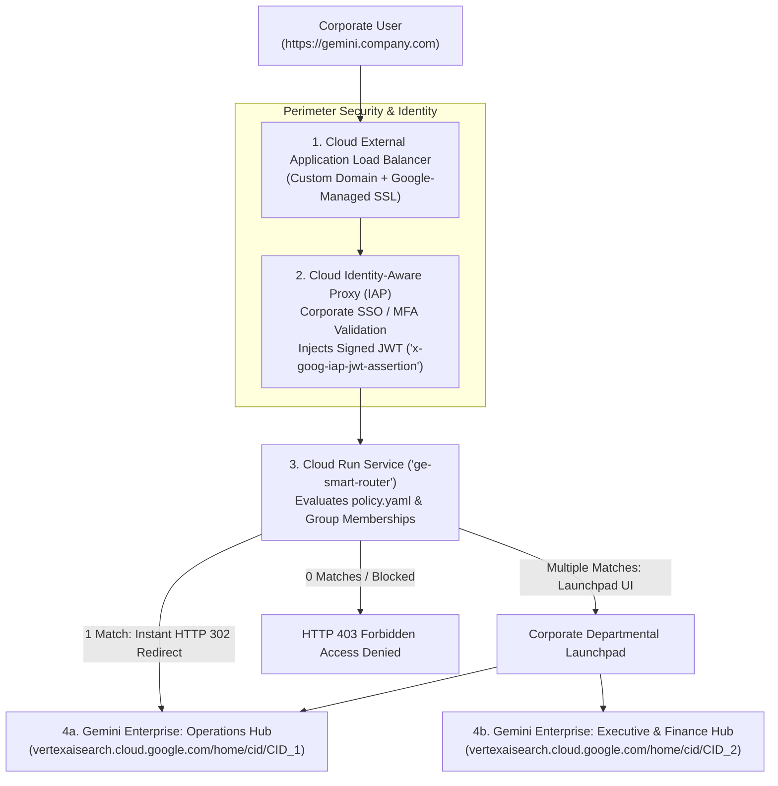

# Gemini Enterprise Smart Router: Production Deployment Guide

> **Conversation Bookmarks**:
> - **GE Smart Router Build & Security Hardening Chat**: `9e412701-9b5c-42ca-9846-8e90f651a218`
> - **GE Smart Router Customer GCP Architecture & `policy.yaml` Chat**: `24f5dbcf-a1c5-4d49-9e38-d1ae372792e3`

## Executive Summary
Enterprises deploying **Gemini Enterprise** (Vertex AI Search & Conversation) across multiple business units (e.g., HR, Finance, Engineering, Legal) create distinct instances to enforce strict data store isolation and compliance perimeters.

However, end-users need a single, intuitive corporate entry point (e.g., **`https://gemini.company.com`**) rather than complex bookmarks (`https://vertexaisearch.cloud.google.com/home/cid/...`).

The **Smart Router** serves as the **Enterprise Front Door**: it authenticates users against corporate SSO via Google Cloud Identity-Aware Proxy (IAP), evaluates their authorized workspaces using `policy.yaml`, and routes them seamlessly.

---

## 1. High-Level Production Architecture in Customer GCP

A customer production deployment consists of 4 standard Google Cloud components:



1. **Cloud External Application Load Balancer**: Terminates the custom domain (`gemini.company.com`) with a Google-managed SSL certificate.
2. **Cloud Identity-Aware Proxy (IAP)**: Enforces corporate SSO (Google Workspace, or Okta / Microsoft Entra ID federated with Cloud Identity). Passes a cryptographically signed JWT assertion to Cloud Run.
3. **Cloud Run Dispatcher (`ge-smart-router`)**: Serverless container that verifies the IAP JWT signature and evaluates `policy.yaml`.
4. **Gemini Enterprise Instances**: The target search/assistant engines.

---

## 2. Role & Management of `policy.yaml` in Production

`policy.yaml` is the declarative **Routing & Access Control Policy** mapping users, groups, and domains to specific Gemini Enterprise instances:

```yaml
default_action: deny

instances:
  - id: "instance-general-hub"
    name: "Gemini Enterprise - Operations & General Workspace"
    description: "Standard enterprise search and assistance workspace for all staff."
    target_url: "https://vertexaisearch.cloud.google.com/home/cid/CUSTOMER_CID_OPERATIONS?hl=en_US"
    allowed_domains:
      - "company.com"
    allowed_groups:
      - "all-staff@company.com"

  - id: "instance-restricted-hub"
    name: "Gemini Enterprise - Executive & Finance Workspace"
    description: "Restricted workspace for executive leadership and sensitive financial data."
    target_url: "https://vertexaisearch.cloud.google.com/home/cid/CUSTOMER_CID_FINANCE?hl=en_US"
    allowed_groups:
      - "exec-finance@company.com"
    allowed_users:
      - "cfo@company.com"
    blocked_users: [] # Deny always wins
```

### How Customers Manage `policy.yaml` in Production:
- **GitOps / CI/CD (Recommended)**: `policy.yaml` is stored in source control (GitHub, GitLab, Cloud Source Repositories). Policy updates go through Pull Request review and automatically redeploy via Cloud Build or Terraform.
- **Secret Manager / Cloud Storage Mount**: `policy.yaml` can be mounted as a volume from Google Cloud Secret Manager or read from a private Cloud Storage bucket (`POLICY_CONFIG_PATH`), allowing dynamic updates without rebuilding container images.

---

## 3. End-User Routing Experience

| User Profile | Authorization Match | Router Action | User Experience |
| :--- | :--- | :--- | :--- |
| **General Employee** | Authorized for **1 instance** | Immediate **HTTP 302 Redirect** | Lands directly in their Gemini Enterprise workspace with **zero extra clicks**. |
| **Executive / Cross-Functional** | Authorized for **2+ instances** | Renders **Departmental Launchpad** | Sees a branded portal showing only the workspaces they have permission to enter. |
| **Unauthorized / Blocked** | **0 matches** or on `blocked_users` | Returns **HTTP 403 Forbidden** | Blocked at the front door; security event is written to Cloud Logging. |

---

## 4. Production Nuance: Resolving Google Groups

In local demos, group headers can be simulated. In production GCP:
1. **IAP** cryptographically proves the user's email address (`email` claim in JWT).
2. **Domain** (`allowed_domains`) and **User** (`allowed_users` / `blocked_users`) rules evaluate immediately from the JWT.
3. **Group Membership** (`allowed_groups`): The Cloud Run service account is granted the **Cloud Identity Groups Reader** role (`roles/cloudidentity.groupsViewer` or Workspace Admin SDK Directory Reader). The router queries the Cloud Identity Groups API (`groups.memberships.checkTransitiveMembership`) to verify group membership server-side.

---

## 5. Security & Defense-in-Depth

- **Smart Router = Front Door & Discovery Layer**: Provides a unified corporate domain and prevents users from needing raw CID URLs.
- **Gemini Enterprise IAM = Hard Data Perimeter**: Gemini Enterprise and Vertex AI Search data stores enforce Google Cloud IAM and data ACLs directly. Even if an unauthorized user obtained a direct CID link, Gemini Enterprise blocks access at the data layer.

---

## 6. Infrastructure-as-Code Deployment

Customers can deploy the entire stack using the included Terraform configuration in [`terraform/`](./terraform):
1. Configure `project_id`, `domain_name`, and instance policies in `terraform.tfvars`.
2. Run `terraform init && terraform apply`.
