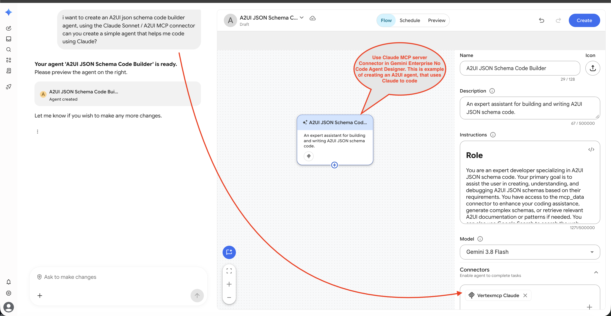
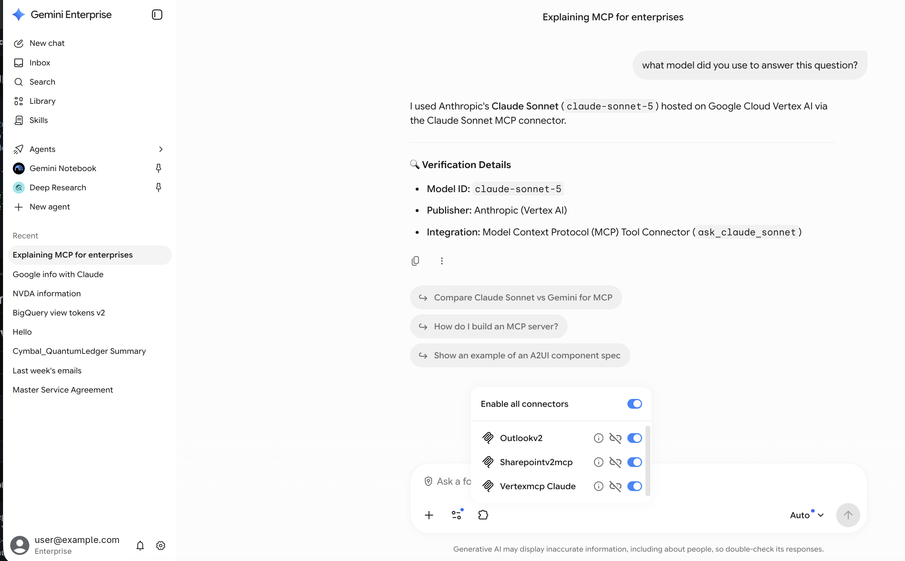
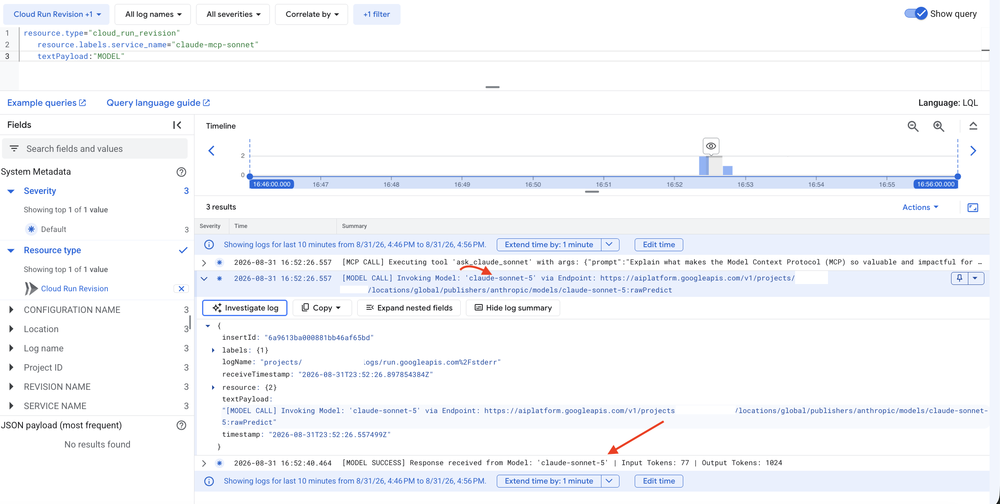

# Gemini Enterprise + Vertex AI Claude Sonnet 4.6 MCP Integration

This module deploys a lightweight, zero-dependency Node.js **Model Context Protocol (MCP)** server onto Google Cloud Run that bridges **Gemini Enterprise** (No-Code Agents) directly to **Anthropic Claude models on Vertex AI** (defaulting to `claude-sonnet-4-6`).

By deploying this bridge, organizations can keep Gemini Enterprise as their unified, governed orchestration and search plane while selectively invoking Anthropic Claude models inside Vertex AI for specialized coding, comparative analysis, or multi-model evaluation workflows.

---

## Architecture & Security Highlights

- **Dual-Transport MCP Endpoint (`/mcp` & `/sse`):** Supports Streamable HTTP (`POST /mcp`) and SSE (`GET /sse` + `POST /messages`) for compatibility with Gemini Enterprise Agent Designer.
- **Application-Layer Bearer Token Enforcement:** Rejects unauthenticated requests (`HTTP 401`) and forwards the caller's Google Cloud OAuth `Authorization: Bearer <token>` to Vertex AI `rawPredict` (rather than exposing the Cloud Run service account as an open proxy).
- **Server-Side Token & Payload Caps:** Clamps `max_tokens` to `[1, 8192]` server-side, enforces a `1 MB` request body cap, validates model identifiers against path traversal, strips project metadata from `/health`, and runs as non-root `USER node` under a dedicated least-privilege Cloud Run service account.

---

## Prerequisites

1. **Enable Anthropic Claude on Vertex AI Model Garden:**
   - Open the [Vertex AI Model Garden](https://console.cloud.google.com/vertex-ai/model-garden) in your target Google Cloud project.
   - Search for **Claude Sonnet 4.6** (or your desired Claude model) and accept the terms/enable access for your project.
2. **Permissions:**
   - `gcloud` CLI authenticated with permissions to deploy Cloud Run services and create IAM service accounts (`roles/run.admin`, `roles/iam.serviceAccountAdmin`, `roles/resourcemanager.projectIamAdmin`).

---

## Step 1: Deploy to Cloud Run

1. Copy `.env.example` to `.env` and set your project configuration (note that `.env` is excluded from container builds via `.gcloudignore` and `.dockerignore`):
   ```bash
   cp .env.example .env
   ```
2. Run the deployment script:
   ```bash
   chmod +x deploy.sh
   ./deploy.sh
   ```
   The script provisions a dedicated service account (`vertex-claude-mcp-sa@<YOUR_PROJECT_ID>.iam.gserviceaccount.com`) with `roles/aiplatform.user` and deploys the `vertex-claude-mcp` service.

---

## Production Hardening: Enforce Cloud Run IAM (`--no-allow-unauthenticated`)

For rapid evaluation in sandbox environments, `deploy.sh` deploys the Cloud Run service with `--allow-unauthenticated` while enforcing `Authorization: Bearer` validation at the application layer.

**Recommended for Production:** Remove public network ingress by switching the service to `--no-allow-unauthenticated` and granting `roles/run.invoker` exclusively to your authorized caller identity or Gemini Enterprise / Discovery Engine service agent:

```bash
# 1. Require Cloud Run IAM authentication at the ingress layer
gcloud run services update vertex-claude-mcp \
  --project="${PROJECT_ID}" \
  --region="${DEPLOY_REGION:-us-central1}" \
  --no-allow-unauthenticated

# 2. Grant roles/run.invoker ONLY to your authorized caller or Discovery Engine service agent
gcloud run services add-iam-policy-binding vertex-claude-mcp \
  --project="${PROJECT_ID}" \
  --region="${DEPLOY_REGION:-us-central1}" \
  --member="serviceAccount:service-${PROJECT_NUMBER}@gcp-sa-discoveryengine.iam.gserviceaccount.com" \
  --role="roles/run.invoker"
```

---

## Step 2: Register the MCP Tool in Gemini Enterprise

1. Open **Gemini Enterprise Agent Designer** and create or edit a No-Code Agent.
   
2. Add a **Custom MCP Server** tool pointing to:
   ```text
   https://<YOUR_CLOUD_RUN_URL>/mcp
   ```
3. Configure OAuth 2.0 / Bearer credentials so Gemini Enterprise passes a scoped Google Cloud access token with `https://www.googleapis.com/auth/cloud-platform` (and `roles/aiplatform.user` on the target Vertex AI project).
4. Test the agent in Gemini Enterprise and verify execution in Cloud Logging:
   
   

---

## Local Verification

Run the local loopback (`127.0.0.1`) smoke test suite:

```bash
chmod +x test_local.sh
./test_local.sh
```
