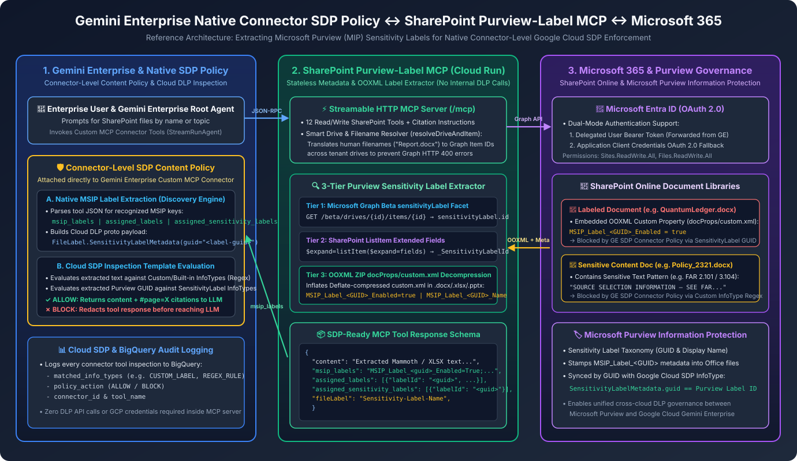
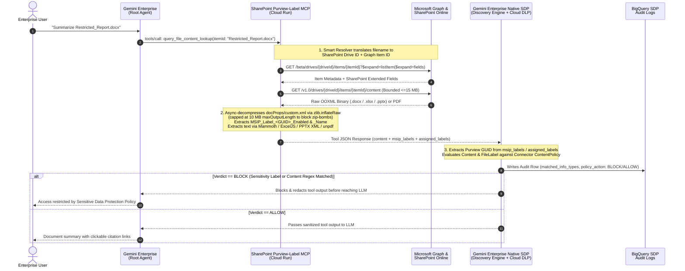

# SharePoint MCP Server with Microsoft Purview Sensitivity Label Extraction for Gemini Enterprise Native SDP

> **Disclaimer**: This repository and its contents are provided for illustration and educational purposes only as example code. This is **NOT** an official Google product or officially supported Google software. Provided under the Apache License 2.0.



## 1. Overview

This Model Context Protocol (MCP) server bridges **Microsoft SharePoint Online / OneDrive** with **Google Cloud Gemini Enterprise**, enabling **Gemini Enterprise's native connector-level Sensitive Data Protection (SDP) Content Policy** to inspect and enforce `ALLOW` / `BLOCK` verdicts on both:
1. **Document Text Content (Built-in & Custom Regex InfoTypes)** — e.g., blocking documents containing restricted procurement clauses (`SOURCE SELECTION INFORMATION — SEE FAR 2.101 AND 3.104`) or PII/credentials across `.docx`, `.xlsx`, `.pptx`, `.pdf`, and text formats.
2. **Microsoft Purview (MIP) Sensitivity Label GUIDs (`FileLabel.SensitivityLabelMetadata`)** — e.g., blocking documents tagged in Microsoft 365 with a restricted Purview sensitivity label GUID (`11111111-2222-3333-4444-555555555555`).

Unlike architectures where the MCP server calls Google Cloud DLP APIs internally, **this MCP server makes zero calls to Google Cloud SDP/DLP**. Instead, it extracts Microsoft Purview sensitivity label metadata from SharePoint and Office binary containers (`.docx`, `.xlsx`, `.pptx`) using bounded asynchronous decompression and returns it in the exact JSON schema that **Discovery Engine** natively parses for connector-level SDP enforcement.

---

## 2. End-to-End Architecture & Sequence Flow



---

## 3. Requirements for Native Connector-Level SDP Enforcement

When you attach a **Content Policy (`projects/<PROJECT_ID>/locations/<LOCATION>/contentPolicies/<POLICY_ID>`)** to a Custom MCP Connector in Gemini Enterprise, Discovery Engine intercepts every MCP tool response before passing it to the LLM.

### Requirement 1: Expose Recognized MSIP Label Keys in the Tool Response JSON
Your MCP tool response must include at least one (or all) of the following recognized keys whenever a file has a sensitivity label:

| Recognized JSON Key | Expected Format | Example Value |
| :--- | :--- | :--- |
| **`msip_labels`** *(Recommended)* | MAPI semicolon-delimited string containing `MSIP_Label_<GUID>_Enabled=True` (and optional `_Name`) | `"MSIP_Label_11111111-2222-3333-4444-555555555555_Enabled=True;MSIP_Label_11111111-2222-3333-4444-555555555555_Name=Highly-Confidential"` |
| **`assigned_labels`** | Array of objects containing **`labelId`** and `displayName` | `[{"labelId": "11111111-2222-3333-4444-555555555555", "displayName": "Highly-Confidential"}]` |
| **`assigned_sensitivity_labels`** | Array of objects containing **`labelId`** and `displayName` | `[{"labelId": "11111111-2222-3333-4444-555555555555", "displayName": "Highly-Confidential"}]` |

#### Example SDP-Compatible MCP Tool Output (`query_file_content_lookup`)
```json
{
  "content": "Extracted document text...",
  "name": "Restricted_Report.docx",
  "webUrl": "https://<YOUR_TENANT>.sharepoint.com/sites/Finance/Shared%20Documents/Restricted_Report.docx?web=1",
  "msip_labels": "MSIP_Label_11111111-2222-3333-4444-555555555555_Enabled=True;MSIP_Label_11111111-2222-3333-4444-555555555555_Name=Highly-Confidential",
  "assigned_labels": [
    {
      "labelId": "11111111-2222-3333-4444-555555555555",
      "displayName": "Highly-Confidential"
    }
  ],
  "assigned_sensitivity_labels": [
    {
      "labelId": "11111111-2222-3333-4444-555555555555",
      "displayName": "Highly-Confidential"
    }
  ],
  "fileLabel": "Highly-Confidential",
  "purviewSensitivityGuid": "11111111-2222-3333-4444-555555555555"
}
```

### Requirement 2: Bounded Async Decompression of OOXML `docProps/custom.xml`
Because `.docx`, `.xlsx`, and `.pptx` files are DEFLATE-compressed ZIP archives (`compressionMethod = 8`), scanning raw binary bytes misses embedded `MSIP_Label_<GUID>` properties. `sharepoint_common.js` locates `docProps/custom.xml` in the ZIP Central Directory and inflates it asynchronously via `zlib.inflateRaw` with `maxOutputLength: 10 * 1024 * 1024` (10 MB) and 5-way bounded concurrency to prevent zip-bomb event-loop stalls.

### Requirement 3: Scope `msip_labels` to File-Level Tools (Not Folder Listing Tools)
- **Folder listing tools** (`query_library_items_lookup`) emit human-readable `fileLabel` and `purviewSensitivityGuid` *without* `msip_labels` so a single restricted file does not block listing unrestricted files in the same folder.
- **File-level tools** (`query_file_content_lookup`, `query_file_metadata_lookup`, `query_file_download_url_lookup`) emit `msip_labels`, `assigned_labels`, and `assigned_sensitivity_labels`.

---

## 4. Setup, Deployment & Production Hardening

### Step 1: Configure Environment & Secret Manager
```bash
cp .env.example .env
printf '%s' "<YOUR_ENTRA_CLIENT_SECRET>" | gcloud secrets create ms-graph-client-secret \
  --data-file=- \
  --project="<YOUR_PROJECT_ID>"
```

### Step 2: Test Locally
```bash
npm install
chmod +x test_local.sh test_get_docs.sh
./test_local.sh
```

### Step 3: Deploy to Cloud Run
```bash
chmod +x deploy.sh
./deploy.sh
```

### Recommended Production Hardening: Switch to `--no-allow-unauthenticated` + `roles/run.invoker`

By default, `deploy.sh` retains `--allow-unauthenticated` for evaluation while enforcing OAuth Bearer validation at the application layer. For production deployments, disable unauthenticated Cloud Run ingress and grant `roles/run.invoker` strictly to your authorized caller:

```bash
# 1. Disable public unauthenticated Cloud Run ingress
gcloud run services update sharepoint-mcp-server-purview-label \
  --project="${GCP_PROJECT}" \
  --region="${GCP_REGION:-us-central1}" \
  --no-allow-unauthenticated

# 2. Grant Cloud Run Invoker strictly to your authorized caller / Discovery Engine service agent
gcloud run services add-iam-policy-binding sharepoint-mcp-server-purview-label \
  --project="${GCP_PROJECT}" \
  --region="${GCP_REGION:-us-central1}" \
  --member="serviceAccount:service-${PROJECT_NUMBER}@gcp-sa-discoveryengine.iam.gserviceaccount.com" \
  --role="roles/run.invoker"
```
