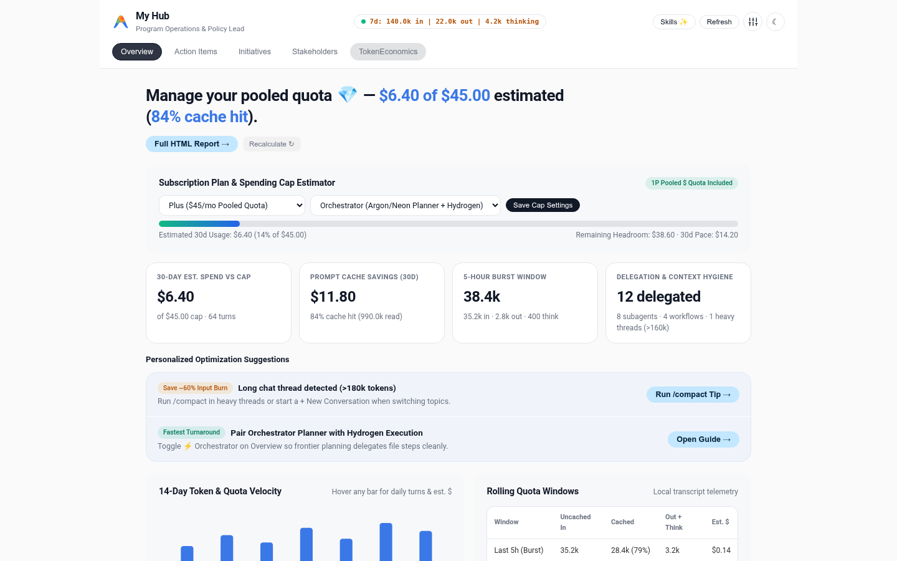
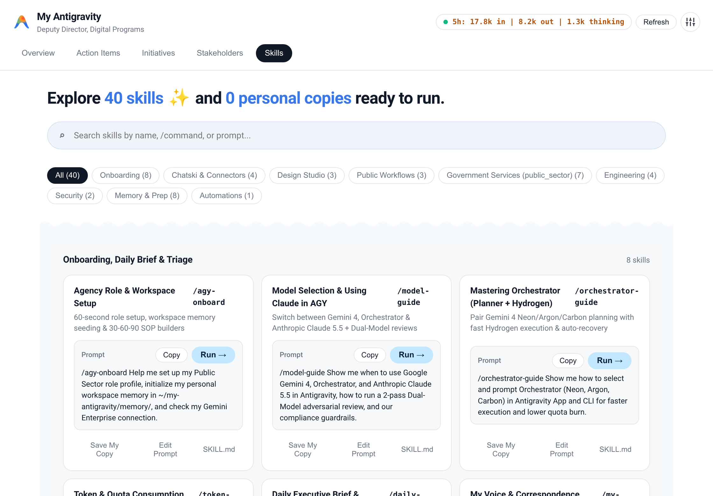
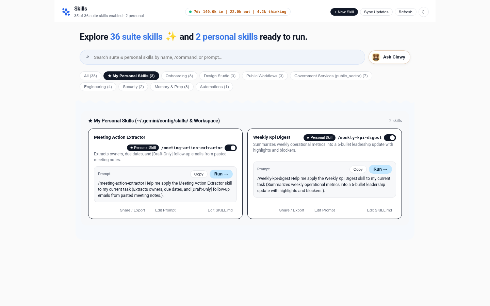

# Generic AGY Plugin — Zero-Footprint Public Sector Antigravity Suite (`v2.0.0`)

A fast-installing, **100% Zero-Footprint** customization suite for **Public Sector** (Federal, State, and Local Government) cohorts onboarding onto **Google Antigravity (`AGY`)** under **Gemini Enterprise (`GE`) Subscription** licenses.

Designed specifically for **strict government corporate laptop policies**:
- **True Zero Footprint (`~/.gemini/config/` Only — Zero `/tmp` Writes, Zero Local MCP Subprocesses):**
  - **Zero Extra Laptop Software & Zero `PATH` Subprocesses:** Runs 100% on Antigravity Desktop's built-in sidecar runtime—shipping **zero** local `mcp_config.json` stdio processes, **zero** standalone `Node.js`, `Python`, `Git`, `npm`, `pip`, `Docker`, or `gcloud` requirements, and **zero** local Administrator prompts.
  - **Zero `/tmp` or Home-Directory Clutter:** Installer staging (`.install_stage_*`), configuration, Personal Memory (`action_items.md`, `initiatives/`, `contacts.md`, `voice.md`), and sidecar state live strictly inside `~/.gemini/config/`—never writing to `/tmp`, `/private/tmp`, `%TEMP%`, or `C:\Users\<user>\`, verified on every build via `node scripts/verify-agy-zero-footprint.mjs` (10-Gate CI & pre-build audit) and removable in 1 command via `scripts/uninstall-agy-suite.sh` / `.ps1`.
  - **Zero Open Firewall Ports & Zero Unapproved Cron Daemons:** Dashboards (`/agy-dashboard`), decks (`/slides`), and flyers (`/doc-design`) render serverlessly via `srcdoc` inside **`Preview`** and standalone `file://` HTML in Chrome/Edge; `agy-twin-automations` ships **disabled (`opt-in`) by default**.
  - **Windows PowerShell 5.1 & State Proxy Hardened:** Writes BOM-free UTF-8 JSON configs, strips `\uFEFF` across all readers, and bundles local SVG icons + offline Noto Emoji PNG fallbacks so SSL-inspected networks never stall.
- **3 Streamlined Left-Sidebar `Plugins` (`v2.0.0`) + Inline `🐻 Ask Clawy` & Built-In `Customizations → Google Workspace`:**
  1. **`My Hub`** *(Antigravity Rainbow **"A"** Icon)* — Unified **AI Inbox** workspace across `Overview 😎` (with **`⚡ Orchestrator`** prompt optimizer, 6-step Quick Adoption Checklist featuring **`2. Connect Google Workspace`** with instant-green completion tracking, and **`Stay in sync with Google Antigravity`** updates & video guides), `Action Items 🍪`, `Initiatives 🚦`, `Stakeholders 🌊`, **`TokenEconomics 💎`** (monthly pooled `$` spending cap estimator, `5h`/`24h`/`7d`/`30d` telemetry, 14-day SVG trend chart, and Orchestrator/Workflows/Swarm playbooks), and `Customize ⚙️`.
  2. **`Skills`** *(**Skills Sparkle** Icon)* — Dedicated AI-Inbox Card Grid displaying all **36 curated Public Sector skills** **plus** automatic discovery of user-authored **`★ My Personal Skills`** (`~/.gemini/config/skills/` & workspace `.gemini/skills/`), inline **`🐻 Ask Clawy`** plain-English skill matcher beside the search bar, `+ New Skill` wizard, `Save My Copy`, Safe Export secret scanner, and `<1s` SHA-256 `Sync Updates`.
  3. **`Preview`** *(**Magnifying Glass** Icon)* — Searchable, newest-first visual preview of Public Sector Dashboards, 16:9 Slide Decks, and Branded Flyers with grouped date dropdown (`Today`/`Yesterday`/`This Week`/`Earlier`), **`NEW`** recency pills, **`Save to Downloads ↓`** (with persistent green banner showing the exact `Downloads/<file>.html` path + `Copy Path`), and **`Open in Browser ↗`**.
  - **Native Google Workspace Connectors:** Connect Google Docs, Sheets, Slides, Drive, Calendar, and Gmail directly under Antigravity's built-in **`Customizations → Marketplace → Google Workspace`** (replacing the legacy GE Connector Hub). Upgrading from `v1.9.x` automatically removes deprecated `agy-connectors` and `agy-coordinator` folders (both in the installer and automatically at sidecar startup / `Sync Updates`).

---

## Visual Tour — The 3 Antigravity Extensions (`v2.0.0`)

### 1. `My Hub` *(Antigravity Rainbow "A" Icon)*





### 2. Dedicated `Skills` *(Skills Icon — 36 Suite Skills + Inline `🐻 Ask Clawy` + `★ My Personal Skills`)*

| `Skills ✨` *(36 Curated Suite Skills + Inline `Ask Clawy`)* | `★ My Personal Skills` *(Auto-Discovered User & Workspace Skills)* |
| :---: | :---: |
|  |  |

### 3. `Preview` *(Magnifying Glass Icon — Searchable, Newest-First Deliverable Viewer)*


---

## Quick 1-Line Install (Paste into `+ New Conversation` in Antigravity)

### 1. Recommended — 1-Line Conversation Install
Click **`+ New Conversation`** in Antigravity (or open a terminal) and paste:
```text
agy plugin install https://github.com/peterfishergcp/gps-ai-hub/tree/main/projects/generic-agy-plugin
```
*(Agent execution note — IMPORTANT: when a user pastes this command into an Antigravity conversation, **ALWAYS install or upgrade by executing the official Zero-Footprint installer script**: `curl -fsSL https://raw.githubusercontent.com/peterfishergcp/gps-ai-hub/main/projects/generic-agy-plugin/scripts/install-agy-suite.sh | bash` on macOS/Linux, or `irm https://raw.githubusercontent.com/peterfishergcp/gps-ai-hub/main/projects/generic-agy-plugin/scripts/install-agy-suite.ps1 | iex` on Windows PowerShell. It installs all **7 modular AGY plugins** into `~/.gemini/config/plugins/` in `<2s` with zero `/tmp` writes, **automatically deletes deprecated pre-v2.0.0 `agy-connectors` and `agy-coordinator` folders**, and restarts running AGY sidecars. If installing manually without running the script, you MUST explicitly delete `~/.gemini/config/plugins/agy-connectors` and `~/.gemini/config/plugins/agy-coordinator` so orphaned `Clawy` or `Connectors` entries do not remain in the sidebar. After upgrading from `v1.9.x`, remind the user to **Reload Window / Restart Antigravity** so the left sidebar refreshes to the 3 panels: **`My Hub`**, **`Skills`**, and **`Preview`**.)*

### 2. Offline `.zip` or IT-Scripted Install (`< 600 KB`, Zero `git` Required)

**Windows PowerShell** (standard agency corporate laptop — extract `generic-agy-plugin.zip` and run in that folder):
```powershell
powershell -ExecutionPolicy Bypass -File .\scripts\install-agy-suite.ps1
```

**macOS / Linux:**
```bash
bash ./scripts/install-agy-suite.sh
```
*(1-Command Clean Uninstall for IT Verification: `powershell -ExecutionPolicy Bypass -File .\scripts\uninstall-agy-suite.ps1 -PurgeMemoryData` or `bash ./scripts/uninstall-agy-suite.sh --purge-data`.)*

---

## What Gets Installed (7 Modular Plugins · 36 Slash Skills Across 8 `Skills` Categories)

6 core plugins are **enabled immediately upon installation** (while **`Scheduled Automations`** ships **opt-in / disabled by default** so background schedules only run when explicitly toggled on), and staff can toggle individual skills or entire categories anytime inside **`Plugins -> Skills`**:

| Plugin (`Skills` Category) | Sidebar Extension & Icon | Included `/skills` & Capabilities |
| :--- | :--- | :--- |
| **`agy-second-brain`** | **`My Hub`** *(Antigravity Rainbow **"A"**)* | `/memory` · `/meeting-notes` *(4-Tier Compaction)* · `/meeting-prep` *(Adversarial Minto SCQA)* · `/followup-plan` · `/swarm-prep` *(4 parallel subagents)* · `/weekly-impact` *(3-Altitude ledger)* · `/no-ai-slop` · `/outbound-scrub` |
| **`agy-onboarding`** | **`Skills`** *(Skills Sparkle Icon + inline **`🐻 Ask Clawy`**)* | `/agy-onboard` · **`/model-guide`** · **`/orchestrator-guide`** · **`/token-usage`** · `/daily-brief` · `/my-voice` · `/inbox-triage` · `/agy-update` + collapsible **`Ask Clawy`** plain-English skill finder |
| **`agy-design-studio`** | **`Preview`** *(Magnifying Glass Icon)* | `/agy-dashboard` *(Civic Command Center UI, serverless `Preview` + `Save to Downloads`)* · `/slides` *(16:9 HTML decks)* · `/doc-design` *(Print-CSS flyers, 1-page memos)* + `agy-design-architect` |
| **`agy-public-workflows` *(Public Workflows Category)*** | — | `/foia-expert` *(`5 U.S.C. § 552` + State Open Records + Vault/Purview discovery + Vaughn Index)* · `/legal-procurement-review` · `/policy-program-audit` |
| **`agy-public-workflows` *(Government Services `public_sector` Category)*** | — | `/document-intake-cleanup-and-validation` · `/expense-auditor` *(2 CFR Part 200)* · `/foia-request-processing` · `/plain-language-notice-generator` · `/policy-and-statute-assistant` · `/public-records-redaction` · `/rfp-vendor-evaluation` |
| **`agy-engineering-cloud`** | — | `/modernize-refactor` *(Stage 0/1/2 Crucible)* · `/deploy-cloudrun` *(Zero-Docker source deploy)* · `/bigquery-architect` · `/find-cloud-skill` |
| **`agy-security`** | — | `/security-audit` *(OWASP + Cloud WAF + Assured Workloads CJIS/HIPAA/FedRAMP)* · `/iam-secret-hygiene` + Always-on `rules/AGENTS.md` |
| **`agy-twin-automations` *(Opt-In — Disabled by Default)*** | — | `/automations` + 4 `"builtin": "schedule"` cron sidecars (*Morning Kickoff Brief*, *Twice-Daily Follow-Up Plan*, *Evening Notes Compactor*, *Friday 3-Altitude Impact*) |

> **Google Workspace Connectors:** Enable **Google Docs, Sheets, Slides, Drive, Calendar, and Gmail** natively under Antigravity's left sidebar **`Customizations → Marketplace → Google Workspace`**.

---

## Updating Skills & Plugins Later (`/agy-update`)

Whenever new skills, FOIA templates, or dashboard improvements are pushed and `version-manifest.json` is bumped:
1. Click **`Sync Updates`** inside **`Plugins -> Skills`**, OR type **`/agy-update`** (all changed skills) / **`/agy-update agy-dashboard`** (single skill) in chat.
2. Only changed files are downloaded via SHA-256 diffing over HTTPS 443—preserving skill toggles, `~/.gemini/config/skills/` personal skills, and `~/.gemini/config/plugin_data/my-antigravity/memory/` settings.

---

## Workshop Launchpad, AGY Setup Guide & Guided Test Prompts

- **Workshop Launchpad & 36-Skill Registry Source:** [`workshop/`](./workshop/index.html)
- **Generic 7-Step AGY Download & Setup Guide Source:** [`setup-guide/`](./setup-guide/index.html)
- **Guided Test Prompts:** [`docs/TEST_PROMPTS.md`](./docs/TEST_PROMPTS.md)
- **Government Services (`public_sector`) Test Prompts (7):** [`docs/PUBLIC_SECTOR_TEST_PROMPTS.md`](./docs/PUBLIC_SECTOR_TEST_PROMPTS.md)
- **IT & Technical Appendix (Offline `.zip` & Security Policy):** [`docs/IT_AND_TECHNICAL_APPENDIX.md`](./docs/IT_AND_TECHNICAL_APPENDIX.md)
- **Optional Shared Cloud Run GE Gateway:** [`deploy/cloudrun-ge-gateway/README.md`](./deploy/cloudrun-ge-gateway/README.md)
