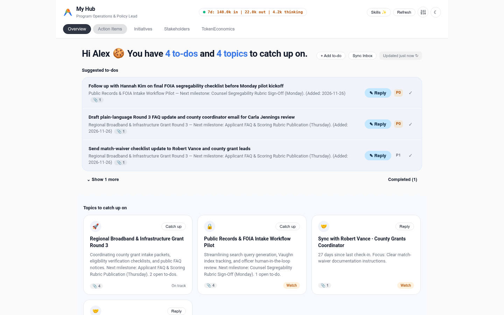
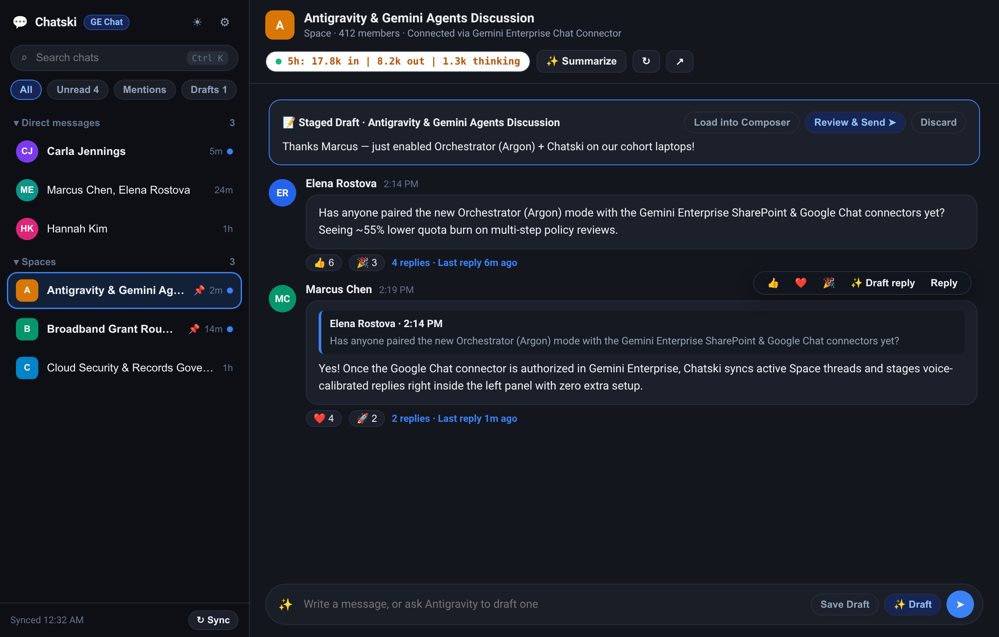

# Generic AGY Plugin — Public Sector Antigravity Skill & Federated Connector Suite

A fast-installing, Git-updatable customization suite for **Public Sector** (Federal, State, and Local Government) cohorts onboarding onto **Google Antigravity (`AGY`)** under **Gemini Enterprise (`GE`) Subscription** licenses.

Designed specifically for **strict government corporate laptop policies**:
- **Zero Extra Laptop Software Required:** Every skill, dashboard, slide deck, flyer, and MCP bridge runs with **zero separate `Node.js`, `Python`, `npm`, `pip`, or `Docker` installs** on employee laptops.
  - Our bundled **Gemini Enterprise (`GE`) Bridge MCP** (`agy-ge-bridge`) runs automatically on Antigravity Desktop's **built-in `agy-node` runtime** even when Node.js is not installed on the laptop.
  - Dashboards (`/agy-dashboard`), decks (`/slides`), and flyers (`/doc-design`) render natively in Antigravity's **Side Pane** (`Extensions -> Preview`) with automatic conversation artifact discovery and open standalone in **Chrome or Edge (`file://` Zero-Node Browser Mode)** with visual drag-and-drop saving via `window.showSaveFilePicker()`, and automatically unlock local `127.0.0.1:4173` live query previews whenever `node` is present on developer workstations.
- **Built for Public Sector Identity & Connector Architectures:**
  - **Azure / Entra ID -> Google Cloud Identity Sync:** Works seamlessly with synced Google Cloud Identity accounts and replicated Entra security groups.
  - **Federated Gemini Enterprise (`GE`) Instance as Default:** Instead of configuring 6 separate per-app connectors on every laptop, users provide their **GE Instance** once (`/connect-ge` or `-GeInstance` during install) to unlock **Outlook, SharePoint, OneDrive, Microsoft Teams, Gmail, Google Drive, and GitHub** through `AssistantService.StreamAssist` and `SearchService.Search` with per-user ACLs intact.
- **Sub-2-Second Onboarding & Incremental `< 1s` Git Updates (`/agy-update`):**
  - Ships as a `< 500 KB` pre-built bundle (`dist/generic-agy-plugin.zip`) and modular `plugins/` tree with SHA-256 incremental diffing so cohorts install or update all 8 plugins and 40 skills in seconds—with or without `git` installed.
- **100% Zero-Footprint Architecture (`~/.gemini/config/` Only — `v1.7.3`):**
  - All Personal Memory (`action_items.md`, `initiatives/`, `contacts.md`, `voice.md`), toggles, and sidecar state live strictly inside `~/.gemini/config/plugin_data/my-antigravity/memory/`—leaving zero extra folders in `$HOME`.
- **4 Left-Sidebar `Extensions` with Distinct Custom Icons, Dedicated `Skills` (`★ My Personal Skills`), `TokenEconomics`, & Antigravity Updates Hub (`v1.7.3`):**
  1. **`My Antigravity`** *(Antigravity Rainbow **"A"** Icon)* — Unified **AI Inbox** across `Overview 😎` (with **`⚡ Orchestrator`** prompt optimizer, 5-step Quick Adoption Checklist, **`Stay in sync with Google Antigravity`** blog/video updates & subscribe hub), `Action Items 🍪`, `Initiatives 🚦`, `Stakeholders 🌊`, **`TokenEconomics 💎`** (monthly pooled `$` spending cap estimator, `5h`/`24h`/`7d`/`30d` telemetry, 14-day SVG trend chart, and Orchestrator/Workflows/Swarm playbooks), and `Customize ⚙️`.
  2. **`Skills`** *(**Skills Sparkle** Icon)* — Dedicated AI-Inbox Card Grid skill & connector hub displaying all 40 curated suite skills **plus** automatic discovery of all user-authored **`★ My Personal Skills`** (`~/.gemini/config/skills/` & workspace `.gemini/skills/`), `+ New Skill` wizard, `Save My Copy`, per-skill toggles, Safe Export secret scanner, and `<1s` `Sync Updates`.
  3. **`Preview`** *(**Magnifying Glass** Icon)* — Serverless visual preview of Dashboards, 16:9 Slide Decks, and Branded Flyers with Print-to-PDF and 1-click HTML download.
  4. **`Chatski`** *(**Chat Bubble** Icon)* — Browsing & staging `[Draft-Only]` replies across Google Chat Spaces & DMs right through your existing Gemini Enterprise Chat Connector with zero extra setup, plus a live hoverable **`in | out | thinking` Token Consumption Pill** (with `/compact` context-bloat alert) across all 4 panels.

---

## Visual Tour — `My Antigravity`, Dedicated `Skills`, `TokenEconomics` & `Chatski` (`v1.7.3`)

### 1. `Overview` — Instant Search, `⚡ Orchestrator` Optimizer & Antigravity Updates + Video Walkthroughs (`😎`)
Search across Action Items, Initiatives, Stakeholders, and all 40 skills, toggle **`⚡ Orchestrator`** prompt optimization, watch 3–4 minute two-host video walkthroughs, and subscribe to official Google Antigravity updates:


### 2. Dedicated `Skills` Sidebar Hub — 40 Curated Skills + `★ My Personal Skills` (`✨`)
Browse all 40 suite skills and every personal skill in `~/.gemini/config/skills/` or `.gemini/skills/`—run in 1 click, toggle skills on/off, create new skills, or run Safe Export:

| `Skills ✨` *(40 Curated Suite Skills)* | `★ My Personal Skills` *(Auto-Discovered User & Workspace Skills)* |
| :---: | :---: |
|  |  |

### 3. `TokenEconomics` — Monthly Spending Cap Tracker & Orchestrator / Workflows Playbook (`💎`)
See where you stand against your monthly pooled `$` quota (`Standard $30`, `Plus $45`, `Enterprise $60`, or Custom Cap), inspect 14-day token velocity, and apply personalized Orchestrator + Hydrogen + Workflows recommendations:


### 4. `Action Items` (`🍪`), `Chatski` (`💬`), `Initiatives` (`🚦`) & `Stakeholders` (`🌊`)





| `Initiatives 🚦` *(RAG Status & Milestones)* | `Stakeholders 🌊` *(>21d Check-In Radar)* |
| :---: | :---: |
|  |  |

---

## 3 Frictionless Ways to Install (Pick One)

### 1. Direct Zero-`/tmp` 1-Command Install (Recommended — Zero `/tmp/lsrpc.sh` Prompts)
Run directly in Terminal / PowerShell (`<2 seconds`, stages strictly inside `~/.gemini/config/`):
- **macOS / Linux:**
  ```bash
  curl -fsSL https://raw.githubusercontent.com/peterfishergcp/gps-ai-hub/main/projects/generic-agy-plugin/scripts/install-agy-suite.sh | bash
  ```
- **Windows PowerShell 5.1:**
  ```powershell
  irm https://raw.githubusercontent.com/peterfishergcp/gps-ai-hub/main/projects/generic-agy-plugin/scripts/install-agy-suite.ps1 | iex
  ```
- **Or paste directly into a `+ New Conversation` in Antigravity Chat:**
  ```text
  Run the direct HTTPS setup script for my OS in ~/.gemini/config (do not load the plugin skill and do not write to /tmp) — macOS/Linux: curl -fsSL https://raw.githubusercontent.com/peterfishergcp/gps-ai-hub/main/projects/generic-agy-plugin/scripts/install-agy-suite.sh | bash  |  Windows PowerShell: irm https://raw.githubusercontent.com/peterfishergcp/gps-ai-hub/main/projects/generic-agy-plugin/scripts/install-agy-suite.ps1 | iex
  ```

### 2. Fastest Corporate Laptop Install (`< 2 Seconds`, Zero `git` Required)

**Windows PowerShell** (standard agency corporate laptop — extract `generic-agy-plugin.zip` and run in that folder):
```powershell
powershell -ExecutionPolicy Bypass -File .\scripts\install-agy-suite.ps1 `
  -GeInstance "projects/YOUR_PROJECT_ID/locations/global/collections/default_collection/engines/YOUR_GE_ENGINE_ID"
```
*(For laptops without `gcloud`, Agency IT can also pass `-OAuthClientId` and `-OAuthClientSecret` for 1-click Google Identity browser SSO, or deploy `deploy/cloudrun-ge-gateway/`. Omit `-GeInstance` if users will enter their GE Resource Path or Cloud Console URL interactively via `/connect-ge`.)*

**macOS / Linux:**
```bash
bash ./scripts/install-agy-suite.sh \
  --ge-instance "projects/YOUR_PROJECT_ID/locations/global/collections/default_collection/engines/YOUR_GE_ENGINE_ID"
```

### 3. Fast Git Sparse-Checkout (Developers & Agency IT Admins — Clones Only This Folder)
```bash
git clone --depth 1 --filter=blob:none --sparse https://github.com/peterfishergcp/gps-ai-hub.git generic-agy
cd generic-agy && git sparse-checkout set projects/generic-agy-plugin
bash projects/generic-agy-plugin/scripts/install-agy-suite.sh
```

---

## What Gets Installed (8 Modular Plugins · 40 Slash Skills Across 9 `Skills` Categories)

7 core plugins are **enabled immediately upon installation** (while **`Scheduled Automations`** ships **opt-in / disabled by default** so background schedules only run when explicitly toggled on), and staff can toggle individual skills or entire categories anytime inside **`Extensions -> Skills`**:

| Plugin (`Skills` Category) | Included `/skills` & Capabilities | Target Personas |
| :--- | :--- | :--- |
| **`agy-onboarding`** | `/agy-onboard` *(+ 1-step Personal Memory setup)* · **`/model-guide` *(Using Claude & Gemini in AGY)*** · **`/orchestrator-guide`** · **`/token-usage`** · `/daily-brief` *(GE + Action Items/milestones)* · `/my-voice` *(calibrated to `voice.md`)* · `/inbox-triage` · `/agy-update` *(+ In-App `Skills` Panel)* | All Public Sector Staff, Admins & Leadership |
| **`agy-connectors`** | **`/chatski` *(+ `Chatski` Left-Panel Google Chat UI via GE Chat Connector)*** · `/connect-ge` *(Default)* · `/connect-m365-workspace` · `/connect-github-bigquery` + **`agy-ge-bridge` MCP** *(Federated Google Chat, Outlook, SharePoint, OneDrive, Teams, Gmail, Drive & GitHub via GE)* | All Staff + IT Onboarding |
| **`agy-design-studio`** | `/agy-dashboard` *(Civic Command Center UI, 100% serverless Side-Pane preview + 1-click HTML download)* · `/slides` *(16:9 HTML/PDF decks)* · `/doc-design` *(Print-CSS flyers, 1-page memos)* + `agy-design-architect` agent + `Preview` sidecar | Analysts, Comms & Program Leads |
| **`agy-public-workflows` *(Public Workflows Category)*** | `/foia-expert` *(`5 U.S.C. § 552` + State Open Records + Vault/Purview/GE discovery + Vaughn Index)* · `/legal-procurement-review` · `/policy-program-audit` | FOIA Officers, Legal, Procurement & Policy |
| **`agy-public-workflows` *(Government Services `public_sector` Category)*** | `/document-intake-cleanup-and-validation` · `/expense-auditor` *(2 CFR Part 200)* · `/foia-request-processing` · `/plain-language-notice-generator` · `/policy-and-statute-assistant` · `/public-records-redaction` · `/rfp-vendor-evaluation` | Caseworkers, Grant Auditors, FOIA, Comms & Procurement |
| **`agy-engineering-cloud`** | `/modernize-refactor` *(Stage 0/1/2 Crucible adapted from [migrate-to-rust](https://github.com/google/skills/tree/main/skills/developers/migrate-to-rust))* · `/deploy-cloudrun` *(Zero-Docker source deploy)* · `/bigquery-architect` · `/find-cloud-skill` | Application, Data & Cloud Engineers |
| **`agy-security`** | `/security-audit` *(OWASP + Cloud WAF + Assured Workloads CJIS/HIPAA/FedRAMP)* · `/iam-secret-hygiene` + Always-on `rules/AGENTS.md` | Engineers, Security & All Builders |
| **`agy-second-brain`** | `/memory` · `/meeting-notes` *(4-Tier Compaction)* · `/meeting-prep` *(Adversarial Minto SCQA)* · `/followup-plan` · `/swarm-prep` *(4 parallel subagents)* · `/weekly-impact` *(3-Altitude ledger)* · `/no-ai-slop` · `/outbound-scrub` + **`My Antigravity` Sidecar UI** *(AI Inbox `Action Items` + `Customize` icon)* | Program Managers, Analysts, Comms, Engineers & Leaders |
| **`Scheduled Automations` *(Opt-In — Disabled by Default)*** | `/automations` + 4 `"builtin": "schedule"` cron sidecars (*Morning Kickoff Brief*, *Twice-Daily Follow-Up Plan*, *Evening Notes Compactor*, *Friday 3-Altitude Impact*) | Power Users & Team Leads |

---

## Updating Skills & Plugins Later via Git (`/agy-update`)

Whenever new skills, FOIA templates, dashboard themes, or connector improvements are pushed to Git and `version-manifest.json` is bumped:
1. Click **`Sync Git Updates`** (or the **`↻`** icon next to any skill) inside **`Extensions -> Skills`**, OR type **`/agy-update`** (all changed skills) / **`/agy-update agy-dashboard`** (single skill) in chat.
2. Only changed files are downloaded via SHA-256 diffing over HTTPS 443—preserving the user's saved `ge-instance.json`, skill toggles, `~/.gemini/config/skills/` personal skills, and `~/.gemini/config/plugin_data/my-antigravity/memory/` settings.

---

## Workshop Launchpad, AGY Setup Guide & Guided Test Prompts

- **Workshop Launchpad & 40-Skill Registry Source:** [`workshop/`](./workshop/index.html)
- **Generic 7-Step AGY Download & Setup Guide Source:** [`setup-guide/`](./setup-guide/index.html)
- **Guided Test Prompts (Core 9, Including Action Items, Memory & Swarm):** [`docs/TEST_PROMPTS.md`](./docs/TEST_PROMPTS.md)
- **Government Services (`public_sector`) Test Prompts (7):** [`docs/PUBLIC_SECTOR_TEST_PROMPTS.md`](./docs/PUBLIC_SECTOR_TEST_PROMPTS.md)
- **IT & Technical Appendix (Offline `.zip`, Security Policy & MCP Matrix):** [`docs/IT_AND_TECHNICAL_APPENDIX.md`](./docs/IT_AND_TECHNICAL_APPENDIX.md)

---

## Optional Central IT Scale-Out: Shared Cloud Run GE Gateway

See [`deploy/cloudrun-ge-gateway/README.md`](./deploy/cloudrun-ge-gateway/README.md) if agency IT wants to deploy one stateless **Cloud Run Streamable HTTP MCP** endpoint pre-bound to the agency's GE Engine ID so 500+ staff connect with zero project/engine variables.
