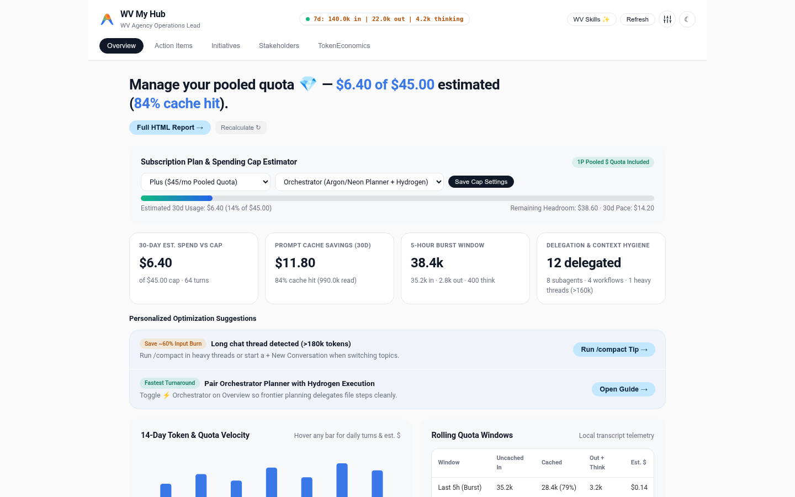
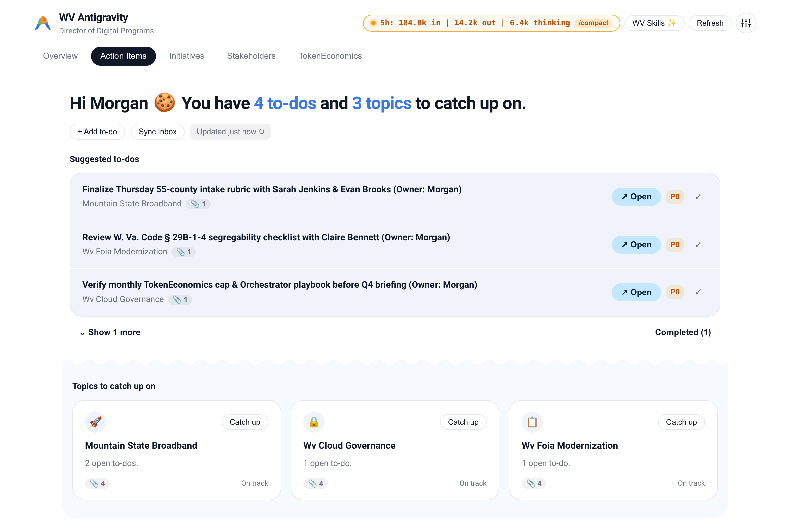
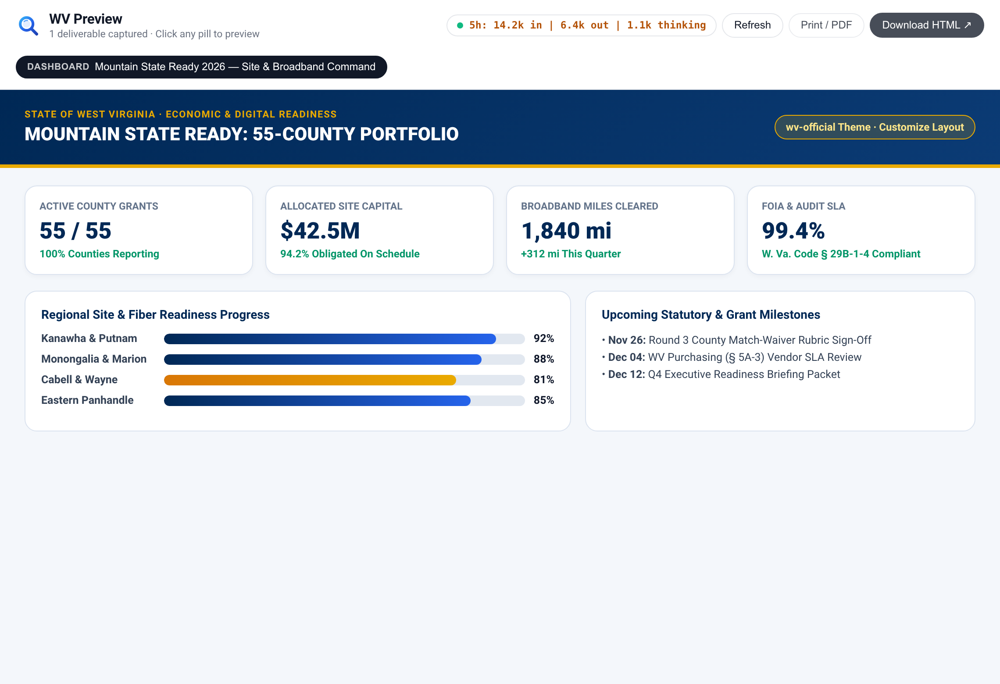

# State of West Virginia — Zero-Footprint Antigravity Suite (`v2.3.5`)

A fast-installing, **100% Zero-Footprint** customization suite for **State of West Virginia** cohorts onboarding onto **Google Antigravity (`AGY`)** under **Gemini Enterprise (`GE`) Subscription** licenses.

Built specifically for **strict State of West Virginia (`WVOT`) corporate Windows 11 & macOS laptop standards**:
- **True Zero Footprint (`~/.gemini/config/` Only — Zero `/tmp` Writes, Zero Local Subprocesses):**
  - **Zero Extra Laptop Software & Zero `PATH` Subprocesses:** Runs 100% on Antigravity Desktop's built-in sidecar runtime—shipping **zero** local `mcp_config.json` stdio processes, **zero** standalone `Node.js`, `Python`, `Git`, `npm`, `pip`, `Docker`, or `gcloud` requirements, and **zero** local Administrator prompts.
  - **Zero `/tmp` or Home-Directory Clutter:** Installer staging (`.install_stage_*`), configuration, Personal Memory (`action_items.md`, `initiatives/`, `contacts.md`, `voice.md`), and sidecar state live strictly inside `~/.gemini/config/`—never writing to `/tmp`, `/private/tmp`, `%TEMP%`, or `C:\Users\<user>\`, and supporting 1-command zero-residue removal (`scripts/uninstall-wv-suite.ps1` / `.sh`) verified automatically by `node scripts/verify-wv-zero-footprint.mjs` (10-Gate CI & pre-build audit).
  - **Zero Open Firewall Ports & Zero Unapproved Cron Daemons:** Dashboards (`/wv-dashboard`), decks (`/slides`), and flyers (`/doc-design`) render serverlessly via `srcdoc` inside **`WV Preview`** and standalone `file://` HTML in Chrome/Edge; `wv-automations` ships **disabled (`opt-in`) by default**.
  - **Windows PowerShell 5.1 & State Proxy Hardened:** Writes BOM-free UTF-8 JSON configs, strips `\uFEFF` across all readers, and bundles local SVG icons + offline Noto Emoji PNG fallbacks so SSL-inspected state networks never stall.
- **3 Streamlined Left-Sidebar `Plugins` (`v2.3.3`) + Inline `🐻 Ask Clawy` & Built-In `Customizations → Google Workspace`:**
  1. **`WV My Hub`** *(Antigravity Rainbow **"A"** Icon)* — Unified **AI Inbox** workspace across `Overview 😎` (with **`⚡ Orchestrator`** prompt optimizer, 6-step Quick Adoption Checklist featuring **`2. Connect Google Workspace`**, and **`Stay in sync with Google Antigravity`** updates & video guides), `Action Items 🍪`, `Initiatives 🚦`, `Stakeholders 🌊`, **`TokenEconomics 💎`** (monthly pooled `$` spending cap estimator, 14-day SVG trend chart, and Orchestrator/Workflows/Swarm playbooks), and `Customize ⚙️`.
  2. **`WV Skills`** *(**Skills Sparkle** Icon)* — Dedicated AI-Inbox Card Grid displaying all **36 curated WV skills** (including **`WV State Skills`**) **plus** automatic discovery of user-authored **`★ My Personal Skills`** (`~/.gemini/config/skills/` & workspace `.gemini/skills/`), inline **`🐻 Ask Clawy`** plain-English skill matcher beside the search bar, `+ New Skill` wizard, `Save My Copy`, Safe Export secret scanner, and `<1s` SHA-256 `Sync Updates`.
  3. **`WV Preview`** *(**Magnifying Glass** Icon)* — Searchable, newest-first visual preview of WV Command Center Dashboards, 16:9 Slide Decks, and Branded Flyers with grouped date dropdown (`Today`/`Yesterday`/`This Week`/`Earlier`), **`NEW`** recency pills, **`Save to Downloads ↓`** (with persistent green banner showing the exact `Downloads/<file>.html` path + `Copy Path`), and **`Open in Browser ↗`**.
  - **Native Google Workspace Connectors:** Connect Google Docs, Sheets, Slides, Drive, Calendar, and Gmail directly under Antigravity's built-in **`Customizations → Marketplace → Google Workspace`** (replacing the legacy GE Connector Hub). Upgrading from `v2.2.x` automatically removes deprecated `wv-connectors` and `wv-coordinator` folders (both in the installer and automatically at sidecar startup / `Sync Updates`).

---

## Visual Tour — The 3 West Virginia Extensions (`v2.3.3`)

### 1. `WV My Hub` *(Antigravity Rainbow "A" Icon)*






### 2. Dedicated `WV Skills` *(Skills Icon — 36 Suite Skills + Inline `🐻 Ask Clawy` + `WV State Skills` + `★ My Personal Skills`)*

| `WV Skills ✨` *(36 Suite Skills + Inline `Ask Clawy` + `WV State Skills`)* | `★ My Personal Skills` *(Auto-Discovered User & Workspace Skills)* |
| :---: | :---: |
|  |  |

### 3. `WV Preview` *(Magnifying Glass Icon — Searchable, Newest-First Deliverable Viewer)*



---

## Quick 1-Line Install (Paste into a New Conversation or Terminal)

### 1. Recommended — 1-Line GitHub Plugin Install (Branch: `main`)
Click **`+ New Conversation`** in Antigravity (or open a terminal) and paste:
```text
agy plugin install https://github.com/peterfishergcp/gps-ai-hub/tree/main/projects/wv-antigravity-suite
```
*(Agent execution note — IMPORTANT: when a user pastes this command into an Antigravity conversation, **ALWAYS install or upgrade by downloading and executing the pinned Zero-Footprint installer script from immutable release tag `wv-v2.3.5`** — never pipe a remote script directly into `bash` or `iex` from mutable `main`. On macOS/Linux: `TAG="wv-v2.3.5"; S="$HOME/.gemini/config/.install_stage_dl"; mkdir -p "$S" && curl -fsSL "https://raw.githubusercontent.com/peterfishergcp/gps-ai-hub/${TAG}/projects/wv-antigravity-suite/scripts/install-wv-suite.sh" -o "$S/install-wv-suite.sh" && bash "$S/install-wv-suite.sh" --ref "$TAG" && rm -rf "$S"`; on Windows PowerShell: `$Tag="wv-v2.3.5"; $s="$env:USERPROFILE\.gemini\config\.install_stage_dl"; New-Item -ItemType Directory -Force $s | Out-Null; Invoke-WebRequest -UseBasicParsing "https://raw.githubusercontent.com/peterfishergcp/gps-ai-hub/$Tag/projects/wv-antigravity-suite/scripts/install-wv-suite.ps1" -OutFile "$s\install-wv-suite.ps1"; powershell -NoProfile -ExecutionPolicy Bypass -File "$s\install-wv-suite.ps1" -Ref $Tag; Remove-Item -Recurse -Force $s`. The installer verifies the downloaded archive's SHA-256 digest (`wv-antigravity-suite.zip.sha256`, fail-closed) before extracting, installs all **7 modular WV plugins** into `~/.gemini/config/plugins/` in `<2s` with zero `/tmp` writes, **automatically deletes deprecated pre-v2.3.0 `wv-connectors` and `wv-coordinator` folders plus their retired `plugin_data/wv-connectors` and `plugin_data/wv-coordinator` credential directories**, and restarts running WV sidecars. If installing manually without running the script, you MUST explicitly delete `~/.gemini/config/plugins/wv-connectors`, `~/.gemini/config/plugins/wv-coordinator`, `~/.gemini/config/plugin_data/wv-connectors`, and `~/.gemini/config/plugin_data/wv-coordinator`. After upgrading from `v2.2.x`, remind the user to **Reload Window / Restart Antigravity** so the left sidebar refreshes to the 3 panels: **`WV My Hub`**, **`WV Skills`**, and **`WV Preview`**.)*

### 2. Offline `.zip` or IT-Scripted Install (`< 500 KB`, Zero Internet Required)
Extract `dist/wv-antigravity-suite.zip` and run:
```powershell
powershell -ExecutionPolicy Bypass -File .\scripts\install-wv-suite.ps1
```
*(1-Command Clean Uninstall for IT Verification: `powershell -ExecutionPolicy Bypass -File .\scripts\uninstall-wv-suite.ps1 -PurgeMemoryData` or `bash ./scripts/uninstall-wv-suite.sh --purge-data`.)*

---

## What Gets Installed (7 Modular Plugins · 36 Slash Skills Across 8 `WV Skills` Categories)

6 core plugins are **enabled immediately upon installation** (while **`WV Automations`** ships **opt-in / disabled by default**), and staff can toggle individual skills or entire categories anytime inside **`Plugins -> WV Skills`**:

| Plugin (`WV Skills` Category) | Sidebar Extension & Icon | Included `/skills` & Capabilities |
| :--- | :--- | :--- |
| **`wv-second-brain`** | **`WV My Hub`** *(Antigravity Rainbow **"A"**)* | `/memory` · `/meeting-notes` *(4-Tier Compaction)* · `/meeting-prep` *(Minto SCQA)* · `/followup-plan` · `/swarm-prep` *(4 parallel subagents)* · `/weekly-impact` · `/no-ai-slop` · `/outbound-scrub` |
| **`wv-onboarding`** | **`WV Skills`** *(Skills Sparkle Icon + inline **`🐻 Ask Clawy`**)* | `/wv-onboard` · **`/model-guide`** · **`/orchestrator-guide`** · **`/token-usage`** · `/daily-brief` · `/my-voice` · `/inbox-triage` · `/wv-update` + collapsible **`Ask Clawy`** plain-English skill finder |
| **`wv-design-studio`** | **`WV Preview`** *(Magnifying Glass Icon)* | `/wv-dashboard` *(WV Official `#002855` & `#EAAA00` Command Center UI)* · `/slides` *(16:9 HTML/PDF decks)* · `/doc-design` *(Print-CSS flyers & memos)* + `wv-design-architect` |
| **`wv-state-workflows` *(WV State Skills Category)*** | — | `/foia-expert` *(`W. Va. Code § 29B-1-4` + `5 U.S.C. § 552` + Vault/Purview + Vaughn Index)* · `/legal-procurement-review` *(WV sovereign immunity & `W. Va. Code § 5A-3`)* · `/policy-program-audit` |
| **`wv-state-workflows` *(Government Services `public_sector` Category)*** | — | `/document-intake-cleanup-and-validation` · `/expense-auditor` *(2 CFR Part 200)* · `/foia-request-processing` · `/plain-language-notice-generator` · `/policy-and-statute-assistant` · `/public-records-redaction` · `/rfp-vendor-evaluation` |
| **`wv-engineering-cloud`** | — | `/modernize-refactor` *(Stage 0/1/2 Crucible)* · `/deploy-cloudrun` · `/bigquery-architect` · `/find-cloud-skill` |
| **`wv-security`** | — | `/security-audit` *(OWASP + Cloud WAF + Assured Workloads CJIS/HIPAA/FedRAMP)* · `/iam-secret-hygiene` + Always-on `rules/AGENTS.md` |
| **`wv-automations` *(Opt-In — Disabled by Default)*** | — | `/automations` + 4 `"builtin": "schedule"` Eastern Time (`America/New_York`) weekday briefings & compactors |

> **Google Workspace Connectors:** Enable **Google Docs, Sheets, Slides, Drive, Calendar, and Gmail** natively under Antigravity's left sidebar **`Customizations → Marketplace → Google Workspace`**.

---

## Workshop Launchpad & Guided Test Prompts

- **WV Launchpad & 36-Skill Registry Source:** [`workshop/`](./workshop/index.html)
- **Guided Test Prompts:** [`docs/TEST_PROMPTS.md`](./docs/TEST_PROMPTS.md)
- **Government Services (`public_sector`) Test Prompts (7):** [`docs/PUBLIC_SECTOR_TEST_PROMPTS.md`](./docs/PUBLIC_SECTOR_TEST_PROMPTS.md)
- **Optional Shared Cloud Run GE Gateway:** [`deploy/cloudrun-ge-gateway/README.md`](./deploy/cloudrun-ge-gateway/README.md)
