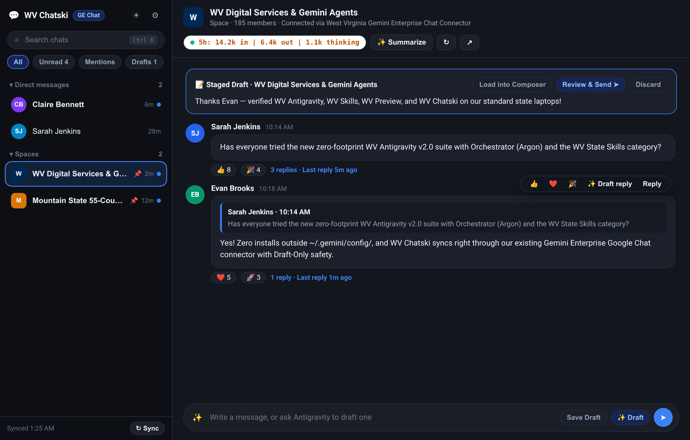

# State of West Virginia — Zero-Footprint Antigravity Suite (`v2.0.0`)

A fast-installing, **100% Zero-Footprint** customization suite for **State of West Virginia** cohorts onboarding onto **Google Antigravity (`AGY`)** under **Gemini Enterprise (`GE`) Subscription** licenses.

Built specifically for **strict State of West Virginia (`WVOT`) corporate Windows 11 laptop standards**:
- **True Zero Footprint (`~/.gemini/config/` Only):**
  - **Zero Extra Laptop Software:** Runs 100% on Antigravity Desktop's **built-in `agy-node` runtime**—zero standalone `Node.js`, `Python`, `Git`, `npm`, `pip`, `Docker`, or `gcloud` installs and zero local Administrator rights required.
  - **Zero Home-Directory Clutter:** All configuration, Personal Memory (`action_items.md`, `initiatives/`, `contacts.md`, `voice.md`), and sidecar state live strictly inside `~/.gemini/config/plugin_data/wv-*`—creating **zero** folders in `C:\Users\<user>\` and supporting 1-command zero-residue removal (`scripts/uninstall-wv-suite.ps1` / `.sh`).
  - **Zero Open Firewall Ports & Zero Unapproved Cron Daemons:** Dashboards (`/wv-dashboard`), decks (`/slides`), and flyers (`/doc-design`) render serverlessly via `srcdoc` inside **`WV Preview`** and standalone `file://` HTML in Chrome/Edge; `wv-automations` ships **disabled (`opt-in`) by default**.
  - **Windows PowerShell 5.1 & State Proxy Hardened:** Writes BOM-free UTF-8 JSON configs, strips `\uFEFF` across all readers, and bundles local SVG icons + offline Noto Emoji PNG fallbacks so SSL-inspected state networks never stall.
- **4 Left-Sidebar `Extensions` with Distinct Custom Icons + Live Token Meter (`in | out | thinking`):**
  1. **`WV Antigravity`** *(Antigravity Rainbow **"A"** Icon)* — Unified **AI Inbox** workspace across `Overview 😎`, `Action Items 🍪`, `Initiatives 🚦`, `Stakeholders 🌊`, `Skills ✨`, and `Customize ⚙️`.
  2. **`WV Skills`** *(**Skills Sparkle** Icon)* — AI Inbox skill & connector manager with per-skill toggles (including **`WV State Skills`**) and `<1s` SHA-256 `Sync Updates`.
  3. **`WV Preview`** *(**Magnifying Glass** Icon)* — Serverless visual preview of WV Command Center Dashboards, 16:9 Slide Decks, and Branded Flyers with Print-to-PDF and 1-click HTML download.
  4. **`WV Chatski`** *(**Chat Bubble** Icon)* — Left-sidebar Google Chat workspace powered **out-of-the-box** by West Virginia's existing **Gemini Enterprise Chat Connector** (`StreamAssist` with `actionDisabled: true` on reads and 2-step human confirmation on sends).

---

## Visual Tour — The 4 West Virginia Extensions (`v2.0.0`)

### 1. `WV Antigravity` *(Antigravity Rainbow "A" Icon)* — AI Inbox `Action Items` & `Overview`


### 2. `WV Chatski` *(Chat Bubble Icon)* — Google Chat via WV Gemini Enterprise Connector



### 3. `WV Skills` *(Skills Icon)* & `WV Preview` *(Magnifying Glass Icon)*

| `WV Skills ✨` *(AI Inbox Manager + `WV State Skills`)* | `WV Preview 🔍` *(Serverless WV Command Center Preview)* |
| :---: | :---: |
|  |  |

---

## 3 Frictionless Ways to Install (Pick One)

### 1. Native Antigravity 1-Command Bulk Install (Recommended)
Open a **+ New Conversation** in Antigravity, paste the command below into the chat box, and press **Enter**:
```bash
agy plugin install https://github.com/peterfishergcp/gps-ai-hub/tree/main/projects/wv-antigravity-suite
```

### 2. Fastest WV Corporate Laptop Install (`< 2 Seconds`, Zero `git` Required — PowerShell 5.1)
Extract `wv-antigravity-suite.zip` (`< 500 KB`) and run:
```powershell
powershell -ExecutionPolicy Bypass -File .\scripts\install-wv-suite.ps1 `
  -GeInstance "projects/YOUR_PROJECT_ID/locations/global/collections/default_collection/engines/YOUR_GE_ENGINE_ID"
```

**macOS / Linux:**
```bash
bash ./scripts/install-wv-suite.sh \
  --ge-instance "projects/YOUR_PROJECT_ID/locations/global/collections/default_collection/engines/YOUR_GE_ENGINE_ID"
```

*(1-Command Clean Uninstall for IT Verification: `powershell -ExecutionPolicy Bypass -File .\scripts\uninstall-wv-suite.ps1 -PurgeMemoryData` or `bash ./scripts/uninstall-wv-suite.sh --purge-data`.)*

### 3. Fast Git Sparse-Checkout (Developers & Agency IT Admins)
```bash
git clone --depth 1 --filter=blob:none --sparse https://github.com/peterfishergcp/gps-ai-hub.git wv-agy
cd wv-agy && git sparse-checkout set projects/wv-antigravity-suite
bash projects/wv-antigravity-suite/scripts/install-wv-suite.sh
```

---

## What Gets Installed (8 Modular Plugins · 40 Slash Skills Across 9 `WV Skills` Categories)

7 core plugins are **enabled immediately upon installation** (while **`WV Automations`** ships **opt-in / disabled by default**), and staff can toggle individual skills or entire categories anytime inside **`Extensions -> WV Skills`**:

| Plugin (`WV Skills` Category) | Sidebar Extension & Icon | Included `/skills` & Capabilities |
| :--- | :--- | :--- |
| **`wv-second-brain`** | **`WV Antigravity`** *(Antigravity Rainbow **"A"**)* | `/memory` · `/meeting-notes` *(4-Tier Compaction)* · `/meeting-prep` *(Minto SCQA)* · `/followup-plan` · `/swarm-prep` *(4 parallel subagents)* · `/weekly-impact` · `/no-ai-slop` · `/outbound-scrub` |
| **`wv-onboarding`** | **`WV Skills`** *(Skills Sparkle Icon)* | `/wv-onboard` · **`/model-guide`** · **`/orchestrator-guide`** · **`/token-usage`** · `/daily-brief` · **`/my-voice`** · `/inbox-triage` · `/wv-update` |
| **`wv-design-studio`** | **`WV Preview`** *(Magnifying Glass Icon)* | `/wv-dashboard` *(WV Official `#002855` & `#EAAA00` Command Center UI)* · `/slides` *(16:9 HTML/PDF decks)* · `/doc-design` *(Print-CSS flyers & memos)* + `wv-design-architect` |
| **`wv-connectors`** | **`WV Chatski`** *(Chat Bubble Icon)* | **`/chatski`** *(Google Chat via GE Connector)* · `/connect-ge` · `/connect-m365-workspace` · `/connect-github-bigquery` + **`wv-ge-bridge` MCP** |
| **`wv-state-workflows` *(WV State Skills Category)*** | — | `/foia-expert` *(`W. Va. Code § 29B-1-4` + `5 U.S.C. § 552` + Vault/Purview + Vaughn Index)* · `/legal-procurement-review` *(WV sovereign immunity & `W. Va. Code § 5A-3`)* · `/policy-program-audit` |
| **`wv-state-workflows` *(Government Services `public_sector` Category)*** | — | `/document-intake-cleanup-and-validation` · `/expense-auditor` *(2 CFR Part 200)* · `/foia-request-processing` · `/plain-language-notice-generator` · `/policy-and-statute-assistant` · `/public-records-redaction` · `/rfp-vendor-evaluation` |
| **`wv-engineering-cloud`** | — | `/modernize-refactor` *(Stage 0/1/2 Crucible)* · `/deploy-cloudrun` · `/bigquery-architect` · `/find-cloud-skill` |
| **`wv-security`** | — | `/security-audit` *(OWASP + Cloud WAF + Assured Workloads CJIS/HIPAA/FedRAMP)* · `/iam-secret-hygiene` + Always-on `rules/AGENTS.md` |
| **`wv-automations` *(Opt-In — Disabled by Default)*** | — | `/automations` + 4 `"builtin": "schedule"` Eastern Time (`America/New_York`) weekday briefings & compactors |

---

## Workshop Launchpad & Guided Test Prompts

- **WV Launchpad & 40-Skill Registry Source:** [`workshop/`](./workshop/index.html)
- **Guided Test Prompts:** [`docs/TEST_PROMPTS.md`](./docs/TEST_PROMPTS.md)
- **Government Services (`public_sector`) Test Prompts (7):** [`docs/PUBLIC_SECTOR_TEST_PROMPTS.md`](./docs/PUBLIC_SECTOR_TEST_PROMPTS.md)
- **Optional Shared Cloud Run GE Gateway:** [`deploy/cloudrun-ge-gateway/README.md`](./deploy/cloudrun-ge-gateway/README.md)
