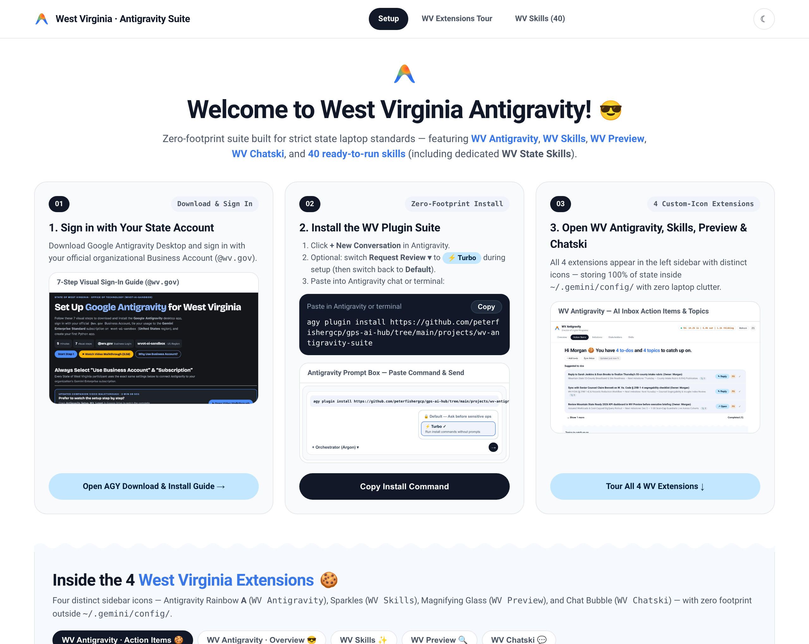
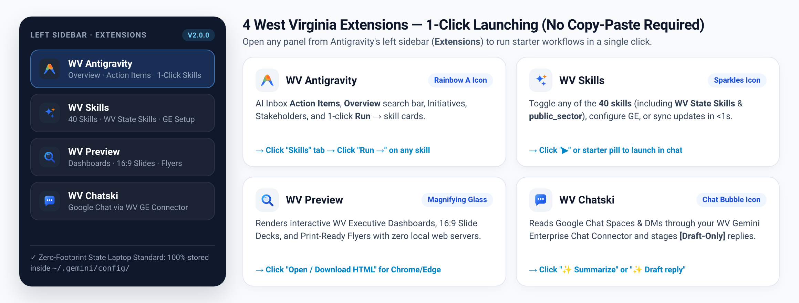
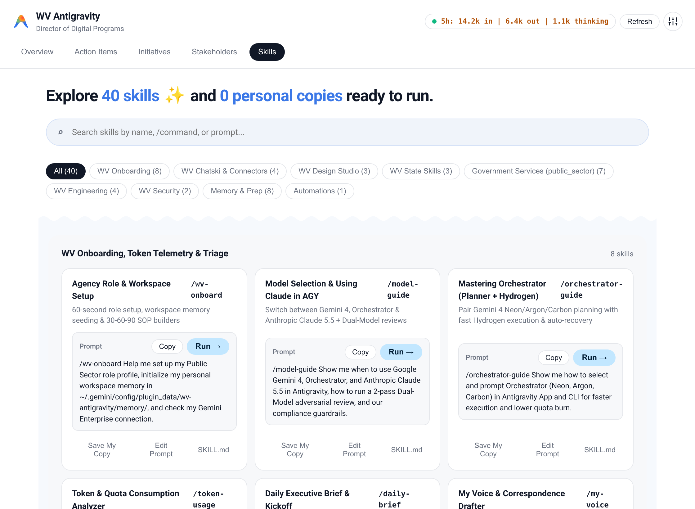
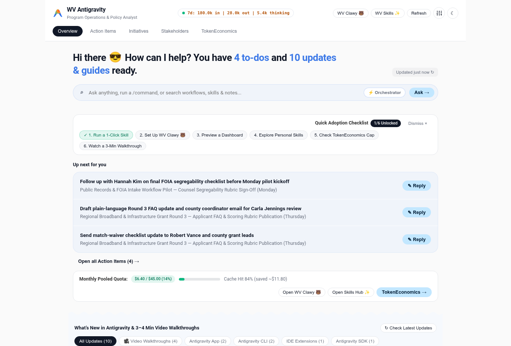
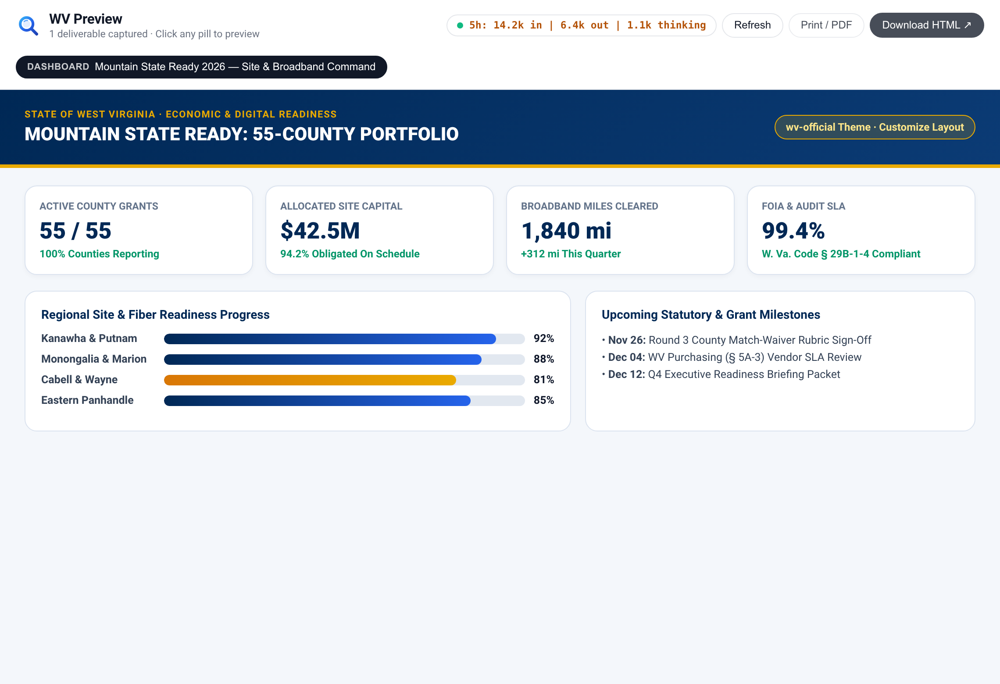
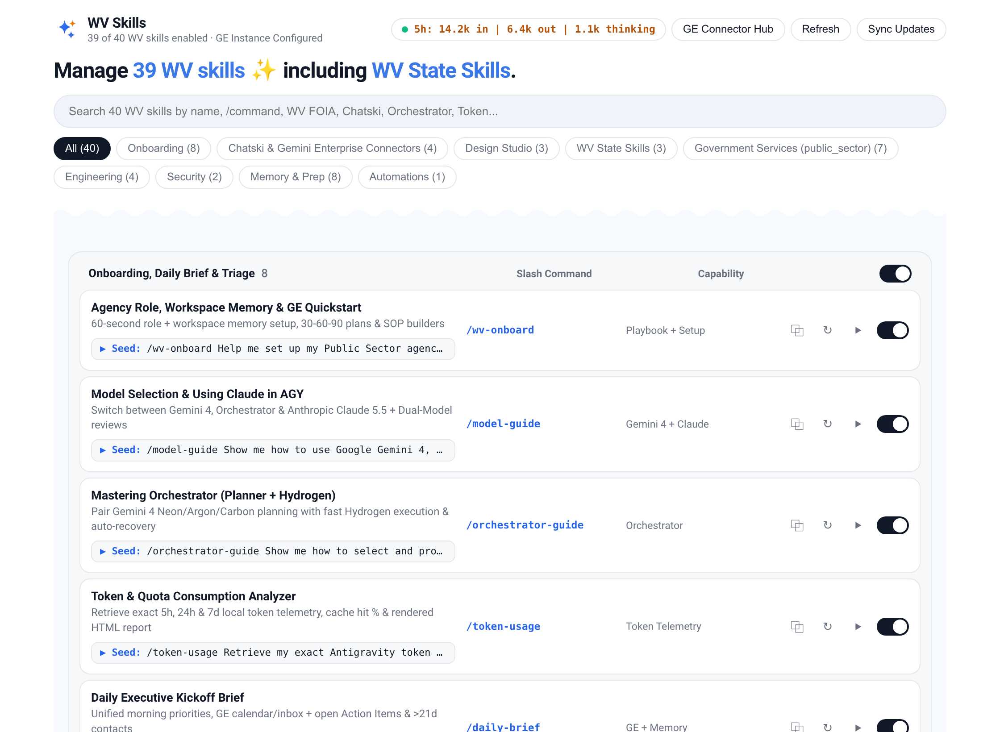
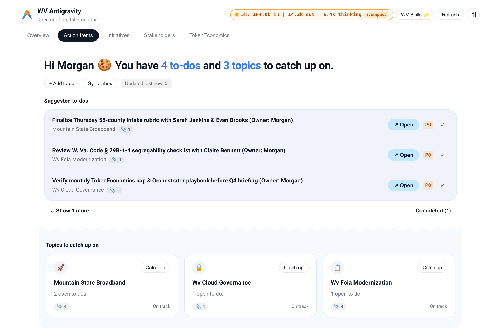
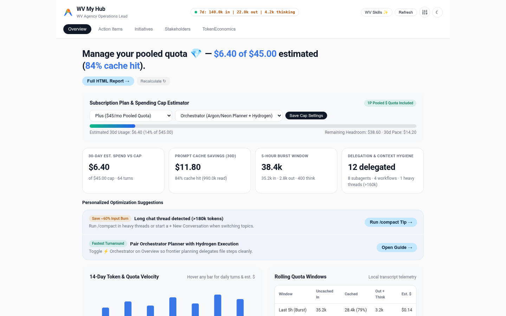

# State of West Virginia — Antigravity Suite (`v2.1.2`) Guided Test Prompts

Welcome to **Version 2.1.0** of the **State of West Virginia Antigravity Suite** (`8` modular plugins · `39` ready-to-run skills + auto-discovered **`★ My Personal Skills`** · `3` custom-icon left-sidebar extensions · **`TokenEconomics`** dashboard · **`Overview` Updates & Video Walkthroughs Hub** · `100%` zero-footprint storage inside `~/.gemini/config/`).

> [!TIP]
> **What Changed in `v2.1.2` — Dedicated `WV Skills` (`★ My Personal Skills`), `TokenEconomics` & `Overview` Updates Hub:**
> - **Dedicated `WV Skills` Hub:** All `39` curated skills (including **`WV State Skills`**) **plus** your own **`★ My Personal Skills`** (`~/.gemini/config/skills/` & workspace `.gemini/skills/`) now live inside **`Extensions → WV Skills`** (Sparkles icon) in the AI-Inbox Card Grid with 1-Click **`Run →`**, `+ New Skill`, `Save My Copy`, and Safe Export secret scanning.
> - **`TokenEconomics` Dashboard Tab:** Open **`Extensions → WV Antigravity → TokenEconomics`** to track your monthly pooled quota cap, 14-day velocity, Orchestrator + Hydrogen + Workflows playbooks, and amber `/compact` context alerts (`>=160k` tokens).
> - **`Overview` Updates & Video Walkthroughs:** Open **`Extensions → WV Antigravity → Overview`** to toggle **`⚡ Orchestrator`**, watch 3–4 minute two-host video tutorials, and subscribe to Google Antigravity updates. Every test section below includes **both** the **1-Click In-App Starter** and the **Full West Virginia Deep-Test Script**.

## Before You Begin

- **What you'll need:** Your state-managed laptop, your official `@wv.gov` Google Business Account, and about **15–30 minutes**.
- **Sample data only during pilot testing:** Every scenario in this guide uses synthetic sample data. **Do not paste real constituent SSNs, live PII, or confidential case records during pilot evaluation.**
- **Questions?** Contact your agency pilot coordinator (`[Name / Email / Chat Space]`).

---

## Quick 3-Step Setup (Zero-Footprint State Laptop Standard)

1. **Step 1 — Sign In to Antigravity Desktop (`@wv.gov` Business Account):** Complete the [7-Step Antigravity Setup Guide](../setup-guide/index.html), or open the interactive [West Virginia Antigravity v2.1.2 Launchpad](../workshop/index.html) in Chrome or Edge.
2. **Step 2 — Install the `v2.1.2` Suite (From a New Conversation in Antigravity):** Click **`+ New Conversation`**, optionally switch **`Request Review`** (bottom-right of the prompt box) to **`Turbo`** during setup (then switch back to **`Default`** once complete), and paste:

```text
agy plugin install https://github.com/peterfishergcp/gps-ai-hub/tree/main/projects/wv-antigravity-suite
```

3. **Step 3 — Open the 3 West Virginia Extensions & Launch Skills in 1 Click:** Look at the **`Extensions`** rail on the left side of Antigravity. In `v2.1.2`, you will see three West Virginia panels—each with its own distinct icon and a live hoverable **`5h: in | out | thinking`** token pill in the top bar.



---

## Meet the 3 West Virginia Left-Sidebar Extensions (`v2.1.2`)



| Left-Sidebar Extension | Sidebar Icon | What It Does | Fastest 1-Click Action (No Copy-Paste) |
| :--- | :--- | :--- | :--- |
| **`WV Antigravity`** | Antigravity Rainbow **A** | Daily command center with **Overview** (`⚡ Orchestrator` + Updates & Video Hub), AI Inbox **Action Items**, **Initiatives**, **Stakeholders**, and **TokenEconomics** (monthly cap & spend playbooks). | Toggle **`⚡ Orchestrator`** on `Overview` or check your monthly cap in **`TokenEconomics`**. |
| **`WV Skills`** | Sparkles | Dedicated AI-Inbox Card Grid for all **39 suite skills** (including **`WV State Skills`**) **plus** auto-discovered **`★ My Personal Skills`** (`~/.gemini/config/skills/` & `.gemini/skills/`), GE Hub, Safe Export & `<1s` `Sync Updates`. | Click **`Run →`** on any skill card, **`+ New Skill`**, or **`★ My Personal Skills`**. |
| **`WV Preview`** | Magnifying Glass | Serverless visual viewer for West Virginia Executive Dashboards, 16:9 Slide Decks, and Stakeholder Flyers (`0` local ports). | Click any captured deliverable pill, or click **`Download HTML`** / **`Print / PDF`**. |





---

## Recommended Order of Guided Tests (`v2.1.2`)

| Test # | Focus Area & Plugin | Audience | 1-Click Ready? |
| :--- | :--- | :--- | :--- |
| **Test 1 (Start Here)** | **WV Dashboards, 16:9 Slides, Flyers & `WV Preview`** (`wv-design-studio`) | Everyone | Yes — `Run →` on `/wv-dashboard`, `/slides`, `/doc-design` |
| **Test 2** | **Gemini 4, Claude 5.5, Orchestrator & Live Token Meter** (`wv-onboarding`) | Everyone + IT | Yes — `Run →` on `/model-guide`, `/orchestrator-guide`, `/token-usage` |
| **Test 3** | **Onboarding, Daily Brief, My Voice (`/my-voice`) & Inbox Triage** (`wv-onboarding`) | Everyone | Yes — `Run →` in `WV Antigravity` or `WV Skills` |
| **Test 4** | **`WV State Skills`: WV FOIA (`§ 29B-1-4`), Legal Redlining & Policy Audit** (`wv-state-workflows`) | Legal, FOIA, Program Staff | Yes — Filter pill **`WV State Skills (3)`** → `Run →` |
| **Test 5 (New in v2.0)** | **Zero-Footprint Memory, AI Inbox `Action Items`, SCQA Prep & Anti-Slop** (`wv-second-brain`) | Everyone | Yes — `Action Items` tab + `Memory & Prep (8)` |
| **Test 6 (New in v2.1)** | **`TokenEconomics` Spending Cap, `★ My Personal Skills` & `Overview` Updates Hub** (`WV Antigravity` + `WV Skills`) | Everyone | Yes — Open `TokenEconomics` & `★ My Personal Skills` |
| **Test 7** | **Legacy App Refactoring, Cloud Run & BigQuery SQL** (`wv-engineering-cloud`) | Developers & Data Analysts | Yes — Filter pill **`WV Engineering (4)`** → `Run →` |
| **Test 8** | **Security & Cloud Readiness ("Catch the 4 Real-World Mistakes")** (`wv-security`) | CISO, Security & Cloud IT | Yes — 1-click workspace scan or paste 4-bug snippet |
| **Test 9** | **Federated Gemini Enterprise (`GE`) Connectors** (`wv-connectors`) | IT & Power Users | Yes — `GE Connector Hub` button or `/connect-ge` |
| **Test 10 (Run Last)** | **4-Agent Parallel Swarm, 3-Altitude Weekly Impact & Opt-In Automations** (`wv-second-brain` + `wv-automations`) | Power Users & Leads | Yes — `Run →` on `/swarm-prep` & `/weekly-impact` |

*(For the 7 `Government Services (public_sector)` prompts `PS-1` through `PS-7`, see [`PUBLIC_SECTOR_TEST_PROMPTS.md`](./PUBLIC_SECTOR_TEST_PROMPTS.md).)*

---

## Test 1 — WV Dashboards, 16:9 Slides, Flyers & `WV Preview` (`wv-design-studio`)

- **What this tests:** `/wv-dashboard`, `/slides`, `/doc-design`, and **`Extensions → WV Preview`** (serverless visual previews in the Side Pane + `Download HTML` for Chrome/Edge with zero Python or `127.0.0.1` ports).



### Option A — 1-Click Starter (No Copy-Paste Needed)

Open **`Extensions → WV Skills`**, click **`WV Design Studio (3)`**, and click **`Run →`** on **`/wv-dashboard`** (or **`/slides`** / **`/doc-design`**):

```markdown
/wv-dashboard Spin up an interactive Public Sector executive KPI & grant readiness dashboard with 4 KPI cards, regional breakdowns, and live visual Customize Layout.
```

### Option B — Full West Virginia Deep-Test Script (Optional Copy-Paste)

```markdown
Using `/wv-dashboard`, `/slides`, and `/doc-design`, create a West Virginia "Mountain State Ready" executive package in `./wv-mountain-state-demo` using these exact program figures ($40.0M total portfolio closing December 31, 2026: $25.0M WVEDA Shell Building Loans + $15.0M IJDC Tier 1–3 Site Readiness Grants across Kanawha, Monongalia, Cabell, Berkeley, and Raleigh counties):
1. `/wv-dashboard`: Scaffold an interactive West Virginia Command Center dashboard in `./wv-mountain-state-demo/dashboard` (`wv-official` theme) featuring the Capitol Command Navy header (`#0F1A2A`), `Ask Gemini Enterprise` search bar, `2026 SITE READINESS CLOCK` ribbon, numbered tabs (`1. TODAY & TRIAGE`, `2. PRIORITY AGENDA`, `3. PORTFOLIO ANALYTICS` for charts, `4. COUNTY SITE REGISTER` for the register table), green-bordered System Health banner, 4 KPI cards ($40.0M Authorized Funding, Active Pipeline, Qualifying Acreage, Projected Jobs), and dark-navy-header `NEEDS ACTION NOW` + `MY WORK LIST` operational split panels.
2. `/slides`: Create a 5-slide 16:9 executive briefing deck (`./wv-mountain-state-demo/slides/deck.html`) with keyboard navigation and speaker notes (`N` key).
3. `/doc-design`: Create a 1-page print-ready stakeholder fact sheet (`./wv-mountain-state-demo/flyer/flyer.html`) comparing WVEDA Loan terms vs. IJDC Grant tiers.
IMPORTANT — Follow the v2.1.2 WV Design Studio visual preview rules:
- Write the self-contained single-file HTML copies (`dashboard-standalone.html`, `deck.html`, `flyer.html`) to the Conversation Artifact Directory with `UserFacing: true` and embed `<agent-embed>` previews so I see rendered visuals—never link raw workspace `index.html` code files in chat.
- Do NOT create any 127.0.0.1 or localhost .url.json artifacts and do NOT start python3 -m http.server (all 3 HTML deliverables render serverless in the Side Pane and inside `Extensions -> WV Preview` with an 'Open / Download HTML' button for Chrome/Edge).
```

---

## Test 2 — Gemini 4, Anthropic Claude 5.5, Orchestrator & Live Token Meter (`/model-guide`, `/orchestrator-guide`, `/token-usage`)

- **What this tests:** `/model-guide`, `/orchestrator-guide`, `/token-usage`, plus hovering the top-right **`5h: ... in | ... out | ... thinking`** token pill inside any of the 3 WV sidebar extensions.

### Option A — 1-Click Starter (No Copy-Paste Needed)

Open **`Extensions → WV Skills`** (`WV Onboarding (8)`) and click **`Run →`** on **`/model-guide`**, **`/orchestrator-guide`**, or **`/token-usage`**.

### Option B — Full West Virginia Deep-Test Script (Optional Copy-Paste)

```markdown
Run `/model-guide` and `/orchestrator-guide` for our West Virginia agency developers and policy analysts who want to use Google Gemini 4, Orchestrator, and Anthropic Claude (Claude Sonnet 5.5 and Claude Opus 5.5) inside Antigravity:
1. Give a step-by-step guide on how a user switches between Google Gemini, Orchestrator (`Neon`, `Argon`, `Carbon`), and Anthropic Claude in both the Antigravity Desktop model picker and the `agy` CLI.
2. Build a West Virginia Task-to-Model Routing Cheat Sheet comparing 1P Gemini (included in our pooled subscription quota + 1M context + multimodal) vs. Orchestrator (Planner + Hydrogen execution for multi-file builds) vs. Anthropic Claude Sonnet & Opus (opt-in Pay-As-You-Go multi-file refactoring & contract/security redlines).
3. Provide the 4-step checklist for our West Virginia GCP Administrator to enable Anthropic Claude in Vertex AI Model Garden (`us-east5`), set Pay-As-You-Go budget alerts, and enforce CJIS/HIPAA/FedRAMP data governance.
4. Give me a ready-to-paste "Pass-2 Claude Cross-Review" prompt I can run right now after switching my model picker to Claude Sonnet or Claude Opus to audit the dashboard and flyer we built in Test 1.
```

---

## Test 3 — Onboarding, Daily Brief, My Voice (`/my-voice`) & Inbox Triage (`wv-onboarding`)

- **What this tests:** `/wv-onboard`, `/daily-brief`, `/my-voice` *(renamed from `/digital-twin` in `v2.1.2`)*, `/inbox-triage` (Unreadable-Attachment Fail-Safe Hold), and `/wv-update`.



### Option A — 1-Click Starter (No Copy-Paste Needed)

Click **`Run →`** / **`▶ Seed:`** on **`/wv-onboard`**, **`/daily-brief`**, **`/inbox-triage`**, or **`/my-voice`** inside **`WV Antigravity`** or **`WV Skills`**.

### Option B — Full West Virginia Deep-Test Script (Optional Copy-Paste)

```markdown
Run a combined test of our `wv-onboarding` v2.1.2 skills (`/wv-onboard`, `/inbox-triage`, `/daily-brief`, and `/my-voice`) for my role as Deputy Director of Operations at the West Virginia Department of Economic Development:
1. `/wv-onboard`: Initialize my zero-footprint role and writing voice profile inside `~/.gemini/config/plugin_data/wv-antigravity/memory/profile/` (`identity.md` and `voice.md`, with zero files written outside `~/.gemini/config/`), tuned to a concise executive BLUF (Bottom-Line-Up-Front) voice for agency leadership and county commissioners.
2. `/inbox-triage`: Triage these 3 incoming emails against our escalation rules (Escalate immediately if: budget impact > $250K, statutory/FOIA deadline <= 5 business days, or County Commissioner / Legislature inquiry):
   - Email A (From: Kanawha County Commission): "Urgent: $1.4M water main match modification needed before Friday's IJDC board vote."
   - Email B (From: Vendor Portal Notification): "Monthly newsletter: Q4 training webinar schedule."
   - Email C (From: Regional Grant Contractor): "Updated Drawdown Request #14 attached — [ERROR: Attachment 'Drawdown_14_Signed.pdf' is corrupted/unreadable, 0 bytes extracted]."
   Verify that Email C triggers the Unreadable-Attachment Fail-Safe Hold!
3. `/daily-brief`: Turn the triaged items plus a 2:00 PM ET IJDC Board Prep call into a 1-page Morning Executive Brief.
4. `/my-voice`: Draft a concise reply to the Kanawha County Commission (`Email A`) calibrated to my `voice.md` BLUF profile (strictly `[Draft-Only]`).
```

---

## Test 4 — `WV State Skills`: West Virginia FOIA (`§ 29B-1-4`), Legal Review & Policy Audit (`wv-state-workflows`)

- **What this tests:** `/foia-expert` (**W. Va. Code § 29B-1-4** & **5 U.S.C. § 552** segregability + Vaughn Index), `/legal-procurement-review` (**W. Va. Code § 5A-3**, constitutional sovereign immunity, fiscal non-appropriation, AI training bans), and `/policy-program-audit`.

### Option A — 1-Click Starter (No Copy-Paste Needed)

Click the **`WV State Skills (3)`** category pill in **`WV Antigravity → Skills`** (or **`WV Skills`**) and click **`Run →`** on **`/foia-expert`**, **`/legal-procurement-review`**, or **`/policy-program-audit`**.

### Option B — Full West Virginia Deep-Test Script (Optional Copy-Paste)

```markdown
Test all 3 `WV State Skills` (`/foia-expert`, `/legal-procurement-review`, and `/policy-program-audit`) on this West Virginia scenario:
1. `/foia-expert`: We received a public records request for "all emails and SharePoint memos between Jan 1, 2026 and March 31, 2026 mentioning Project Allegheny or parcel bids in Mason County."
   - Generate the exact Google Vault and Microsoft Purview KQL discovery queries.
   - Review this responsive record excerpt for line-by-line segregability under W. Va. Code § 29B-1-4 and 5 U.S.C. § 552 and produce a Vaughn Index table:
     "Paragraph 1: On Feb 12, 2026, Agency Engineers completed the public Phase 1 traffic count on Route 35 (14,200 vehicles/day). Paragraph 2 [DRAFT INTERNAL DELIBERATION]: Chief Counsel advises that our pre-decisional negotiation ceiling for Parcel 4B is $820,000, and applicant John Doe's home cell (304-555-0199) and SSN (999-00-1234) are listed on the tax worksheet."
2. `/legal-procurement-review`: Score this vendor SaaS contract clause using 1:3:9 risk scoring under West Virginia law (including W. Va. Code § 5A-3 and constitutional sovereign immunity) and write the West Virginia replacement redline:
   "Section 14: State Agency agrees to indemnify and hold harmless Vendor against all third-party claims, locks into a non-cancellable 5-year term regardless of legislative appropriations, submits to binding arbitration in Delaware, and grants Vendor a perpetual license to train commercial AI models on State Agency uploads."
3. `/policy-program-audit`: Check whether a draft press release saying "$18M in IJDC grants closing Jan 15, 2027" conflicts with our official $15M / Dec 31, 2026 program rules.
```

---

## Test 5 (New in `v2.1.2`) — Personal Memory, AI Inbox `Action Items`, Minto SCQA Prep & Outbound Scrubbing (`WV Antigravity`)

- **What this tests:** AI Inbox **`Action Items`** (`Suggested to-dos` + `Topics to catch up on`), `/memory`, `/meeting-notes`, `/meeting-prep`, `/followup-plan`, `/no-ai-slop`, and `/outbound-scrub`.



### Option A — 1-Click Starter (No Copy-Paste Needed)

Open **`Extensions → WV Antigravity → Action Items`** and click **`+ Add to-do`**, **`Reply`**, or **`Catch up`**—or click **`Run →`** on **`/meeting-prep`**, **`/no-ai-slop`**, or **`/outbound-scrub`** under **`Memory & Prep (8)`**.

### Option B — Full West Virginia Deep-Test Script (Optional Copy-Paste)

```markdown
Run an end-to-end test of `wv-second-brain` (`/meeting-notes`, `/meeting-prep`, `/no-ai-slop`, and `/outbound-scrub`) using zero-footprint storage in `~/.gemini/config/plugin_data/wv-antigravity/memory/`:
1. `/meeting-notes`: Compact these raw call notes into a `wv-55-county-broadband` initiative folder, extract P0/P1 to-dos into `action_items.md` (so they appear in my `WV Antigravity -> Action Items` tab), and log stakeholder `Last_Touch_Date` in `contacts.md`:
   "Nov 20 Call w/ Sarah Jenkins (WV Broadband Council, sjenkins@wv.gov) & Comms Lead Evan Brooks: Agreed to publish the 55-county match-waiver rubric by Thursday 4 PM ET. Action for me (P0): confirm whether Raleigh and Cabell Tier-2 industrial parks qualify for the 15% distressed-county match waiver. Note: we haven't updated County Coordinator Robert Vance since Oct 15 (>21 days stale!)."
2. `/meeting-prep`: Build a 1-page pre-meeting brief for tomorrow's Joint Legislative Oversight briefing on `wv-55-county-broadband`, including an Adversarial Minto SCQA Critic (the 3 hardest budget/timeline pushback questions legislators will ask + evidence-backed counter-moves).
3. `/no-ai-slop` + `/outbound-scrub`: Rewrite and safety-scan this draft update so it strips AI-slop clichés AND flags the leaked test credential + unresolved placeholder before external sharing:
   "First and foremost, in today's ever-evolving digital landscape, this paradigm-shifting broadband rollout is a total game changer! [CONFIRM: Cabell waiver %] Temp test token: sk-proj-FAKEWVTEST999888777."
```

---

## Test 6 (New in `v2.1.2`) — `TokenEconomics` Cap Estimator, `★ My Personal Skills` & `Overview` Updates Hub

- **What this tests:** **`Extensions → WV Antigravity → TokenEconomics`** (monthly pooled `$` cap estimator, 14-day SVG trend chart, Orchestrator/Workflows playbooks), **`Overview`** (`⚡ Orchestrator` optimizer + Updates & Video Walkthroughs), and **`Extensions → WV Skills → ★ My Personal Skills`** (personal skill creation & Safe Export secret scan).



### Option A — 1-Click Starter (No Copy-Paste Needed)

1. Open **`Extensions → WV Antigravity → TokenEconomics`**, select your license tier (`Standard $30`, `Plus $45`, `Enterprise $60`, or Custom Cap), and click any **Optimization Playbook** button.
2. Open **`Extensions → WV Skills`**, click **`+ New Skill`**, create a sample personal skill in `~/.gemini/config/skills/`, and click **`Safe Export`** to verify the deterministic secret/PII scanner.

### Option B — Full West Virginia Deep-Test Script (Optional Copy-Paste)

```markdown
Run `/token-usage` and `/orchestrator-guide` for our West Virginia cohort:
1. Summarize my active 5-hour, 24-hour, and 7-day Antigravity token velocity, cache hit ratio, and estimated standing against a $45/month Enterprise Plus pooled quota cap.
2. Give our state analysts 3 concrete habits using Orchestrator (`Argon`/`Neon` Planner + `Hydrogen` Execution), deterministic Skills/Workflows, and `/compact` (before 160k context bloat) to stretch their monthly pooled quota 2–3x further.
```

---

## Test 7 — Legacy App Refactoring, Cloud Run & BigQuery SQL (`wv-engineering-cloud`)

### Option A — 1-Click Starter (No Copy-Paste Needed)

Click **`WV Engineering (4)`** in **`WV Antigravity → Skills`** and click **`Run →`** on **`/modernize-refactor`**, **`/deploy-cloudrun`**, or **`/bigquery-architect`**.

### Option B — Full West Virginia Deep-Test Script (Optional Copy-Paste)

```markdown
Test `wv-engineering-cloud` (`/modernize-refactor`, `/deploy-cloudrun`, and `/bigquery-architect`) on this legacy West Virginia grant eligibility script:
1. `/modernize-refactor`: Create a Stage 1 6-Section Modernization Blueprint (including a Legacy Bug Audit) and refactor this legacy Python procedural snippet into a clean, tested modern Python module in `./wv-grant-service`:
   def calc_grant(amount, county, flags=[]):
       if county == "Kanawha" or "Monongalia":  # BUG: always truthy!
           flags.append("priority")
       if amount > 500000:
           match = amount * 0.25
       elif amount < 500000:  # BUG: exact 500000 falls through!
           match = amount * 0.50
       return {"match": match, "flags": flags}
2. `/deploy-cloudrun`: Generate the hardened zero-Docker `gcloud run deploy` command and `.gcloudignore` for `./wv-grant-service` in `us-east4` using a dedicated service account and Secret Manager.
3. `/bigquery-architect`: Rewrite this legacy SQL Server query into partitioned BigQuery Standard SQL with parameterized `@county_name` and a 1 GB `maximumBytesBilled` cap:
   SELECT TOP 50 ISNULL(applicant_name, 'Unknown'), DATEDIFF(day, submitted_dt, GETDATE()) FROM dbo.wv_grant_apps WHERE county = 'Kanawha'
```

---

## Test 8 — Security & Cloud Readiness: "Catch the 4 Real-World Mistakes" (`wv-security`)

### Option A — 1-Click Starter on Your Current Workspace (No Copy-Paste Needed)

Click **`WV Security (2)`** in **`WV Antigravity → Skills`** and click **`Run →`** on **`/security-audit`** or **`/iam-secret-hygiene`**.

### Option B — Full 4-Vulnerability CISO Test Snippet (Optional Copy-Paste)

```javascript
// Run /security-audit and /iam-secret-hygiene on this draft West Virginia citizen grant status endpoint and deployment command.
// Find all 4 security and IAM mistakes, explain each risk in plain English for our Agency CISO, and give me the corrected code and gcloud commands:

const MASTER_API_KEY = "AIzaSyD-HARDCODED-WV-TEST-KEY-999";
async function lookupApplication(req, res, bqClient, statusBannerEl) {
  const county = req.query.county;
  const note = req.query.applicantNote;
  // Mistake 1: Unsafe DOM rendering
  statusBannerEl.innerHTML = "Checking note: " + note;
  // Mistake 2: SQL string concatenation
  const sql = `SELECT * FROM \`wv_grants.applications\` WHERE county = '${county}'`;
  return await bqClient.query({ query: sql });
}

// DRAFT DEPLOYMENT & IAM COMMANDS (Contains 2 intentional cloud security mistakes to catch):
// gcloud projects add-iam-policy-binding wv-agency-prod --member="user:contractor@gmail.com" --role="roles/editor"
// gcloud run deploy wv-grant-portal --source . --region us-east4 --allow-unauthenticated --service-account 123456789-compute@developer.gserviceaccount.com --set-env-vars "DB_PASSWORD=SuperSecretStatePassword123,MASTER_API_KEY=AIzaSyD-HARDCODED"
```

---

## Test 9 — Federated Gemini Enterprise (`GE`) Connectors (`wv-connectors`)

### Option A — 1-Click Starter (No Copy-Paste Needed)

Click **`GE Connector Hub`** in **`Extensions → WV Skills`** or **`Run →`** on **`/connect-ge`**.

### Option B — Full West Virginia Deep-Test Script (Optional Copy-Paste)

```markdown
/connect-ge Check my current West Virginia Gemini Enterprise configuration in `~/.gemini/config/plugin_data/wv-connectors/ge-instance.json`.
1. Show me whether a default Gemini Enterprise (`GE`) instance is configured yet in `~/.gemini/config/plugin_data/wv-connectors/ge-instance.json`, and which zero-footprint connection tier (Agency Remote HTTPS Cloud Run Gateway, `@wv.gov` Google Identity ADC, or GE Web App Companion Mode) is active.
2. Walk me through how our Azure/Entra-synced Google Identity (`@wv.gov`) connects to our federated Outlook, SharePoint, OneDrive, Microsoft Teams, Google Chat, Google Drive, and GitHub data stores through a single GE instance—and if my GE instance is already configured, run a quick test query via `/connect-m365-workspace`.
```

---

## Test 10 (Run Last — New in `v2.1.2`) — 4-Agent Parallel Swarm, 3-Altitude Weekly Impact & Opt-In Automations

### Option A — 1-Click Starter (No Copy-Paste Needed)

Click **`Run →`** on **`/swarm-prep`** or **`/weekly-impact`** inside **`WV Antigravity → Overview`** (`1-Click Workflows`) or **`Skills → Memory & Prep (8)`**.

### Option B — Full West Virginia Deep-Test Script (Optional Copy-Paste)

```markdown
Run `/swarm-prep` and `/weekly-impact` for our West Virginia `Mountain State Ready` ($40.0M WVEDA + IJDC) and `55-County Broadband` portfolio:
1. `/swarm-prep`: Launch your 4 parallel subagents (Memory Scout, Adversarial Minto SCQA Critic, L100–L300 Solution Architect, and Outbound Scrubbing Auditor) to prepare me for Friday's Governor's Office & IJDC Executive Readiness Review—including an architecture/governance Mermaid diagram and a scrubbed `[Draft-Only]` follow-up memo.
2. `/weekly-impact`: Generate this week's 3-Altitude Accomplishment Summary (Altitude 1: Executive Agency Outcomes, Altitude 2: Reusable Templates & Guardrails Built, Altitude 3: Workstream Velocity) and save it inside `~/.gemini/config/plugin_data/wv-antigravity/memory/weekly/`.
```

---

## Send Your Feedback & Zero-Footprint Clean Uninstall

After trying your chosen prompts, please share quick feedback in your pilot form (`[Feedback Form Link]` by `[Testing Target Date]`):
- **Did the 1-click extensions and skills work as expected?**
- **Which workflows are highest value for your agency team?**
- **What felt confusing or should be improved?**

### Clean Uninstall & Incremental Updates
- **Fast `<1s` Updates:** Click **`Sync Updates`** in **`Extensions → WV Skills`** or type `/wv-update`.
- **Clean Uninstall:** Run [`scripts/uninstall-wv-suite.ps1`](../scripts/uninstall-wv-suite.ps1) on Windows PowerShell 5.1 (or [`scripts/uninstall-wv-suite.sh`](../scripts/uninstall-wv-suite.sh) on macOS/Linux; pass `-PurgeData` / `--purge-data` to also delete saved memory and settings).
